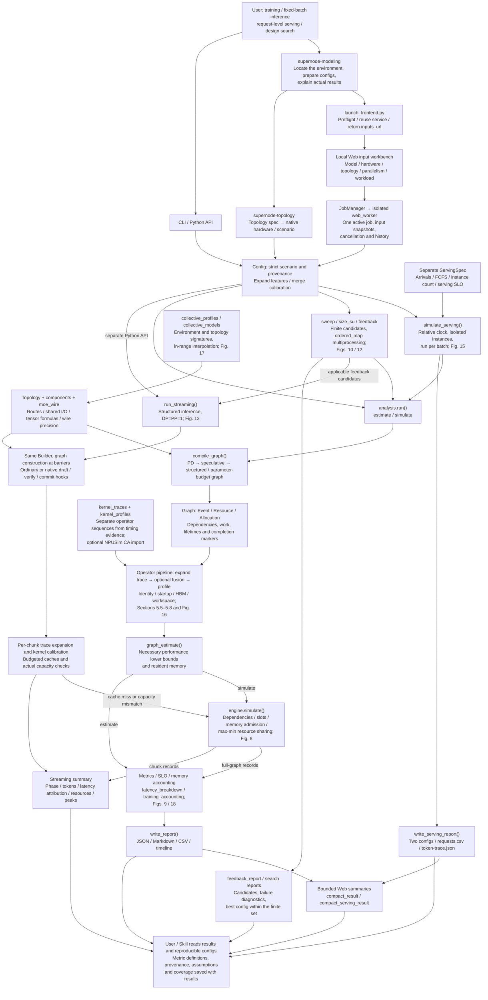
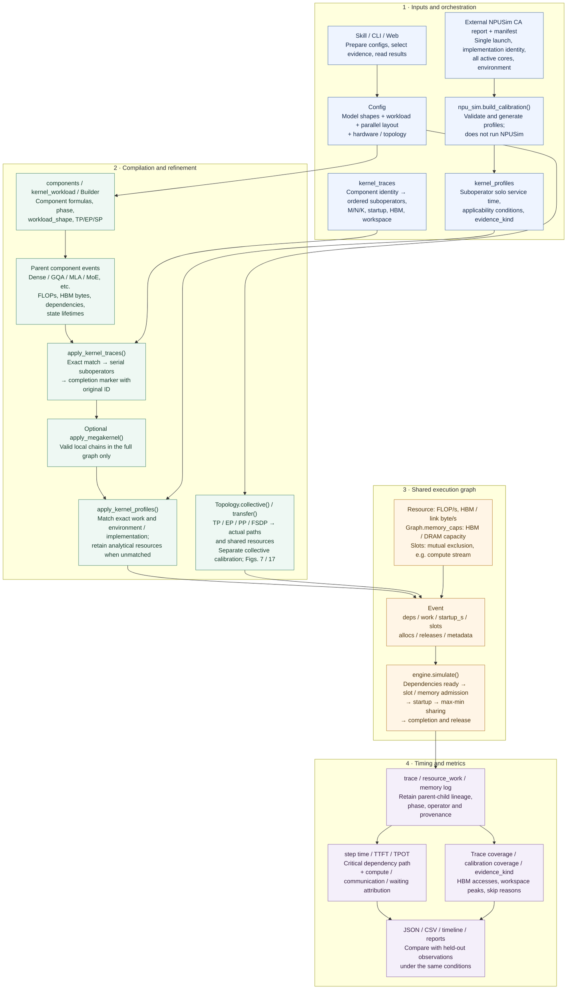
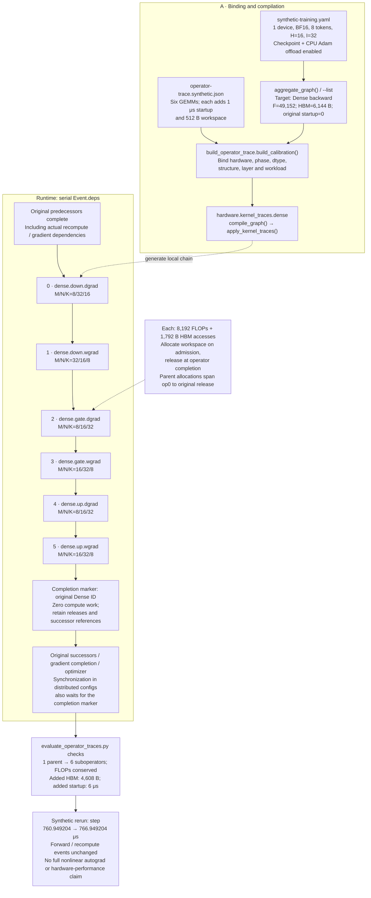
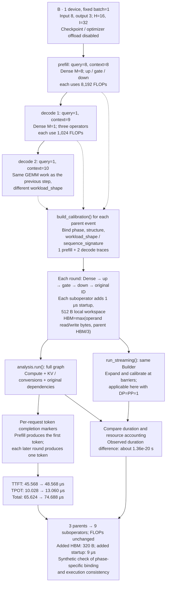
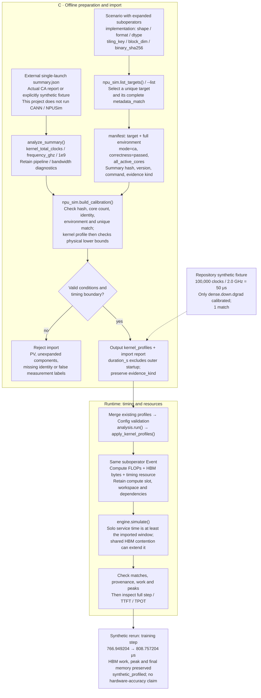

# Operator-Level Simulation: Architecture, Workflow, and Reference Cases

This is the English counterpart of the operator-level explanation in the [Chinese architecture document](simulation-architecture.md) and [Chinese workflow document](simulation-function-flows.md). It includes the same six diagrams, input contracts, timing formulas, three reproducible cases, and verified numerical results. Section and figure numbers follow those source documents so that the two versions can be compared.

Implementation baseline: the current repository. Updated: **2026-11-03**. Numerical values reuse the verified runs from that date. All three cases use **synthetic evidence**; they validate modeling and integration behavior, not predictive accuracy against real hardware.

Reading order: [system context](#system-context) → [operator architecture](#55-operator-architecture-from-components-to-resource-events) → [input contracts](#56-three-input-contracts-and-operator-identity) → [timing and memory](#57-from-an-operator-to-time-traffic-and-memory-peaks) → [execution flow](#161-from-component-events-to-system-latency) → [training](#162-case-a-decomposing-dense-backward-into-six-gemms), [inference](#163-case-b-binding-prefill-and-decode-to-their-actual-workloads), and [NPUSim](#164-case-c-binding-an-npusim-ca-window-to-one-suboperator).

In the diagrams, names ending in `()` refer to actual functions or methods. Other nodes describe processing steps or data. Solid arrows show processing order, data flow, or explicitly identified runtime dependencies; dashed arrows show explanatory or generation relationships. The simulator models operator work and timing rather than executing model tensors on a device. References to other figure numbers point to the full source workflow document.

## System context

The `supernode-modeling` skill, CLI/Python API, and local Web workbench use the same `supernode_sim` numerical engine. Model structure, workload, parallel layout, and SU/SO topology are compiled into resource events. Operator expansion and kernel calibration are part of that shared compilation path.

Diagram source: [00-architecture.en.mmd](diagrams/00-architecture.en.mmd).



This is a responsibility and data-flow view. Each entry point uses the branches appropriate to its task. `analysis.run()` builds the full graph and runs `graph_estimate()`; simulation mode then invokes the event engine. `run_streaming()` constructs small graphs at structural barriers and uses the same execution engine. Serving runs the full-graph analysis per batch, while searches evaluate a finite set of candidates.

## Operator architecture

### 5.5 Operator architecture: from components to resource events

The core design is to **represent each operator invocation as an event with shape, work, dependencies, and resource requirements, then use a common execution engine to determine its completion time**. The Python engine does not execute real GEMMs or model weights. It executes a timing model of work and resources. Cycle information from external NPUSim reports can be imported as calibration evidence; system-level scheduling remains the responsibility of this project.

Diagram source: [00a-operator-architecture.en.mmd](diagrams/00a-operator-architecture.en.mmd). Arrows represent data delivery and processing relationships. The streaming path skips megakernel fusion and uses the same expansion, calibration, and execution logic per chunk.



| Abstraction level | Current representation and responsibility | Connection to the next level |
|---|---|---|
| Model / component | `Builder` produces Dense, Attention, MoE, and other component events from architecture, phase, and parallel sharding. Without an architecture, it uses parameter budgets. | Component formulas provide parent FLOPs, HBM accesses, state capacity, and communication dependencies. |
| Suboperator | `kernel_traces` explicitly lists ordered GEMMs or other suboperators, including M/N/K, added startup, and local workspace. | An exact match replaces the parent event with a serial chain ending at a marker with the original ID. |
| Resource / system | An `Event` uses compute, HBM, link, or other rate resources and is constrained by slots and memory-pool admission. | `engine.simulate()` resolves start and completion times under contention. |
| Internal kernel timing evidence | External CA reports or hardware measurements under matching conditions describe the service window of a specific kernel. | `kernel_profiles` constrains the corresponding event's service time; this project does not reconstruct instruction pipelines. |

The same scenario may contain expanded and calibrated suboperators, expanded but uncalibrated suboperators, and unexpanded analytical components. The presence of traces or profiles in a configuration therefore does not imply uniform refinement or calibration across the model. Inspect actual matches and coverage by phase.

### 5.6 Three input contracts and operator identity

`kernel_traces` specifies which suboperators run, their order, and their work. `kernel_profiles` specifies the solo service time of a particular invocation. `collective_profiles/models` specifies the service time of a communication call under a particular topology and environment. These interfaces have different matching scopes and are maintained separately.

| Interface | Required content and main applicability guards | Output / unmatched behavior |
|---|---|---|
| `hardware.kernel_traces.<parent_kernel>[]` | id/source, hardware_name, phase, dtype, parent FLOPs/HBM bytes, nonempty metadata_match, and operations; optional calibration_context | A unique match expands the event. No match or an unsupported resource type preserves the parent and records a reason. Multiple matches raise an error. |
| `operations[]` | kernel, flops, memory_bytes; optional matmul, startup_s, workspace_bytes, and implementation | Suboperators inherit the parent's dtype. The list describes a local serial chain; it does not automatically generate an intermediate-tensor DAG. |
| `hardware.kernel_profiles.<actual_kernel>[]` | Exact FLOPs/HBM bytes and duration_s; optional phase/dtype, startup_s, hardware/environment/metadata guards, source, and evidence_kind | Only a match adds a service-time constraint. Unmatched events use analytical resources. Ambiguous matches or times below physical lower bounds raise an error. |
| `NPUSim summary + manifest` | Single-launch CA window, hashes, versions, all-active-core and correctness declarations, target suboperator, and full implementation identity | `npu_sim.build_calibration()` produces a kernel profile and import report; it does not invoke the external simulator. |
| `collective_profiles / collective_models` | Collective semantics, payload, algorithm, timing scope, and hardware/environment/topology/rank/peer guards | Communication service times are bound during graph construction. Response curves interpolate only within sampled ranges under matching conditions; see Fig. 17. |

A structured operator's identity combines several groups of information:

- **Structure and placement:** `model_shape_signature`, component/layer, and TP/EP/SP degrees prevent the accidental reuse of calibration across different models with identical operator names or FLOP counts.
- **Phase and workload:** phase and the `workload_shape` fields for query/context tokens, squared-length sums, existing KV, and `sequence_signature`. Two prefills with the same total token count may have different attention work. Two Dense decode calls may have identical GEMMs but different invocation contexts.
- **Implementation:** `matmul.m/n/k/batch` describes mathematical shape. Optional `implementation` metadata describes the kernel binary, tiling, blockDim, and input/output shape, dtype, and format. NPUSim import requires implementation identity; ordinary traces do not.
- **Runtime environment:** hardware_name and calibration_context constrain the device, software, and timing boundary. Legacy profiles may omit these guards and are reported as unguarded. If guarded entries exist for the same work but the environment differs, a legacy entry is not used to bypass those constraints.

The parameter-budget path cannot automatically recover real operator structure. The `build_operator_trace.py` helper requires a target with a structure signature and workload_shape. The underlying schema lets callers specify metadata selectors, but broader selectors provide weaker applicability guarantees. Kernel profiles currently provide neither shape interpolation nor extrapolation across environments.

### 5.7 From an operator to time, traffic, and memory peaks

Let a local operator perform F FLOPs and B bytes of HBM accesses. Let P_eff and BW_eff be the configured effective compute and HBM rates. For an uncalibrated event using only these two resources, with no contention:

```text
T_solo = startup_s + max(F / P_eff, B / BW_eff)
T_chain = Σ T_solo(op_i)               # This local serial chain only, without waiting
```

Compute and memory access jointly constrain the same event through its bottleneck resource. The max expresses the analytical overlap assumption; their times are not added directly. Dependencies serialize different suboperators, so each has its own startup and service cost. End-to-end latency also depends on other dependencies, slots, memory admission, and resource contention. Summing all operator times across parallel ranks does not yield wall-clock latency.

When a profile matches, `calibration.py` retains F and B, switches the event's compute resource to the configured peak P_peak for that dtype, and adds a private `kernel_limit:<event_id>` resource. Its work is `duration_s` and its capacity is 1. Without contention:

```text
duration_s >= max(F / P_peak, B / BW_eff)  # Physical lower-bound check when applying the profile
T_solo = effective_startup + max(F / P_peak, B / BW_eff, duration_s)
```

This avoids applying the original compute-efficiency discount again to an already calibrated service time. An explicitly supplied profile `startup_s` replaces the event's complete startup value; if omitted, the original value remains. At runtime, the available rates of shared resources such as HBM can change. `max_min_rates()` allocates rates among active events, so completion can take longer than the solo profile window.

| Quantity | Accounting in the model | How to interpret it |
|---|---|---|
| `memory_bytes` | HBM read/write accesses in `Event.work`; the same data may be accessed repeatedly | Inspect `resource_work`, HBM utilization, and bottlenecks. Access bytes are not allocated memory capacity. |
| `workspace_bytes` | Temporary HBM allocation for one suboperator, allocated on admission and released at completion | Inspect memory-pool peaks and `operator_workspace`. Six serial operators using 512 B each do not imply 3,072 B of simultaneous workspace. |
| Parent state / activations | The first suboperator inherits parent allocations. The original-ID completion marker performs the original releases; other release points remain unchanged. | Inspect conservative lifetimes and the composition of each device-pool peak at the same instant. |
| `working_set_bytes` | Parent-component proxy plus local workspace, marked `parent_component_proxy_plus_local_workspace` | This is a working-set proxy, not an exact suboperator footprint or an L1/L2/UB capacity estimate. |
| `startup_s` / `duration_s` | Startup precedes service. Duration is the solo service window excluding outer startup. | Avoid repeating the parent's startup or adding profile startup twice. |
| `slots` | Mutual-exclusion eligibility, separate from rate and capacity | Same-rank compute-stream waiting cannot be eliminated simply by increasing FLOP/s. |

Once dependencies are ready, the engine checks that slots and memory can be acquired together, then allocates the required space atomically. Resource service begins only after startup. At completion, it releases slots and declared allocations and wakes successors. If no event is active and all ready events are blocked by capacity, execution may return `memory_admission_deadlock`. Workspace introduced by operator expansion can therefore change feasibility as well as timing.

### 5.8 Connecting communication, external calibration, and application metrics

For TP Dense or EP MoE, `Builder` already creates the collective dependencies before and after each component. A trace refines only the local compute event:

```text
Original predecessors → suboperator chain → original-ID completion marker → original successors
```

Communication cannot consume the result before the last suboperator finishes, and replacing an event does not release parent state prematurely. MoE dispatch/combine still expands through `Topology` into path transfers and buffers; network traffic remains separately modeled.

Compute, transfers, and events on different ranks may overlap when dependencies and separate execution slots allow it. They can still contend for HBM, NICs, PCIe, or shared uplinks. A trace does not add an independent compute stream or automatically parallelize its suboperators. Such scheduling changes require changes to graph construction and resource semantics. After expansion, megakernel processing separately attempts to fuse valid local chains; inspect actual matches. Parent profiles are not automatically inherited by suboperators or newly fused kernels.

The NPUSim CA quantity `kernel_total_clocks / (frequency_ghz × 1e9)` already represents the device window of one launch. That window may include internal MTE, CUBE, and VECTOR overlap. Do not sum the pipeline durations, multiply by active core count, or add duplicate internal transfer events. HBM access volume and workspace still come from the operator model, not inferred pipeline utilization. The importer checks consistency between the manifest and report; the collector must still provide golden-output correctness checks, full-core capture logs, and binary-hash verification. PV functional simulation cannot calibrate performance.

Step and token completion markers produce training step time, TTFT (time to first token), and TPOT (time per output token). Critical-path attribution includes compute, local memory service, communication, and waiting. Fixed-batch timing begins when model execution starts; the separate `serve` layer handles request arrivals and queueing.

Review results in this order:

1. `model_metadata.operator_trace`: matched parent events, generated suboperators, per-phase coverage, additional accesses/startup, and skip_reasons.
2. `model_metadata.kernel_calibration` and `fidelity`: actual kernel matches, guarded/unguarded counts, and measurement/simulator/synthetic/unspecified evidence counts. Trace coverage and calibration coverage have different denominators and cannot be added.
3. `simulation` and reports: conserved work, timely workspace release, capacity feasibility, and the reason for critical-path changes.
4. Held-out observations under matching conditions: compare step time, TTFT, TPOT, and coverage separately. Finer traces, wider coverage, or synthetic consistency alone do not establish lower prediction error on hardware.

The following workflow section provides complete training, inference, and NPUSim cases, including files, commands, results, and checks. All are synthetic. External-method mappings are documented in [reference-simulators.md](../skills/supernode-modeling/references/reference-simulators.md); pinned NPUSim sources are listed in [npu-simulator.md](../skills/supernode-modeling/references/npu-simulator.md).

## 16. Suboperator expansion, fusion, and kernel calibration

Source: [`apply_kernel_traces()`](../supernode_sim/operator_trace.py), [`kernel_workload.py`](../supernode_sim/kernel_workload.py), [`apply_megakernel()`](../supernode_sim/megakernel.py), and [`apply_kernel_profiles()`](../supernode_sim/calibration.py).

### 16.1 From component events to system latency

Here, operator execution means discrete-event simulation of declared work. The graph builder first emits components; a trace then expands supported components using an explicitly supplied decomposition. Profiles provide solo service times for some of the resulting events. Actual matrix multiplication is not performed. Dependencies, resources, and memory admission determine the modeled order and overlap of compute and communication. Resource formulas are given in [Section 5.7](#57-from-an-operator-to-time-traffic-and-memory-peaks).

Diagram source: [16-operator-and-kernel-calibration.en.mmd](diagrams/16-operator-and-kernel-calibration.en.mmd).

```mermaid
flowchart TD
    ENTRY["Full graph / streaming chunk<br/>Component formulas have produced parent Events"] --> SHAPE["Read actual event identity<br/>kernel / phase / dtype / FLOPs / HBM bytes<br/>Structure signature, workload_shape, TP/EP/SP"]
    SHAPE --> TRACE["apply_kernel_traces()<br/>Match hardware.kernel_traces"]
    TRACE --> MATCH{"Unique match and supported<br/>local compute/HBM event?"}
    MATCH -->|unmatched or unsupported| ORIGINAL["Keep the analytical parent event<br/>Record no_trace / shape-scope /<br/>resource mismatch reasons"]
    MATCH -->|multiple matches| ERROR["Raise an error;<br/>fix the configuration and rerun"]
    MATCH -->|yes| CHECK["Decomposition already validated by Config<br/>Child FLOPs sum = parent FLOPs;<br/>HBM accesses must not decrease<br/>GEMM FLOPs = 2 × batch × M × N × K"]
    CHECK --> EXPAND["Expand op0 → op1 → ... → original-ID marker<br/>First startup = parent startup + op0 startup<br/>Later startups = each operator's added startup"]
    EXPAND --> LIFE["First operator inherits parent allocations<br/>Release each local workspace at its operator end<br/>Original releases stay on the completion marker;<br/>successors still reference the original ID"]
    LIFE --> FUSE["Full graph: optional apply_megakernel()<br/>Streaming: fusion unsupported;<br/>continue to profiles"]
    ORIGINAL --> FUSE
    FUSE --> PROFILE["apply_kernel_profiles()<br/>Match suboperators or unexpanded events<br/>Work + optional phase / dtype / environment / metadata"]
    PROFILE --> PMATCH{"Profile match and<br/>physical lower-bound check"}
    PMATCH -->|ambiguous or below physical floor| ERROR
    PMATCH -->|unmatched| ANALYTIC["Analytical solo service time<br/>startup + max(F/P_eff, B/BW_eff)"]
    PMATCH -->|matched| TIMING["Retain FLOPs, HBM work and compute slot<br/>Use the dtype peak for the compute resource<br/>Add a private timing resource: duration_s<br/>Explicit startup_s replaces startup;<br/>keep it separate from duration"]
    ANALYTIC --> EXEC["Full graph: graph_estimate() → optional simulate()<br/>Streaming: per-chunk capacity check / cache<br/>or the same simulate()"]
    TIMING --> EXEC
    EXEC --> SCHED["Runtime: dependencies → slot / memory admission<br/>→ startup → max_min_rates() → finish / release<br/>Communication shares HBM / links; Fig. 8"]
    SCHED --> RESULT["Completion markers → step time / TTFT / TPOT<br/>operator_trace / kernel_calibration coverage and evidence<br/>resource_work, memory peaks, critical-path breakdown"]
```



Trace matching first checks exact parent work, structure, and workload; expansion precedes fusion and calibration. The original event ID remains the final completion marker, and successors continue to wait for it. Parent allocations begin at the first suboperator and conservatively remain until their original release points. Local workspace lives only within its suboperator. The current trace format is serial and cannot describe an arbitrary internal parallel DAG or intermediate-tensor lifetimes spanning suboperators.

Added startup and memory accesses may increase latency. A trace alone is not timing calibration, and parent profiles do not propagate automatically. Kernel `duration_s` excludes `startup_s`; an explicit profile startup replaces the event's complete startup value. Ambiguous matches or service times below physical lower bounds raise errors. When guarded entries exist for the same work but the environment differs, a legacy profile cannot bypass the guard.

Full-graph and streaming execution share expansion and calibration code; streaming does not support megakernel fusion. `operator_trace` coverage counts parent component events, while `kernel_calibration` coverage counts actual kernel events. These counts are not additive. Phase, M/N/K, workload_shape, and version guards must reflect their sources. Synthetic examples validate the interfaces. See [operator-traces.md](../skills/supernode-modeling/references/operator-traces.md) for the full input specification.

### 16.2 Case A: decomposing Dense backward into six GEMMs

This case explains how a parent component is replaced, why its successors remain correct, and how the added costs of refinement are accounted for. The input is [synthetic-training.yaml](../examples/features/synthetic-training.yaml), the decomposition is [operator-trace.synthetic.json](../skills/supernode-modeling/assets/operator-trace.synthetic.json), and the binding helper is [build_operator_trace.py](../skills/supernode-modeling/scripts/build_operator_trace.py).

The scenario has one device, one layer, batch=1, sequence length 8, hidden dimension 16, Dense intermediate dimension 32, and BF16 precision. Activation checkpointing and CPU Adam offload remain enabled. The operator list decomposes only the Dense backward GEMM budget; it adds no nonlinear backward computation and does not represent a complete real autograd trace. All work values below are explicitly synthetic model inputs.

Diagram source: [16a-training-dense-trace.en.mmd](diagrams/16a-training-dense-trace.en.mmd). The upper part describes offline binding and graph construction. The lower part shows runtime `Event.deps`. Dashed arrows indicate explanatory or generation relationships.



The target is `train.s0.p0.backward.m0.l0.npu0.Dense`, originally carrying 49,152 FLOPs, 6,144 B of HBM accesses, and zero startup time. Each GEMM satisfies `2 × M × N × K = 8,192`:

| Order | Suboperator | M / N / K | HBM accesses | Added startup / local workspace |
|---|---|---|---|---|
| 0 | `dense.down.dgrad` | 8 / 32 / 16 | 1,792 B | 1 μs / 512 B |
| 1 | `dense.down.wgrad` | 32 / 16 / 8 | 1,792 B | 1 μs / 512 B |
| 2 | `dense.gate.dgrad` | 8 / 16 / 32 | 1,792 B | 1 μs / 512 B |
| 3 | `dense.gate.wgrad` | 16 / 32 / 8 | 1,792 B | 1 μs / 512 B |
| 4 | `dense.up.dgrad` | 8 / 16 / 32 | 1,792 B | 1 μs / 512 B |
| 5 | `dense.up.wgrad` | 16 / 32 / 8 | 1,792 B | 1 μs / 512 B |

The six operators still total 49,152 FLOPs. HBM accesses become 10,752 B, adding 4,608 B relative to the parent. Each 512 B workspace is released when its suboperator completes. These are six local allocations, so 3,072 B must not be added directly to a simultaneous memory peak. Parent allocations begin at operator 0, original releases remain on the completion marker, and original successors still reference the parent ID. Gradient dependencies, synchronization, and updates therefore cannot be released early.

From the repository root, inspect the actual target, then generate a mergeable trace fragment:

```powershell
python skills/supernode-modeling/scripts/build_operator_trace.py examples/features/synthetic-training.yaml --list --kernel dense --phase backward
python skills/supernode-modeling/scripts/build_operator_trace.py examples/features/synthetic-training.yaml --event-id train.s0.p0.backward.m0.l0.npu0.Dense --operators skills/supernode-modeling/assets/operator-trace.synthetic.json -o outputs/operator-traces/training.calibration.json
```

`training.calibration.json` is a calibration fragment, not a runnable full scenario. The following script automatically binds traces, merges configurations, and runs the before/after comparisons for both training and inference:

```powershell
python skills/supernode-modeling/scripts/evaluate_operator_traces.py --output outputs/operator-traces
python -m supernode_sim validate outputs/operator-traces/training.operators.config.json
python -m supernode_sim simulate outputs/operator-traces/training.operators.config.json -o outputs/operator-traces/training-report
```

In the **2026-11-03** run, only one backward parent event expanded into six suboperators; forward and recompute retained their original models. Training step time changed from **760.949204 μs to 766.949204 μs**. The added 6 μs matches the declared startup overhead; compute remains the bottleneck of this local chain. Across the whole scenario, BF16 compute-resource work remained 197,632 FLOPs, while HBM accesses changed from 64,384 B to 68,992 B. This compute entry excludes separately accounted FP32 auxiliary work and the CPU optimizer. The time increase reflects explicitly modeled cost; it does not establish a hardware slowdown or any change in prediction accuracy.

### 16.3 Case B: binding prefill and decode to their actual workloads

The same [evaluate_operator_traces.py](../skills/supernode-modeling/scripts/evaluate_operator_traces.py) converts the baseline to fixed-batch inference on one device: batch=1, input length 8, output length 3, with checkpointing and optimizer offload disabled. Dense in each round expands into `up → gate → down`. Surrounding Attention, KV access/conversion, and token-completion dependencies remain intact.

Diagram source: [16b-inference-operator-trace.en.mmd](diagrams/16b-inference-operator-trace.en.mmd). The upper solid arrows show inference rounds; dashed arrows show separate selector construction for each round. Full-graph and streaming execution are independent comparison runs.



| Round | Query / context / existing KV tokens | M/N/K for up and gate; M/N/K for down | Parent FLOPs → three suboperators | Parent HBM → total suboperator HBM |
|---|---|---|---|---|
| Prefill, producing token 1 | 8 / 8 / 0 | 8/32/16; 8/16/32 | 24,576 → 3 × 8,192 | 5,120 → 5,376 B |
| Decode 1, producing token 2 | 1 / 9 / 8 | 1/32/16; 1/16/32 | 3,072 → 3 × 1,024 | 3,328 → 3,360 B |
| Decode 2, producing token 3 | 1 / 10 / 9 | 1/32/16; 1/16/32 | 3,072 → 3 × 1,024 | 3,328 → 3,360 B |

For each BF16 GEMM, the script declares HBM accesses as `max((M×K + K×N + M×N)×2, parent_HBM/3)`, plus 1 μs startup and 512 B workspace. This is a reproducible access proxy, not measured HBM transactions. Both decode rounds have identical GEMM work, but different context/KV values and sequence_signature fields. They therefore receive separate traces; equal FLOP counts alone do not establish identical invocation shapes.

Use the reproduction commands in Case A, then optionally export the standard inference report:

```powershell
python -m supernode_sim validate outputs/operator-traces/inference.operators.config.json
python -m supernode_sim simulate outputs/operator-traces/inference.operators.config.json -o outputs/operator-traces/inference-report
```

In the **2026-11-03** run, one prefill parent and two decode parents produced nine suboperators. Total inference compute work remained 55,232 FLOPs; HBM accesses changed from 27,824 B to 28,144 B, with 9 μs of added startup:

| Metric | Parent-component baseline | After suboperator expansion |
|---|---|---|
| TTFT | 45.568 μs | 48.568 μs |
| TPOT: mean of the two intervals after the first token | 10.028 μs | 13.060 μs |
| Full execution duration | 65.624 μs | 74.688 μs |

The additional 0.064 μs beyond the 9 μs startup increase comes from the changed memory-access constraints in this example. The local prefill Dense remains compute-limited, while the smaller decode GEMMs are more sensitive to memory bandwidth. Output length 3 means one prefill and two decode rounds, not three decode rounds.

For this supported configuration, `run_streaming()` and full-graph execution differ in total duration by approximately `1.36e-20 s`, a floating-point rounding difference. Comparison records are saved in `comparison.json` and `inference.streaming.result.json`. This example validates phase-specific binding and execution consistency; it includes neither a request-arrival queue nor hardware-accuracy evidence.

### 16.4 Case C: binding an NPUSim CA window to one suboperator

This case imports one synthetic service window for `dense.down.dgrad` in the already expanded six-GEMM training chain. Inputs are in [examples/npu_sim/](../examples/npu_sim/), parsing and binding logic is in [npu_sim.py](../supernode_sim/npu_sim.py), and the command entry point is [build_npu_sim_calibration.py](../skills/supernode-modeling/scripts/build_npu_sim_calibration.py). The fixture requires no CANN installation. Collection instructions and pinned source references for actual external reports are in [npu-simulator.md](../skills/supernode-modeling/references/npu-simulator.md).

Diagram source: [16c-npusim-calibration.en.mmd](diagrams/16c-npusim-calibration.en.mmd). The offline stage reads an existing report and generates a profile. Runtime consumes that profile; it does not rerun NPUSim for each simulation round.



The fixture has `kernel_total_clocks=100000` and `frequency_ghz=2.0`, giving `duration_s=100000/(2.0×1e9)=0.00005`, or **50 μs**. The active-core count of 2 checks the capture declaration; it does not multiply the 50 μs window by two. CUBE and MTE utilization values must not be added to derive another duration.

Run from the repository root:

```powershell
python skills/supernode-modeling/scripts/build_npu_sim_calibration.py examples/npu_sim/synthetic.config.json --list
python skills/supernode-modeling/scripts/build_npu_sim_calibration.py --analyze --summary examples/npu_sim/summary.synthetic.json
python skills/supernode-modeling/scripts/build_npu_sim_calibration.py examples/npu_sim/synthetic.config.json --summary examples/npu_sim/summary.synthetic.json --manifest examples/npu_sim/manifest.synthetic.json -o outputs/npu-sim/calibration.json
python skills/supernode-modeling/scripts/evaluate_npu_sim.py --output outputs/npu-sim
```

`--analyze` validates report fields and units only; it does not establish capture mode, correctness, or implementation identity. Import requires a manifest binding CA mode, the correctness declaration, all-active-core capture, summary hash, device/software environment, and target suboperator. The implementation identity includes binary_sha256, tiling_key, block_dim, and input/output shapes and formats. The collector must retain actual logs, golden comparisons, and binary evidence. This entry point rejects PV, an entire unexpanded Dense component, collectives, and events without implementation identity.

In the **2026-11-03** run, the profile matched exactly **one suboperator**. Training step time changed from **766.949204 μs to 808.757204 μs**, while HBM work, memory peaks, and final memory use remained unchanged. The original suboperator's solo compute time was 8.192 μs; replacing its service window with 50 μs adds 41.808 μs. Its original 1 μs startup is retained. Thus, the full training step is not replaced with 50 μs, and 50 μs is not added on top of the old service time.

The result is labeled `synthetic_profiled`, with zero hardware `measurement` matches. Actual CA reports use `simulator`; `measurement` is reserved for hardware observations under matching conditions. The NPUSim importer rejects a report source labeled `measured`. Without contention, kernel service is constrained by the 50 μs window; external resource contention may extend it.

### 16.5 Verification checklist and reference mappings

The case directories save complete baseline/operators or profiled configurations, results, and comparisons. The evaluation scripts do not automatically write standard Markdown/CSV reports; use the `simulate -o` commands above for those exports. The numerical values in this guide come from the **2026-11-03** runs in `outputs/operator-docs-20261103/`. They are not public hardware benchmarks.

| Evidence to check | Output | What these cases validate |
|---|---|---|
| Parent matches and suboperator counts | matched_events, generated_operations, and by_phase under `model_metadata.operator_trace` | A expands 1→6; B expands 3→9. Other unmatched events retain analytical behavior. |
| Work and additional cost | `simulation.resource_work`, additional_memory_bytes, additional_startup_s | FLOPs are retained; additional HBM reads/writes and startup are explicit. |
| Lifetimes and feasibility | `simulation.memory_peaks_bytes`, memory_final_bytes, status, and standard-report memory details | Workspace is released per suboperator and capacity constraints remain active. Access bytes cannot determine memory peaks. |
| Calibration applicability and provenance | `kernel_calibration`, `fidelity`, and Case C's `kernel.report.json` | C matches one synthetic profile. The entire chain is not relabeled as hardware-measured. |
| Application latency | metrics.step_time_s, ttft_s, tpot_s, and critical-path attribution | Distinguish one operator, a local serial chain, and end-to-end metrics. Do not sum parallel-rank times. |
| Full-graph / streaming consistency | Case B's `comparison.json` and streaming result | Compare the same supported configuration; do not extend this conclusion to PD or megakernel. |

The following mappings connect external methods to the runnable cases. Detailed sources are listed in the repository reference documents:

| Reference | What it helps explain here | Scope |
|---|---|---|
| [ASTRA-sim](../skills/supernode-modeling/references/reference-simulators.md) | Event dependencies, resource admission, and separate service-time modeling in Fig. 16 | This project uses its own Graph; there is no automatic Chakra import. |
| [SimAI / AICB](../skills/supernode-modeling/references/reference-simulators.md) | Phases, microbatches, and training compute/communication work in Case A | The six GEMMs are a synthetic description, not a framework autograd trace. There is no automatic AICB workload conversion. |
| [Vidur](../skills/supernode-modeling/references/reference-simulators.md) | Token/sequence features and prefill/decode distinctions in Case B | This project uses exact matching; it has no kernel regression predictor or continuous batching. |
| [CANN NPUSim](../skills/supernode-modeling/references/npu-simulator.md) | Implementation identity, a single-launch CA window, and internal pipeline diagnostics in Case C | External simulation evidence is imported. It is not hardware measurement and does not replace system-wide communication simulation. |

## Validation scope

The English diagrams preserve the nodes, edges, and branches of the Chinese diagrams. Code identifiers, commands, input dimensions, formulas, and reported numerical values are preserved. The six diagrams have standalone Mermaid source files so they can be edited and rendered independently.

Function names, branches, interfaces, and limitations are grounded in the current repository. The diagrams omit repetitive rank loops, some barriers, and field construction for readability; use actual execution traces for exact event details. The training/inference trace cases and NPUSim import case were reproduced for the source explanation on 2026-11-03. They validate decomposition, timing binding, resource preservation, and execution consistency using synthetic evidence.
