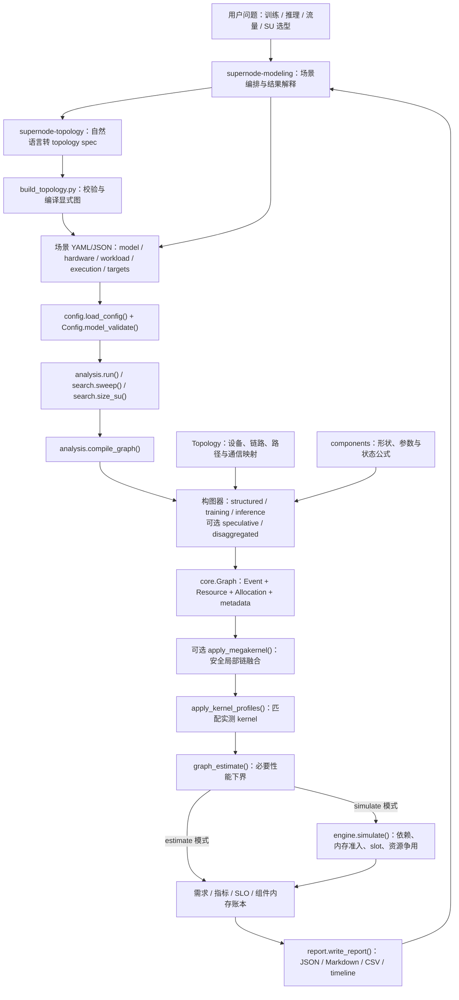
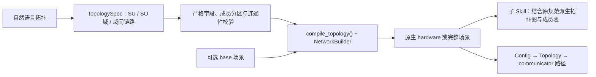
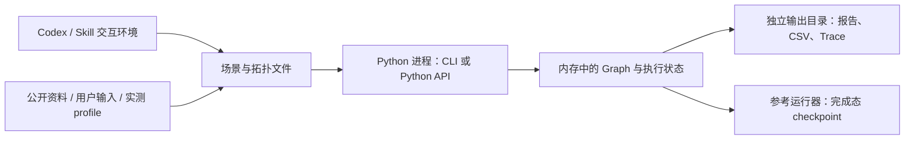

# 超节点流量仿真系统整体架构设计

系统以 `supernode-modeling` skill 为交互入口，以 `supernode_sim` 为数值内核，将模型、负载、并行策略与 SU/SO 拓扑统一编译为资源事件图，分析存储、计算、通信需求及 SLO。整体采用“Skill 编排 + 严格配置 + 统一中间表示 + 解析下界 / 离散事件执行 + 可追溯报告”的分层架构。

设计基线：当前仓库实现；更新日期：2026-10-19；引擎版本：`0.1.0`；配置与结果 schema：`1.0`。适用读者为模型与网络架构分析人员、仿真引擎开发者和 Skill 维护者。第 11 节列出演进建议，其余章节描述当前能力及使用约束。

配套文件：[函数级仿真流程图](simulation-function-flows.md)。图中区分真实函数调用、函数内部控制流和运行时事件依赖；各张图也提供独立 `.mmd` 源文件。

## 1. 整体定位

项目是面向超节点架构分析的**配置驱动、算子粒度的解析模型与离散事件仿真器**。它把模型结构、硬件拓扑、并行策略和负载编译成事件 DAG，再计算容量、计算/访存/通信需求、执行时序及 SLO。

`supernode-modeling` skill 是面向使用者的编排和解释层：收集参数、选择场景、调用命令、检查输出、解释假设。数值计算由 Python 包执行。Skill 目录没有独立仿真引擎，也没有常驻 agent 服务。

父 skill 可接收独立 topology spec，包含 SU 结构、SO 域的 SU 成员分区与有向域间链路。嵌套子 skill [`supernode-topology`](../skills/supernode-modeling/subskills/supernode-topology/SKILL.md) 将自然语言转为规范，`build_topology.py` 编译成原生显式图，再进入同一 `Config` / `Topology` / 数值执行流程。它是配置生成器，不是另一套流量仿真器。生成的 `routing_policy: su_so` 防止 NPU 通信经其他链路类别绕行；旧显式图默认仍用 `shortest_hop`。

### 1.1 设计目标与问题闭环

系统承接 [超节点网络需求建模需求](../supernode_network_requirements.md) 中的“硬件形态 → 场景 → 模型与特性 → SLO → 存储 / 通信 / 计算约束”流程，并将分析结果反馈到硬件、并行布局或优化特性选择。

| 目标 | 具体交付 | 判断依据 |
|---|---|---|
| 判断资源能否承载场景 | 驻留容量、执行峰值、资源争用、失败诊断 | 配置约束与仿真结果 |
| 分析通信需求和瓶颈 | 语义 payload、逐跳物理流量、链路与注入资源负载 | 同一事件图的路径和资源账本 |
| 比较方案与 SU 规模 | 参数扫描、有限候选内的可行方案 | 保留负载变化及每个候选的失败原因 |
| 支持复现与校准 | 解析后配置、来源、假设、版本和输出明细 | 数值由代码执行，Skill 解释实际输出 |
| 支持按模块扩展 | 统一 Graph、组件公式、拓扑映射和报告接口 | 新能力进入引擎与对应验证点 |

原始需求中的 Agentic Serving 在线调度和 expert offload 尚未形成当前执行模型。PD 分离支持固定 batch 的独立双池与同 TP/EP 布局交接；投机推理支持显式成本与接受数驱动的同步 batch 轮次模型，不复现具体 DSpark 算法。当前训练分析针对声明的训练步与执行策略。

可选特性输入采用顶层 `features` 或 CLI `--features`：`features.resolve_feature_input` 在严格配置验证前展开为 canonical 字段，重复字段冲突会报错，resolved config 不保留输入简写。`feature_catalog` 给出能力清单，`build_feature_plan` 写入结果和报告。完整字段及可重跑小示例见 [features 说明](../skills/supernode-modeling/references/features.md)。

`disaggregated.build_disaggregated` 复用 Builder 的 prefill/decode 阶段构图，保留全物理拓扑并增加状态/token ID 交接事件；两池各有常驻权重，源状态在传输完成后释放。`megakernel.apply_megakernel` 在 kernel 校准之前融合合法局部链，保留工作量和保守内存生命周期，另报实际匹配覆盖；无匹配不改变性能。两者当前仅用于普通图，不在 streaming 中静默降级。

`sparse_attention.py` 实现 CSA/HCA 参数之外的 attention、indexer、压缩、选择及状态模型，`components.py` 提供相应参数/activation/保存状态，`structured.py` 将其映射至计算、HBM、TP collective 和生命周期。`speculative.py` 提供草稿准备、draft/verify/accept/replay/commit 计划，借助 `Builder.inference` 的轮次 hook 构图，再使用统一 `analysis`/`engine` 执行。普通图支持该投机路径；streaming 当前明确拒绝。该路径支持等长同步 batch、DP=PP=1，不含在线请求调度或完整 V4 的 mHC/indexer 辅助训练目标。

### 1.2 核心概念

| 概念 | 系统口径 |
|---|---|
| SU 域 | 一组通过 scale-up 网络互联的 NPU；`su_size` 是每个 SU 域的卡数 |
| SO 域 | 一组 SU 域组成的 scale-out 分区；其成员数量是超节点数，不能与 `su_size` 混用 |
| rank 放置 | 并行逻辑 rank 到物理 NPU 的映射，决定 communicator 实际经过哪些网络 |
| 资源事件图 | 描述依赖、计算 / 访存 / 传输工作量与张量生命周期的 DAG |
| 可行 | 声明的执行策略可完成且满足容量约束；SLO 是否满足还需独立检查 |
| 来源与校准 | 公开规格、用户输入、合成假设和实测值分别记录，型号名称不等于性能校准 |

### 1.3 总体组件与数据流



上图是职责与数据流视图。具体执行顺序见函数流程图：`run()` **总是先构图并执行 `graph_estimate()`**，只有 `mode='simulate'` 时才继续执行数值仿真。

## 2. 目录与分层职责

| 层次 | 文件 / 目录 | 主要职责与接口 |
|---|---|---|
| Skill 编排 | [`skills/supernode-modeling/SKILL.md`](../skills/supernode-modeling/SKILL.md) | 定位引擎、选资料、形成可重跑配置、先校验再计算、解释口径 |
| Skill 使用资料 | [`references/`](../skills/supernode-modeling/references/) | configuration、training、inference、topology、memory-breakdown、ascend950-kimi-k3 六类说明 |
| Skill 展示元数据 | [`agents/openai.yaml`](../skills/supernode-modeling/agents/openai.yaml) | 展示名称、简介和默认提示词；不实现任务调度 |
| 拓扑子 Skill | [`subskills/supernode-topology/`](../skills/supernode-modeling/subskills/supernode-topology/) | 生成独立 topology spec、原生 hardware / 场景、成员表与拓扑图 |
| 拓扑编译器 | [`build_topology.py`](../skills/supernode-modeling/subskills/supernode-topology/scripts/build_topology.py) | `TopologySpec`、`compile_topology()`；校验域划分、生成有向链路与共享瓶颈、合并 base 场景 |
| 配置与输入 | [`config.py`](../supernode_sim/config.py) | Pydantic 类型/交叉约束、YAML/JSON、校准合并、HF 模型片段导入 |
| 命令入口 | [`cli.py`](../supernode_sim/cli.py)、[`__main__.py`](../supernode_sim/__main__.py) | `snmodel` 与 `python -m supernode_sim`，命令分派、退出码和报告落盘 |
| 分析编排 | [`analysis.py`](../supernode_sim/analysis.py) | `compile_graph()`、`graph_estimate()`、`run()`、指标与 SLO、设备需求 |
| 模型组件 | [`components.py`](../supernode_sim/components.py) | 形状参数清单、优化器状态、activation、MLA/KDA/AttnRes 状态公式 |
| 结构化构图 | [`structured.py`](../supernode_sim/structured.py) | `Builder` 将显式组件结构编译为训练/推理事件图 |
| 参数预算构图 | [`training.py`](../supernode_sim/training.py)、[`inference.py`](../supernode_sim/inference.py) | 未提供 architecture 时，使用声明的参数预算和粗粒度层算子构图 |
| 拓扑映射 | [`topology.py`](../supernode_sim/topology.py) | 设备资源、内存池、链路、路由、点对点与 collective 展开 |
| 中间表示 / 执行 | [`core.py`](../supernode_sim/core.py)、[`engine.py`](../supernode_sim/engine.py) | 统一 Graph 数据结构；确定性的多资源离散事件调度 |
| 校准 | [`calibration.py`](../supernode_sim/calibration.py) | 精确工作量匹配 kernel 实测条目，同时保留物理资源争用 |
| 内存归因 | [`memory_breakdown.py`](../supernode_sim/memory_breakdown.py) | 回放有序内存日志，计算组件×状态、池峰值和集群并发峰值 |
| 搜索与扫描 | [`search.py`](../supernode_sim/search.py) | 笛卡尔积扫描、有限 SU 候选枚举、必要条件剪枝、候选仿真 |
| 输出 | [`report.py`](../supernode_sim/report.py) | 中文报告、结构化结果、CSV、Trace；大图明细精简与导出清单 |
| 大实验辅助 | [`scripts/run_reference_experiment.py`](../scripts/run_reference_experiment.py) | 进度、完成态仿真检查点、流式重读与继续导出 |
| 场景与证据 | `examples/`、`profiles/hardware/`、`docs/sources/`、`tests/` | 合成场景、参考硬件片段、公开来源快照、回归测试 |

运行依赖为 Python 3.11+、Pydantic 2 和 PyYAML；测试依赖 pytest。`profiles/hardware/` 是参考数据文件，`load_config()` 不会仅凭硬件名称自动查找或继承 profile；实际值必须进入场景配置，或通过 `calibration` 的 hardware 覆盖合并。

分层的主要边界是：Skill 输出可执行配置；构图器输出 Graph；执行器消费 Graph 并输出 trace 与资源 / 内存日志；指标和报告层读取这些记录。模型公式与路径字节量进入代码，不能由 Skill 用文字推导替代正式数值结果。现有 `analysis.run()` 已组合各阶段，对外提供稳定的单次分析入口。

## 3. Skill 工作流与命令边界

Skill 的标准步骤是：定位本项目/已安装包 → 按问题读取参考资料 → 保留用户场景并补齐必要参数与来源 → `validate` → `estimate` / `simulate` / `sweep` / `size-su` → 阅读数值输出并解释约束。

若输入为自然语言拓扑，先在子 skill 中形成独立规范并编译，再回到上述流程。仅生成拓扑时，不要求用户提供模型与负载。正式分析保留原场景与独立输出目录；容量失败也属于有效分析结果，不自动增加卡数、改变 DP 或调整 global batch 来掩盖失败。

| 命令 | 主调用链 | 结果与边界 |
|---|---|---|
| `schema` | `cli._main()` → `Config.model_json_schema()` | 导出配置字段和约束 |
| `import-hf` | `import_hf_config()` → `read_data()` | 输出模型片段、来源、`missing_fields`；不是完整可运行场景 |
| `validate` | `load_config()` → `Config.model_validate()` | 校验配置；不构图、不验证完整 DAG 或实际容量可行性 |
| `estimate` | `run(..., 'estimate')` | 构图、必要性能下界、驻留/乐观内存及资源需求；状态为 `estimated`，不判定 SLO 满足 |
| `simulate` | `run(..., 'simulate')` | 在同一图上做资源争用与内存准入仿真，再计算指标和 SLO |
| `sweep` | `search.sweep()` → 每候选 `run()` | 对 dotted-path 配置字段取笛卡尔积，逐项校验并保留失败候选 |
| `size-su` | `search.size_su()` → `run(estimate)` → 必要时 `run(simulate)` | 有限候选集合内搜索最小 SU；单域/多域分别报告 |

所有常规分析命令最终由 `write_report()` 导出。Python API 的 `run()` 只返回字典，**不会自动写文件**。CLI `main()` 暂停循环 GC，并在 `finally` 恢复原状态，这是大图内存管理优化。

CLI 退出码：输入/图相关错误通常为 `2`，顶层 `infeasible` / `slo_failed` 为 `3`，正常完成为 `0`。扫描/搜索要继续检查候选与子搜索的 `status`：例如 `size-su` 无可行候选时，子结果为 `no_feasible_candidate`，顶层仍可为 `completed`，不能只看进程退出码。

配置校验、图校验、执行可行性与 SLO 是四个独立关口。`validate` 成功后，实际 communicator 仍可能没有可达路径；图有效后，运行仍可能因内存无法准入而失败；执行完成后，仍可能出现 `slo_failed`。

## 4. 配置协议与统一中间表示

### 4.1 Config 的六组业务输入

| 配置组 | 作用 | 关键约束 |
|---|---|---|
| `model` | 参数预算，或逐层 architecture 与张量形状 | 有 architecture 时派生 total/active 参数；公开四舍五入值放 `reported_*` |
| `hardware` | NPU/CPU、HBM/DRAM、SU/SO、host link、外部存储、显式链路 | `su_size` 整除总卡数；容量、速率、精度算力需有效 |
| `workload` | training/inference、batch、长度、累积步、训练步数 | 推理长度列表必须与 batch 一致，缺省由标量长度展开 |
| `execution` | TP/PP/EP/DP/FSDP、rank 放置、精度、offload、optimizer | 普通模式 `TP × PP × EP × DP = NPU 数`；PD 为 `2 × TP × EP`、DP=PP=1；FSDP 整除 DP，不再乘入总卡数 |
| `targets` | 吞吐、TTFT、TPOT、step time 和候选集合 | 场景区分训练与推理指标，候选数量受 `max_candidates` 限制 |
| `sources` / `assumptions` / `calibration` | 来源与假设、硬件校准覆盖 | 来源状态为 assumed/public/user/measured；校准仅接受 hardware 和 source |

`Spec` 禁止未知字段与非有限数值。`batch_size` 是每个 DP 副本的 batch，因此增加 DP 同时改变聚合负载。默认物理映射顺序为 `[dp, pp, ep, tp]`，`rank_order` 可重排物理设备。

精度独立配置为 weight、compute、gradient、master、optimizer、kv、weight_transfer、activation、communication、recurrent，并可单独指定 routed expert 的权重存储精度。不能从 FP8 权重驻留推导出 FP8 计算或 FP8 回传。

模型导入也是受约束的输入适配：`import_hf_config()` 输出模型片段与 `missing_fields`，硬件、负载和执行布局仍需进入完整场景。Kimi K3 适配器按形状推导文本 backbone，范围排除 vision tower / projector；非零 MTP 会列入缺失项。`reported_total_params` / `reported_active_params` 保存公开约数，与引擎使用的结构推导值分开。

### 4.2 core.py：Graph 是所有构图器与执行器之间的契约

| 数据结构 | 主要字段 | 语义 |
|---|---|---|
| `Allocation` | `id, pool, size_bytes, category, dtype, shape, metadata` | 一次存储分配，组件/层/状态归因放在 metadata |
| `Resource` | `id, capacity, unit, kind` | 连续服务资源，例如 FLOP/s、byte/s、IOPS |
| `Event` | `id, deps, work, startup_s, allocs, releases, metadata, slots` | DAG 节点；依赖、同时需要的各类资源工作量、启动延迟、生命周期和独占执行槽 |
| `Graph` | `resources, memory_caps, initial_allocations, events, metadata` | 资源速率、内存容量、驻留状态、事件图和指标标记 |

`Resource.capacity` 表达**速率**，`Graph.memory_caps` 表达**容量**，`slots` 表达**互斥**；三者分别建模。一个 kernel 可同时消耗 FLOPs 与 HBM 字节，并占用设备 compute slot。事件之间保存 ID 依赖，不使用对象反向引用。

构图器生成 `step_end_events` 或 `sequence_token_completion_events` 等标记；指标层根据这些事件的实际结束时间计算训练步时和逐请求 token 延迟。图的 metadata 也携带组件清单、假设、模型近似和校准命中信息。

### 4.3 数据契约与不变量

| 边界 | 交付物 | 必须保持的约束 |
|---|---|---|
| Skill / 导入器 → Config | 完整场景与字段来源 | 未知结构保留缺失或假设；单位统一，未知字段报错 |
| topology spec → hardware | 显式有向链路、域网关、共享容量与来源 | 原规范保留 SO 成员分区；更换卡数须重编译 |
| 构图器 → Graph | 资源、池容量、分配、事件、完成标记 | ID 唯一、依赖存在且无环、工作量非负、资源与池存在 |
| Graph → 执行记录 | 事件时间、资源工作量、按序内存日志 | 准入分配原子化，释放按生命周期执行；同一共享组容量一致，工作量按经过的链路累计 |
| 执行记录 → 结果 / 报告 | 指标、归因、失败诊断、导出清单 | 失败不声明 SLO 可行；独立峰值不可当成并发峰值相加 |

Graph 本身是内存中的 Python 数据结构，当前没有独立的图文件协议或图缓存服务。对外复跑使用配置与版本化结果；`config_sha256` 标识解析后输入，完整复现还需要保留引擎版本或源码修订。

## 5. 构图架构：先看 architecture，再看场景

`analysis.compile_graph()` 的路由顺序是本项目最关键的分层点：

| 条件 | 真实函数链 | 参数和存储口径 |
|---|---|---|
| `model.architecture != None`，training | `build_structured()` → `Builder.__init__()` → `Builder.training_graph()` | 由形状推导组件张量，再按 TP/EP/FSDP 放置 |
| `model.architecture != None`，inference | `build_structured()` → `Builder.__init__()` → `Builder.inference()` | 同一套组件定义，额外生成 KV/KDA/AttnRes 生命周期 |
| 无 architecture，training | `build_training()` → `_TrainingBuilder.__init__()` → `.build()` | 声明的总参数/活跃参数预算与粗粒度层算子 |
| 无 architecture，inference | `build_inference()` | 声明的参数预算与固定 batch 推理图 |

参数预算路径保留 `Unassigned` 归因，不把未知结构按百分比伪分配给具体组件。兼容路径中合并的 Adam m/v 驻留分配，会在 `compile_graph()` 中按实际实现拆分为 momentum/variance 两类。结构化路径使用 `parameter_inventory()`、`inventory_summary()`、`ParameterTensor.local_elements()`、`optimizer_states()`、`component_activations()` 等共同组件接口。

### 5.1 训练

两条训练路径都使用 `training.pipeline_schedule()` 生成非交错 1F1B 调度：warmup forward → forward/backward 交替 → drain backward。执行图按训练步、PP stage、microbatch、layer 构建，真实并发由依赖和资源执行器决定。

- 参数预算路径：`_TrainingBuilder.build()` → `initial_state()` → `phase()` → `optimizer()`。`phase()` 组织权重 gather、前/反向 kernel、TP/EP 通信、重计算、梯度同步与 PP 传输，并配合 `add_gather()` 支持受限的一层前瞻预取。
- 结构化路径：`Builder.training_graph()` → `initial()` → `gather()` / `kernel()` / `collective()` / `pipeline_transfer()`；activation checkpointing 调用 `recompute_layer()` 重放组件与必要 TP/EP 通信，最后调用 `optimizer()`。
- FSDP 控制权重与状态分片，`reshard_after_forward` 控制前向后的释放和反向重新 gather；`sync_each_microbatch` 控制梯度同步时机。
- optimizer offload 将状态置于 host，并生成梯度 D2H、CPU 更新、权重 H2D，传输精度与驻留精度分别计算。
- 结构化 optimizer 支持 Adam/Muon 参数组。Muon 包含 momentum、Newton–Schulz 工作量/暂存和辅助 Adam 状态；不是 distributed Muon 的全矩阵跨 rank 实现。`inflight_components_per_rank` 显式限制每 rank 同时在途的组件更新链。

当前 optimizer 在该步 backward 及同步依赖满足后执行，不与 backward 重叠。`inflight_components_per_rank` 的窗口控制位于结构化 optimizer；参数预算版训练未实现该窗口。两条路径共用资源执行器，但不能据此假设所有执行特性等价。

两条路径的流水线依赖不完全相同：预算版 phase 的完成标记不等待异步 PP send；结构化版会把 stage 的后继依赖接到 send 完成。因此不能把两者视为同一调度器仅更换参数量。结构化路径当前拒绝 `prefetch=true`。

### 5.2 推理

两条路径都构建**固定、可变长度 batch**：step 0 为 prefill，并产生每个序列首个输出 token；后续 step 为 decode，仅为尚未完成的序列计算。各 DP 副本、PP stage、layer 的依赖与 token 完成事件在构图时确定，没有请求到达队列和动态补入 batch。

序列完成后停止后续计算与 KV 读取，已分配 cache 的容量仍保留到本批次结束。FP8/INT8 activation 通信采用共享静态 scale 假设，不模拟逐消息动态 scale 交换；权重、KV 的量化元数据与 offload 搬运另行记账。

- 参数预算版 `build_inference()` 使用 `kv_layout_bytes()` 算标准/latent KV、量化 scale 与分页元数据；读侧 KV 转换在 attention 中融合建模。
- 结构化版 `Builder.inference()` 使用 `attention_state()` 区分 MLA KV、KDA recurrent/conv state；MLA KV 随上下文增长，KDA 状态不按上下文长度线性增长。
- KV offload 将部分持久 KV 放入 host/remote；decode 按需读取旧 KV，写回新 KV，传输包含 KV 数据与量化 scale；page table 只计驻留容量，不进入 KV 读写 payload。KDA recurrent/conv state 保留在 NPU，不参与 KV offload。结构化路径含显式旧 KV 解码 buffer 与释放依赖。
- MoE 使用 EP dispatch → 专家计算 → combine，TP 与 PP 通信按各路径的函数展开。Engram 在指定层产生查询、存储端资源需求和数据传输，受缓存命中假设影响。
- `component_order()` 控制结构化组件顺序；prefill 的 Output layer logits 只针对每个序列最后一个位置计算。

### 5.3 编译后处理与校准

所有构图路径最终经过 `apply_kernel_profiles()`。条目按 kernel 名、FLOPs、HBM bytes 及可选 dtype/phase 精确匹配；匹配后保留真实工作量、HBM 争用和 compute slot，用独立 timing resource 表达测得的独占服务时间。该时间不含 startup，不能低于配置的物理计算/访存下界。未匹配项继续使用解析模型，匹配信息写入 `model_metadata.kernel_calibration`。

当前 kernel profile 匹配含单个 NPU compute 资源的事件；CPU optimizer 仍使用 CPU FLOPs、DRAM 等解析资源。外部 calibration 的 hardware 覆盖与 kernel 的精确工作量匹配是两个不同的校准层次。

## 6. 拓扑、下界与离散事件执行

### 6.1 拓扑输入与编译

原生场景可以直接指定 `hardware` 模板或显式图。自然语言与独立 topology spec 走以下适配路径：



编译器验证卡数整除、SO 域成员对 SU 域的完整且不重复分区，并在多 SO 域场景检查有向域间连接的强连通。原生链路中的 `domain` 是 SU / SO / H2D / D2H / remote 等类别；具体 SO 域身份由网关和链接体现，成员分区保留在原 topology spec 中。编译器只输出 YAML/JSON；拓扑图与成员表由子 skill 根据原规范和编译后的图派生。

SU 支持 full mesh、ring、mesh、Clos / Fat-tree 等配置；SO 支持其规范允许的网络形态和域间有向链路。独立规范中的带宽、效率、延迟、注入、双向共享、上联共享与 spine 数，经编译转为显式边和共享资源。双向是否共享一份容量必须显式表达，不能仅凭画出的双向箭头推断。

`--base` 合并会保留模型、负载、并行布局与 SLO，替换拓扑相关字段，解析并解除外部 calibration 引用，并校验完整场景。实际 communicator 路径需在后续构图中验证。Skill 工作流将结果保存为独立文件；编译器 CLI 可输出到指定文件或 stdout，API 返回配置字典。单独 hardware 片段还需要完整场景，不能直接用于 `simulate`。

子 skill 编译器默认以 `max_links=200000` 限制展开的有向链路数量；原生 explicit 输入不受该编译器限制。高层 full mesh 会展开平方规模的边；原生 full-mesh 模板则按需懒建链路。编译产物不生成全部 NPU 对的 routes 矩阵。

### 6.2 从通信语义到资源工作量

`Topology` 构建 NPU/CPU 计算资源、HBM/DRAM/外部存储资源与容量、host/NIC/injection 和链路资源。`populate()` 将初始资源写入 Graph；后续懒构造的路径资源在传输使用时加入共享资源表。

`Topology.collective()` 将 all-gather、reduce-scatter、all-reduce 展开为 ring 点对点轮次，all-to-all-v 按流量矩阵展开；`transfer()` 再调用 `path()`，给端点内存、沿途链路、注入带宽及共享组等资源记账，返回 Event。collective 的发送/接收临时 buffer 和 tx/rx slot 由 `collective()` 添加，普通点对点 buffer 由相应构图器管理。

`path()` 依次检查缓存、显式 routes、同 SU full_mesh 懒建直连，再进行确定性最少 hop 搜索，以字典序打破平局。自动路由在模板拓扑或 `routing_policy=su_so` 下，同 SU NPU 通信限走 SU，跨 SU 限走 SO；人工 routes 只有在 `su_so` 下才检查该域约束。旧显式图默认允许混合链路路径，模板在默认策略下提供人工 routes 时也需自行检查绕行。路由不按实时负载选路。AG/RS 的 size 表示每 rank 完整张量大小，共 N−1 轮，每 rank 每轮发送 size/N；AR 为 RS→AG 两阶段，A2AV 为按矩阵的 N−1 轮 pairwise。每轮所有 transfer 完成 ID 成为下一轮依赖。

流量有不同视图：`transport_payload_bytes` 是展开后的传输 payload 总量；`physical_bytes_by_domain` 是沿路逐跳字节量；semantic（如 dispatch/combine）与 collective（如 all-to-all-v）是同一 payload 的不同分类，不能再相加。

例如一次 payload 为 B 的单向点对点传输经过 h 条 SO 链路，其 transport payload 是 B，SO 逐跳物理量是 h×B。资源账本还可能同时记入发送 / 接收内存、NIC、注入与共享上联，不能把所有资源工作量相加称为网络字节量。若要报告“某个 SO 域”的流量，需结合成员表与事件路径归因；当前原生汇总按链路类别统计，未直接提供完整 SO 域级矩阵。

### 6.3 graph_estimate()：解析下界

对每个事件，独占服务耗时近似为：

`startup_s + max(work[resource] / capacity[resource])`

沿依赖 DAG 求最早完成时间，得到 dependency-path 下界；累计每个资源的工作量除以容量，得到 resource 下界；二者最大值为 `duration_lower_bound_s`。

同时输出固定驻留内存与忽略争用/slot 的乐观内存时间线。**乐观时间线峰值不是通用容量下界，也不证明可行性**。`estimate` 模式的组件峰值归因仅基于初始驻留状态，不会伪造乐观时间线的组件构成。

### 6.4 engine.simulate()：实际调度循环

1. 校验事件/分配 ID、资源、依赖、无环性；提交初始驻留分配，超容量即返回 `infeasible`。
2. 在当前时刻先完成事件：释放 allocation 与 slot，更新后继依赖，记录 trace 与有序 `memory_log`。
3. 按事件 ID 排序检查 ready 集合：slot 可用且所有新增分配都可容纳时，原子准入并开始 startup；否则等待。
4. 对 startup 已结束的 active 事件调用 `max_min_rates()`，按其独占 roofline 进度速率做归一化 max-min 共享。
5. 时间跳到最近的 startup 结束或事件完成点，更新进度、资源工作量和 busy time，再进入循环。
6. 全部完成返回 `feasible`；无 active 且 ready 事件因容量无法启动，返回 `status=infeasible`、`diagnostics.code=memory_admission_deadlock`；非法图、错误释放或其他无法推进情形返回 `error`。

一个事件对多个资源同时推进，因此 kernel 计算和访存服务时间采用 roofline 最大项，不简单相加。相同单链路上的不同大小流会先获得相同 byte/s，而不是相同完成时间。引擎是确定性流体近似，未实现包级排队、拥塞控制或周期级硬件行为。

slot 从事件准入起持有到完成，覆盖 startup 与工作阶段；当前排队和重叠行为由 DAG、slot、容量准入和共享速率共同决定。按 ID 准入是一种确定的调度策略，结果不表示所有可行调度策略中的最优值。路由在构图时确定，不随运行时拥塞调整。

## 7. 结果、指标与内存账本

`run()` 返回版本化结果，包含 resolved config、配置 SHA-256、units、sources、assumptions、model_metadata、estimate、requirements、metrics、slo、memory_breakdown；simulate 还包含 simulation。导出的 resolved config 已嵌入校准覆盖，`calibration` 置空，可独立重跑。

资源需求层按资源输出累计工作量、容量和必要平均速率。`required_average_rate_lower_bound` 的时间窗口只由全工作负载的训练 step-time / 吞吐目标或推理吞吐目标形成；TTFT / TPOT 对应不同的执行子区间，不能套用全图字节量除以这些目标来判定可行。

| 指标 | 计算口径 |
|---|---|
| 训练总 token | `batch_size × sequence_length × gradient_accumulation × DP × training_steps` |
| `step_time_s` | 完整 duration / training_steps；另列逐步、首次和后续平均步时 |
| 推理 TTFT | 每序列第一个 token 完成时刻；聚合取最大值，从执行起点计时 |
| 推理 TPOT | 每序列首 token 后相邻完成间隔的平均值；聚合取这些均值的最大值 |
| 推理吞吐 | 输出 token 总数 / 完整执行耗时；输入吞吐单列 |
| 单输出 token | 该序列 TPOT 为 `null`，聚合排除它；只有所有序列都输出 1 token 时，配置才拒绝 TPOT target |
| SLO | 吞吐必须 ≥ target，延迟必须 ≤ target；执行失败时不视为满足 |

`build_memory_breakdown()` 根据 `memory_log.sequence` 与时间顺序回放实际分配/释放，而不是从排序后的 trace 猜测同时间点的先后。输出逻辑组件状态容量、物理张量账本、逐池/集群峰值与其**同一时刻构成**。

必须区分：逻辑参数状态、经过复制/分片后的驻留容量、执行期间的并发峰值。组件独立峰值和不同池独立峰值可能发生在不同时刻，不能相加冒充设备/集群峰值。执行中止时 mode 为 `observed_partial`，只代表已观察到的执行前缀。

| 输出文件 | 内容 |
|---|---|
| `report.md`、`result.json`、`config.resolved.json` | 中文解释、机器结果与来源、可重跑配置 |
| `resources.csv`、`memory.csv` | 资源工作量/容量/利用率、驻留与乐观/仿真峰值 |
| `events.csv`、`timeline.json` | simulate 的事件明细；后者用于 Perfetto/Chrome Trace |
| `component_memory.csv`、`state_memory.csv` | 组件×状态和状态汇总，同时保留峰值时刻口径 |
| `tensors.csv`、`memory_peaks.csv` | allocation 生命周期、逐池峰值及构成 |
| `model_parameters.csv` | 存在组件清单时导出的逻辑参数张量和形状 |

## 8. 搜索、大图与检查点

### 8.1 有限候选搜索

`sweep()` 独立校验并运行每个组合，保留 `invalid_config` 等失败项。`size_su()` 枚举总卡数、SU size、并行布局；未给布局时保留 TP/PP/EP/FSDP，根据卡数推导 DP。

PD 搜索保持 DP=PP=1，以两池总量校验候选；显式 P/D 物理映射绑定场景，不自动随卡数候选重分配。

每个合法 SU 候选先跑 estimate：仅用**固定驻留内存**和**严格性能下界**剪枝。性能剪枝窗口只从训练 step-time/吞吐或推理吞吐导出，不把 TTFT/TPOT 当作全图 deadline。剩余候选重新调用 `run(..., 'simulate')`，因此当前实现会再构图一次。

可行候选按 `(su_size, npu_count, duration_s)` 排序，返回集合内最小值。多域模式需要 `total_npus` 或 `max_total_npus`；结果不声明全局最优，也不保证更大 SU 的性能单调。

当前扫描与搜索按候选串行执行。`size_su()` 未指定布局时会按总卡数推导 DP，这会改变聚合负载，比较结论需同时保留每个候选的解析配置。显式 `explicit_links` 绑定卡数、SU 分组与 SO 域成员；修改这些字段时，必须由拓扑规范逐候选重编译并验证，不能直接复用原图运行内置搜索。当前搜索未自动完成这种重编译。

### 8.2 大图明细精简

有两层不同的精简策略，均不减少被仿真的事件或分配：

- `run(full_detail=False)`：超过 50,000 个事件时，trace 不再复制 work/allocations/releases 负载字段；超过 50,000 个 allocation 时，内存账本不物化临时 buffers 的宽明细行。调度、资源总量和完整 memory_log 仍参与计算。
- `write_report(full_detail=False)`：对大结果导出保留 kernel、token/step 标记和保留模型张量的分配事件，省略重复临时通信记录及原始内存日志；`artifact_export` 记录原始/保留/省略数量。

Python `run()` 默认 `full_detail=True`，CLI `estimate/simulate` 默认 false，`write_report()` 默认 false。需要完整导出时，计算与导出两个阶段都必须保留 full detail；不能从已精简结果补回丢失字段。

### 8.3 检查点与恢复

`run_reference_experiment.py` 包装 analysis 中的构图、下界、simulate 和内存归因函数，打印进度并在结束时恢复原函数。检查点路径为 `checkpoint/<fingerprint前20位>/`，使用 `trace.jsonl.gz`、`memory_log.jsonl.gz` 和最后提交的 `manifest.json`。

fingerprint 包含解析后配置和 core/config/components/structured/training/inference/topology/engine/calibration 源文件；报告与归因逻辑可在重读结果时重新执行。恢复会核验 fingerprint、文件大小和迭代记录数。

这是**已完成一次数值执行后的结果检查点**：恢复仍会构图、重新算下界并回放日志，只跳过 `engine.simulate()`。它不能从仿真循环中途的 event 进度继续；若尚未提交 manifest，需重新数值执行。大结果通过可重复迭代的 `JSONLRecords` 流式读取，避免一次性加载全部原始记录。

运行器通过临时包装 analysis 函数接入进度与恢复，适合独立进程的参考实验。若要嵌入并发服务，应改为显式执行接口；当前包装会改变进程内函数绑定。fingerprint 不包含 analysis、report 和 memory_breakdown，允许这些分析 / 展示层重新处理旧日志；若后续把影响数值执行的新逻辑放入这些模块，应同步调整指纹范围。

## 9. 部署与运行架构

### 9.1 当前部署形态

系统在本地或服务器的单个 Python 进程中运行。Skill 与引擎可以分别安装；Skill 定位用户给定项目、`SUPERNODE_SIM_ROOT` 或当前目录中的仓库，再调用已安装包或项目解释器。模拟 NPU、CPU 和网络资源不要求机器上存在对应硬件。



| 运行方式 | 接口与责任 |
|---|---|
| 命令行分析 | `snmodel` / `python -m supernode_sim`，负责加载、计算、导出与退出码 |
| Python 集成 | `load_config()` → `run()` → 可选 `write_report()`，调用者管理输出与异常 |
| 参考实验 | `run_reference_experiment.py`，增加阶段进度、完成态检查点与继续导出 |
| 多组独立实验 | 可由外部调度器启动独立进程与独立输出目录；当前包未提供任务队列或分布式执行服务 |

仓库不包含 Web 服务、常驻仿真 agent、数据库或远程 worker 协议。服务化属于第 11 节的演进方向，当前交付单元是 Skill、Python 包、场景文件及分析产物。

### 9.2 运行与复现

以下从仓库根目录执行；先安装 Python 3.11+ 和项目依赖。项目解释器可替换命令中的 `python`。

```powershell
python -m pip install -e ".[test]"
python -m supernode_sim --help
python -m supernode_sim validate examples/demo_training.yaml
python -m supernode_sim estimate examples/demo_training.yaml -o outputs/demo-training-estimate
python -m supernode_sim simulate examples/demo_training.yaml -o outputs/demo-training
python -m supernode_sim simulate examples/demo_inference.yaml -o outputs/demo-inference
```

复跑使用输出目录内的 `config.resolved.json`。归档同时保存配置 hash、引擎版本、源码修订、命令、来源与假设；仅保存模型 / 硬件名称不足以复现。每次实验使用独立目录，避免报告或检查点被其他实验覆盖。

### 9.3 规模、可观测性与失败处理

大图成本主要来自事件展开、DAG 与分配驻留、trace / 内存日志和归因导出。ring collective 的点对点事件数随 communicator rank 数平方增长；精简导出减少报告体积，未减少被执行的事件。检查点支持流式重读日志，当前构图仍在内存中完成，不能据此认为已实现流式 DAG 执行。

| 失败阶段 | 可观测结果 | 处理方式 |
|---|---|---|
| 输入 / 配置 | CLI `invalid_input` 或导入 `missing_fields` | 补齐具体字段、修复单位和布局，不进入数值执行 |
| 构图 / 路径 | 不可达 communicator、非法资源或依赖错误 | 修复拓扑或构图逻辑；`validate` 成功不排除此类错误 |
| 容量 / 准入 | `infeasible`、池容量和 `memory_admission_deadlock` 等诊断 | 分析驻留与并发工作集，保留失败场景 |
| 指标目标 | `slo_failed` 与逐项 target / actual | 对瓶颈和目标做方案比较 |
| 导出中断 | 已提交的 checkpoint、阶段进度、导出清单 | 校验匹配检查点后重建分析与导出；未提交完成态则重跑数值执行 |

时间线面向事件依赖与重叠分析，资源 CSV 面向负载和瓶颈，内存峰值表面向同一时刻的组件构成。三类结果来自同一图与执行记录，需要同时阅读。

## 10. 当前能力边界与扩展位置

| 需求 | 应修改 / 扩展的位置 |
|---|---|
| 新模型组件、形状与参数状态 | config 的结构字段 → components 的 inventory/state 公式 → structured 的 kernel/执行依赖 |
| 新训练/推理执行策略 | structured / training / inference 的构图逻辑；显式体现精度转换、allocation/release 与完成标记 |
| 新网络或共享瓶颈 | HardwareSpec → Topology 的资源、路径与 transfer/collective 映射 |
| 新实测 kernel 条目 | hardware.kernel_profiles → apply_kernel_profiles；精确工作量匹配，不按型号推测 |
| 新指标或目标 | 图 metadata 完成标记 → execution_metrics / evaluate_targets → report；搜索剪枝需另证明必要性 |
| 新报表视图 | memory_breakdown / report；保持并发峰值的可加性口径 |
| 新 Skill 分析场景 | SKILL.md 与 references；数值规则仍应进入引擎和测试 |

当前限制包括：无异构 P/D 重分片或在线池调度、expert offload、连续请求排队/P99、包级与周期级模拟；投机仅有输入接受数的同步轮次模型，megakernel 只融合合法局部链。原生 Clos/Fat-tree 模板使用简化单 spine；拓扑子 skill 编译器支持配置多个 spine 及上联共享约束，但仍使用确定性单路径，不模拟 ECMP。MoE 默认均匀路由，稀疏 decode 权重读取按期望触达专家估算。缓存/MTE 输出是工作集和搬运需求，不可直接解释为精确 L1/L2/L3 容量或硬件通道数。

配置显式拒绝的组合还包括：无 architecture 的 Muon、结构化 FSDP lookahead prefetch、跨 PP 的 tied embedding 和 AttnRes、非权重状态使用 FP4。MLA compressed/expanded 改变容量和访存模型，不表示两种实际 kernel 均已校准。

当前训练不支持 interleaved pipeline、pipeline zero2 schedule、activation offload 或 distributed Muon 正交化。两条推理构图路径的 KV 分片和量化 scale 取整公式也存在差异，尤其 TP 不能整除 KV heads 的场景，应以对应路径的输出为准，不把两条路线视为数值等价。

参考场景分为合成 demo/10T 容量锚点和含公开来源的 Kimi K3 / Ascend 950DT 场景。硬件型号、公开结构、运行时布局和效率假设的可信程度不同；同型号不能等同于实机性能复现。

## 11. 关键设计决策与演进建议

### 11.1 当前设计决策

| 决策 | 原因 | 代价或约束 |
|---|---|---|
| Skill 编排与数值引擎分离 | 自然语言理解与可重跑计算分别维护 | Skill 必须找到引擎并读取真实结果 |
| 所有构图路径统一到 Graph | 复用下界、调度、资源与内存归因 | 预算版与结构化版仍有不同执行策略 |
| 解析下界先行，必要时仿真 | 快速发现必要条件失败，并支持安全剪枝 | 下界不能证明 SLO 满足；搜索目前重复构图 |
| 速率、容量和执行槽分别建模 | 同时表达吞吐争用、内存峰值和互斥 | 抽象粒度不覆盖包级与周期级行为 |
| 拓扑规范独立编译 | 将 SO 域成员和高层网络描述转换为严格原生图 | 显式图规模变化必须重编译 |
| 完成态检查点与报告分离 | 数值执行完成后可恢复耗时的归因与导出 | 不支持仿真循环中途续算 |
| 来源、假设和校准命中随结果保存 | 将公开结构、合成参数与实测性能分开 | 正式选型仍需针对具体 kernel / collective 校准 |

### 11.2 建议演进顺序

以下是基于现有接口的演进建议，尚未作为当前能力提供。

| 优先级 | 演进项 | 实施位置与验收目标 |
|---|---|---|
| P1 | 显式拓扑候选重编译与 SO 域级流量归因 | search 对接 topology spec 编译器；每个候选校验成员与路径，按域汇总可与逐事件账本核对 |
| P1 | 执行 / 分析接口与完成态缓存解耦 | 拆出显式构图、执行、恢复与导出接口，复用同一 Graph，替代进程内函数包装 |
| P1 | kernel 与 collective 校准完善 | 保留实测工作量、环境与来源，建立独占服务时间及共享资源情形的校准案例 |
| P2 | 大图事件压缩或流式执行 | 优化 ring 展开与常驻记录规模，以小图等价性验证容量、时序和流量守恒 |
| P2 | 服务化任务管理 | 在现有 Python API 外封装任务状态、独立 worker、产物与取消机制，保留底层配置契约 |
| P3 | 动态 serving 与新优化特性 | 新增请求到达、连续 batching、PD / expert offload，扩展投机变长请求与实测接受分布，再扩展指标与搜索 |

新执行特性应先确定张量和通信语义，再补配置、事件依赖、分配 / 释放、指标和校准验证。新增 SLO 或剪枝规则需说明其时间窗口，并验证是必要条件；不能仅在报告中添加名称就视为实现。

## 12. 源码导航与验证原则

| 主干问题 | 源码入口 | 已有测试证据 |
|---|---|---|
| CLI → 配置 → 路由 | [`cli._main()`](../supernode_sim/cli.py)、[`load_config()`](../supernode_sim/config.py)、[`compile_graph()`](../supernode_sim/analysis.py) | `test_integration.py`、`test_import_and_cache.py` |
| 训练与组件 | [`build_training()`](../supernode_sim/training.py)、[`Builder.training_graph()`](../supernode_sim/structured.py)、[`parameter_inventory()`](../supernode_sim/components.py) | `test_training.py`、`test_components.py`、`test_structured.py` |
| 推理与状态 | [`build_inference()`](../supernode_sim/inference.py)、[`Builder.inference()`](../supernode_sim/structured.py)、[`attention_state()`](../supernode_sim/components.py) | `test_inference.py`、`test_structured.py`、`test_component_integration.py` |
| 拓扑编译与域成员 | [`TopologySpec / compile_topology()`](../skills/supernode-modeling/subskills/supernode-topology/scripts/build_topology.py) | `test_topology_builder.py` |
| 拓扑映射与调度 | [`Topology.collective()`](../supernode_sim/topology.py)、[`simulate() / max_min_rates()`](../supernode_sim/engine.py) | `test_topology.py`、`test_engine.py` |
| 下界与指标 | [`graph_estimate() / execution_metrics()`](../supernode_sim/analysis.py)、[`size_su()`](../supernode_sim/search.py) | `test_integration.py`、`test_device_requirements.py` |
| 峰值与导出 | [`build_memory_breakdown()`](../supernode_sim/memory_breakdown.py)、[`write_report()`](../supernode_sim/report.py) | `test_memory_breakdown.py`、`test_report_export.py`、`test_compact_simulation.py` |
| 恢复 | [`fingerprint() / load_checkpoint()`](../scripts/run_reference_experiment.py) | `test_reference_checkpoint.py` |

架构变更的验证以不变量和真实场景为中心：配置 / 拓扑校验覆盖非法字段、域分区和不可达路径；执行覆盖 DAG 依赖、共享速率、准入及释放；账本覆盖逻辑与物理容量、传输 payload 与逐跳字节量、同一时刻峰值构成；指标覆盖 token / step 完成标记、失败状态和 SLO；恢复覆盖指纹匹配、完成态提交和导出完整性。

文档维护需同步总体图、配套函数图和 Skill 引用，核对 CLI 与 Python 入口、相对链接及能力边界。上述测试文件是各层的回归验证入口；代码变更时运行受影响的测试，数值算法或公共契约变化再执行完整回归。新模型与硬件案例应分别标明公开结构、运行假设和实测校准范围。
