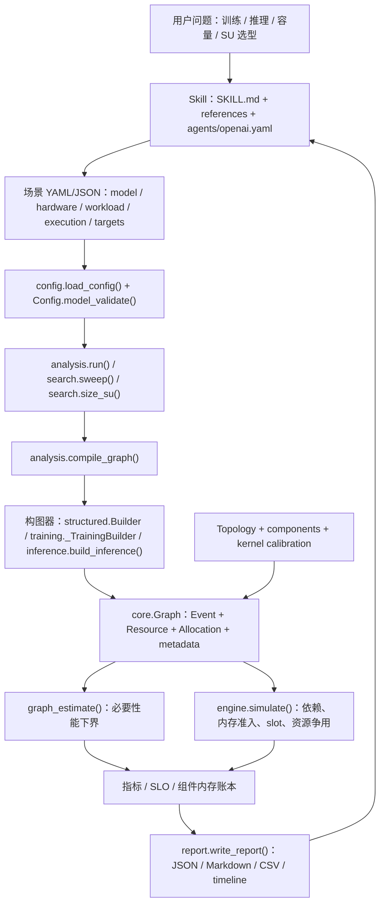

# 超节点仿真 Skill 架构说明

本文按当前工作区源码描述 `supernode-modeling` skill 与 `supernode_sim` 数值引擎的实现。整理日期：2026-09-28；代码声明的引擎版本：`0.1.0`，配置/结果 schema：`1.0`。本文是源码架构说明，不是新增实验或实机校准报告。

配套文件：[函数级仿真流程图](simulation-function-flows.md)。图中区分真实函数调用、函数内部控制流和运行时事件依赖；各张图也提供独立 `.mmd` 源文件。

## 1. 整体定位

项目是面向超节点架构分析的**配置驱动、算子粒度的解析模型与离散事件仿真器**。它把模型结构、硬件拓扑、并行策略和负载编译成事件 DAG，再计算容量、计算/访存/通信需求、执行时序及 SLO。

`supernode-modeling` skill 是面向使用者的编排和解释层：收集参数、选择场景、调用命令、检查输出、解释假设。数值计算由 Python 包执行。Skill 目录没有独立仿真引擎，也没有常驻 agent 服务。

上图是职责与数据流视图。具体执行顺序见函数流程图：`run()` **总是先构图并执行 `graph_estimate()`**，只有 `mode='simulate'` 时才继续执行数值仿真。

## 2. 目录与分层职责

| 层次 | 文件 / 目录 | 主要职责与接口 |
|---|---|---|
| Skill 编排 | [`skills/supernode-modeling/SKILL.md`](../skills/supernode-modeling/SKILL.md) | 定位引擎、选资料、形成可重跑配置、先校验再计算、解释口径 |
| Skill 使用资料 | [`references/`](../skills/supernode-modeling/references/) | configuration、training、inference、topology、memory-breakdown、ascend950-kimi-k3 六类说明 |
| Skill 展示元数据 | [`agents/openai.yaml`](../skills/supernode-modeling/agents/openai.yaml) | 展示名称、简介和默认提示词；不实现任务调度 |
| 配置与输入 | [`config.py`](../supernode_sim/config.py) | Pydantic 类型/交叉约束、YAML/JSON、校准合并、HF 模型片段导入 |
| 命令入口 | [`cli.py`](../supernode_sim/cli.py)、[`__main__.py`](../supernode_sim/__main__.py) | `snmodel` 与 `python -m supernode_sim`，命令分派、退出码和报告落盘 |
| 分析编排 | [`analysis.py`](../supernode_sim/analysis.py) | `compile_graph()`、`graph_estimate()`、`run()`、指标与 SLO、设备需求 |
| 模型组件 | [`components.py`](../supernode_sim/components.py) | 形状参数清单、优化器状态、activation、MLA/KDA/AttnRes 状态公式 |
| 结构化构图 | [`structured.py`](../supernode_sim/structured.py) | `Builder` 将显式组件结构编译为训练/推理事件图 |
| 参数预算构图 | [`training.py`](../supernode_sim/training.py)、[`inference.py`](../supernode_sim/inference.py) | 未提供 architecture 时，使用声明的参数预算和粗粒度层算子构图 |
| 拓扑映射 | [`topology.py`](../supernode_sim/topology.py) | 设备资源、内存池、链路、路由、点对点与 collective 展开 |
| 中间表示 / 执行 | [`core.py`](../supernode_sim/core.py)、[`engine.py`](../supernode_sim/engine.py) | 统一 Graph 数据结构；确定性的多资源离散事件调度 |
| 校准 | [`calibration.py`](../supernode_sim/calibration.py) | 精确工作量匹配 kernel 实测条目，同时保留物理资源争用 |
| 内存归因 | [`memory_breakdown.py`](../supernode_sim/memory_breakdown.py) | 回放有序内存日志，计算组件×状态、池峰值和集群并发峰值 |
| 搜索与扫描 | [`search.py`](../supernode_sim/search.py) | 笛卡尔积扫描、有限 SU 候选枚举、必要条件剪枝、候选仿真 |
| 输出 | [`report.py`](../supernode_sim/report.py) | 中文报告、结构化结果、CSV、Trace；大图明细精简与导出清单 |
| 大实验辅助 | [`scripts/run_reference_experiment.py`](../scripts/run_reference_experiment.py) | 进度、完成态仿真检查点、流式重读与继续导出 |
| 场景与证据 | `examples/`、`profiles/hardware/`、`docs/sources/`、`tests/` | 合成场景、参考硬件片段、公开来源快照、回归测试 |

运行依赖为 Python 3.11+、Pydantic 2 和 PyYAML；测试依赖 pytest。`profiles/hardware/` 是参考数据文件，`load_config()` 不会仅凭硬件名称自动查找或继承 profile；实际值必须进入场景配置，或通过 `calibration` 的 hardware 覆盖合并。

## 3. Skill 工作流与命令边界

Skill 的标准步骤是：定位本项目/已安装包 → 按问题读取参考资料 → 保留用户场景并补齐必要参数与来源 → `validate` → `estimate` / `simulate` / `sweep` / `size-su` → 阅读数值输出并解释约束。

| 命令 | 主调用链 | 结果与边界 |
|---|---|---|
| `schema` | `cli._main()` → `Config.model_json_schema()` | 导出配置字段和约束 |
| `import-hf` | `import_hf_config()` → `read_data()` | 输出模型片段、来源、`missing_fields`；不是完整可运行场景 |
| `validate` | `load_config()` → `Config.model_validate()` | 校验配置；不构图、不验证完整 DAG 或实际容量可行性 |
| `estimate` | `run(..., 'estimate')` | 构图、必要性能下界、驻留/乐观内存及资源需求；状态为 `estimated`，不判定 SLO 满足 |
| `simulate` | `run(..., 'simulate')` | 在同一图上做资源争用与内存准入仿真，再计算指标和 SLO |
| `sweep` | `search.sweep()` → 每候选 `run()` | 对 dotted-path 配置字段取笛卡尔积，逐项校验并保留失败候选 |
| `size-su` | `search.size_su()` → `run(estimate)` → 必要时 `run(simulate)` | 有限候选集合内搜索最小 SU；单域/多域分别报告 |

所有常规分析命令最终由 `write_report()` 导出。Python API 的 `run()` 只返回字典，**不会自动写文件**。CLI `main()` 暂停循环 GC，并在 `finally` 恢复原状态，这是大图内存管理优化。

CLI 退出码：输入/图相关错误通常为 `2`，顶层 `infeasible` / `slo_failed` 为 `3`，正常完成为 `0`。扫描/搜索要继续检查候选与子搜索的 `status`：例如 `size-su` 无可行候选时，子结果为 `no_feasible_candidate`，顶层仍可为 `completed`，不能只看进程退出码。

## 4. 配置协议与统一中间表示

### 4.1 Config 的六组业务输入

| 配置组 | 作用 | 关键约束 |
|---|---|---|
| `model` | 参数预算，或逐层 architecture 与张量形状 | 有 architecture 时派生 total/active 参数；公开四舍五入值放 `reported_*` |
| `hardware` | NPU/CPU、HBM/DRAM、SU/SO、host link、外部存储、显式链路 | `su_size` 整除总卡数；容量、速率、精度算力需有效 |
| `workload` | training/inference、batch、长度、累积步、训练步数 | 推理长度列表必须与 batch 一致，缺省由标量长度展开 |
| `execution` | TP/PP/EP/DP/FSDP、rank 放置、精度、offload、optimizer | `TP × PP × EP × DP = NPU 数`；FSDP 整除 DP，不再乘入总卡数 |
| `targets` | 吞吐、TTFT、TPOT、step time 和候选集合 | 场景区分训练与推理指标，候选数量受 `max_candidates` 限制 |
| `sources` / `assumptions` / `calibration` | 来源与假设、硬件校准覆盖 | 来源状态为 assumed/public/user/measured；校准仅接受 hardware 和 source |

`Spec` 禁止未知字段与非有限数值。`batch_size` 是每个 DP 副本的 batch，因此增加 DP 同时改变聚合负载。默认物理映射顺序为 `[dp, pp, ep, tp]`，`rank_order` 可重排物理设备。

精度独立配置为 weight、compute、gradient、master、optimizer、kv、weight_transfer、activation、communication、recurrent，并可单独指定 routed expert 的权重存储精度。不能从 FP8 权重驻留推导出 FP8 计算或 FP8 回传。

### 4.2 core.py：Graph 是所有构图器与执行器之间的契约

| 数据结构 | 主要字段 | 语义 |
|---|---|---|
| `Allocation` | `id, pool, size_bytes, category, dtype, shape, metadata` | 一次存储分配，组件/层/状态归因放在 metadata |
| `Resource` | `id, capacity, unit, kind` | 连续服务资源，例如 FLOP/s、byte/s、IOPS |
| `Event` | `id, deps, work, startup_s, allocs, releases, metadata, slots` | DAG 节点；依赖、同时需要的各类资源工作量、启动延迟、生命周期和独占执行槽 |
| `Graph` | `resources, memory_caps, initial_allocations, events, metadata` | 资源速率、内存容量、驻留状态、事件图和指标标记 |

`Resource.capacity` 表达**速率**，`Graph.memory_caps` 表达**容量**，`slots` 表达**互斥**；三者分别建模。一个 kernel 可同时消耗 FLOPs 与 HBM 字节，并占用设备 compute slot。事件之间保存 ID 依赖，不使用对象反向引用。

构图器生成 `step_end_events` 或 `sequence_token_completion_events` 等标记；指标层根据这些事件的实际结束时间计算训练步时和逐请求 token 延迟。图的 metadata 也携带组件清单、假设、模型近似和校准命中信息。

## 5. 构图架构：先看 architecture，再看场景

`analysis.compile_graph()` 的路由顺序是本项目最关键的分层点：

| 条件 | 真实函数链 | 参数和存储口径 |
|---|---|---|
| `model.architecture != None`，training | `build_structured()` → `Builder.__init__()` → `Builder.training_graph()` | 由形状推导组件张量，再按 TP/EP/FSDP 放置 |
| `model.architecture != None`，inference | `build_structured()` → `Builder.__init__()` → `Builder.inference()` | 同一套组件定义，额外生成 KV/KDA/AttnRes 生命周期 |
| 无 architecture，training | `build_training()` → `_TrainingBuilder.__init__()` → `.build()` | 声明的总参数/活跃参数预算与粗粒度层算子 |
| 无 architecture，inference | `build_inference()` | 声明的参数预算与固定 batch 推理图 |

参数预算路径保留 `Unassigned` 归因，不把未知结构按百分比伪分配给具体组件。兼容路径中合并的 Adam m/v 驻留分配，会在 `compile_graph()` 中按实际实现拆分为 momentum/variance 两类。结构化路径使用 `parameter_inventory()`、`inventory_summary()`、`ParameterTensor.local_elements()`、`optimizer_states()`、`component_activations()` 等共同组件接口。

### 5.1 训练

两条训练路径都使用 `training.pipeline_schedule()` 生成非交错 1F1B 调度：warmup forward → forward/backward 交替 → drain backward。执行图按训练步、PP stage、microbatch、layer 构建，真实并发由依赖和资源执行器决定。

- 参数预算路径：`_TrainingBuilder.build()` → `initial_state()` → `phase()` → `optimizer()`。`phase()` 组织权重 gather、前/反向 kernel、TP/EP 通信、重计算、梯度同步与 PP 传输，并配合 `add_gather()` 支持受限的一层前瞻预取。
- 结构化路径：`Builder.training_graph()` → `initial()` → `gather()` / `kernel()` / `collective()` / `pipeline_transfer()`；activation checkpointing 调用 `recompute_layer()` 重放组件与必要 TP/EP 通信，最后调用 `optimizer()`。
- FSDP 控制权重与状态分片，`reshard_after_forward` 控制前向后的释放和反向重新 gather；`sync_each_microbatch` 控制梯度同步时机。
- optimizer offload 将状态置于 host，并生成梯度 D2H、CPU 更新、权重 H2D，传输精度与驻留精度分别计算。
- 结构化 optimizer 支持 Adam/Muon 参数组。Muon 包含 momentum、Newton–Schulz 工作量/暂存和辅助 Adam 状态；不是 distributed Muon 的全矩阵跨 rank 实现。`inflight_components_per_rank` 显式限制每 rank 同时在途的组件更新链。

两条路径的流水线依赖不完全相同：预算版 phase 的完成标记不等待异步 PP send；结构化版会把 stage 的后继依赖接到 send 完成。因此不能把两者视为同一调度器仅更换参数量。结构化路径当前拒绝 `prefetch=true`。

### 5.2 推理

两条路径都构建**固定、可变长度 batch**：step 0 为 prefill，并产生每个序列首个输出 token；后续 step 为 decode，仅为尚未完成的序列计算。各 DP 副本、PP stage、layer 的依赖与 token 完成事件在构图时确定，没有请求到达队列和动态补入 batch。

- 参数预算版 `build_inference()` 使用 `kv_layout_bytes()` 算标准/latent KV、量化 scale 与分页元数据；读侧 KV 转换在 attention 中融合建模。
- 结构化版 `Builder.inference()` 使用 `attention_state()` 区分 MLA KV、KDA recurrent/conv state；MLA KV 随上下文增长，KDA 状态不按上下文长度线性增长。
- KV offload 将部分持久 KV 放入 host/remote；decode 按需读取旧 KV，写回新 KV，传输包含 KV 数据与量化 scale；page table 只计驻留容量，不进入 KV 读写 payload。KDA recurrent/conv state 保留在 NPU，不参与 KV offload。结构化路径含显式旧 KV 解码 buffer 与释放依赖。
- MoE 使用 EP dispatch → 专家计算 → combine，TP 与 PP 通信按各路径的函数展开。Engram 在指定层产生查询、存储端资源需求和数据传输，受缓存命中假设影响。
- `component_order()` 控制结构化组件顺序；prefill 的 Output layer logits 只针对每个序列最后一个位置计算。

### 5.3 编译后处理与校准

所有构图路径最终经过 `apply_kernel_profiles()`。条目按 kernel 名、FLOPs、HBM bytes 及可选 dtype/phase 精确匹配；匹配后保留真实工作量、HBM 争用和 compute slot，用独立 timing resource 表达测得的独占服务时间。该时间不含 startup，不能低于配置的物理计算/访存下界。未匹配项继续使用解析模型，匹配信息写入 `model_metadata.kernel_calibration`。

## 6. 拓扑、下界与离散事件执行

### 6.1 从通信语义到资源工作量

`Topology` 构建 NPU/CPU 计算资源、HBM/DRAM/外部存储资源与容量、host/NIC/injection 和链路资源。`populate()` 将初始资源写入 Graph；后续懒构造的路径资源在传输使用时加入共享资源表。

`Topology.collective()` 将 all-gather、reduce-scatter、all-reduce 展开为 ring 点对点轮次，all-to-all-v 按流量矩阵展开；`transfer()` 再调用 `path()`，给端点内存、沿途链路、注入带宽及共享组等资源记账，返回 Event。collective 的发送/接收临时 buffer 和 tx/rx slot 由 `collective()` 添加，普通点对点 buffer 由相应构图器管理。

`path()` 依次检查缓存、显式 routes、同 SU full_mesh 懒建直连，再进行确定性最少 hop 搜索，以字典序打破平局。模板拓扑中同 SU 的 NPU 通信限走 SU，跨 SU 限走 SO；不按实时负载选路。AG/RS 的 size 表示每 rank 完整张量大小，共 N−1 轮，每 rank 每轮发送 size/N；AR 为 RS→AG 两阶段，A2AV 为按矩阵的 N−1 轮 pairwise。每轮所有 transfer 完成 ID 成为下一轮依赖。

流量有不同视图：`transport_payload_bytes` 是展开后的传输 payload 总量；`physical_bytes_by_domain` 是沿路逐跳字节量；semantic（如 dispatch/combine）与 collective（如 all-to-all-v）是同一 payload 的不同分类，不能再相加。

### 6.2 graph_estimate()：解析下界

对每个事件，独占服务耗时近似为：

`startup_s + max(work[resource] / capacity[resource])`

沿依赖 DAG 求最早完成时间，得到 dependency-path 下界；累计每个资源的工作量除以容量，得到 resource 下界；二者最大值为 `duration_lower_bound_s`。

同时输出固定驻留内存与忽略争用/slot 的乐观内存时间线。**乐观时间线峰值不是通用容量下界，也不证明可行性**。`estimate` 模式的组件峰值归因仅基于初始驻留状态，不会伪造乐观时间线的组件构成。

### 6.3 engine.simulate()：实际调度循环

1. 校验事件/分配 ID、资源、依赖、无环性；提交初始驻留分配，超容量即返回 `infeasible`。
2. 在当前时刻先完成事件：释放 allocation 与 slot，更新后继依赖，记录 trace 与有序 `memory_log`。
3. 按事件 ID 排序检查 ready 集合：slot 可用且所有新增分配都可容纳时，原子准入并开始 startup；否则等待。
4. 对 startup 已结束的 active 事件调用 `max_min_rates()`，按其独占 roofline 进度速率做归一化 max-min 共享。
5. 时间跳到最近的 startup 结束或事件完成点，更新进度、资源工作量和 busy time，再进入循环。
6. 全部完成返回 `feasible`；无 active 且 ready 事件因容量无法启动，返回 `status=infeasible`、`diagnostics.code=memory_admission_deadlock`；非法图、错误释放或其他无法推进情形返回 `error`。

一个事件对多个资源同时推进，因此 kernel 计算和访存服务时间采用 roofline 最大项，不简单相加。相同单链路上的不同大小流会先获得相同 byte/s，而不是相同完成时间。引擎是确定性流体近似，未实现包级排队、拥塞控制或周期级硬件行为。

## 7. 结果、指标与内存账本

`run()` 返回版本化结果，包含 resolved config、配置 SHA-256、units、sources、assumptions、model_metadata、estimate、requirements、metrics、slo、memory_breakdown；simulate 还包含 simulation。导出的 resolved config 已嵌入校准覆盖，`calibration` 置空，可独立重跑。

| 指标 | 计算口径 |
|---|---|
| 训练总 token | `batch_size × sequence_length × gradient_accumulation × DP × training_steps` |
| `step_time_s` | 完整 duration / training_steps；另列逐步、首次和后续平均步时 |
| 推理 TTFT | 每序列第一个 token 完成时刻；聚合取最大值，从执行起点计时 |
| 推理 TPOT | 每序列首 token 后相邻完成间隔的平均值；聚合取这些均值的最大值 |
| 推理吞吐 | 输出 token 总数 / 完整执行耗时；输入吞吐单列 |
| 单输出 token | 该序列 TPOT 为 `null`，聚合排除它；只有所有序列都输出 1 token 时，配置才拒绝 TPOT target |
| SLO | 吞吐必须 ≥ target，延迟必须 ≤ target；执行失败时不视为满足 |

`build_memory_breakdown()` 根据 `memory_log.sequence` 与时间顺序回放实际分配/释放，而不是从排序后的 trace 猜测同时间点的先后。输出逻辑组件状态容量、物理张量账本、逐池/集群峰值与其**同一时刻构成**。

必须区分：逻辑参数状态、经过复制/分片后的驻留容量、执行期间的并发峰值。组件独立峰值和不同池独立峰值可能发生在不同时刻，不能相加冒充设备/集群峰值。执行中止时 mode 为 `observed_partial`，只代表已观察到的执行前缀。

| 输出文件 | 内容 |
|---|---|
| `report.md`、`result.json`、`config.resolved.json` | 中文解释、机器结果与来源、可重跑配置 |
| `resources.csv`、`memory.csv` | 资源工作量/容量/利用率、驻留与乐观/仿真峰值 |
| `events.csv`、`timeline.json` | simulate 的事件明细；后者用于 Perfetto/Chrome Trace |
| `component_memory.csv`、`state_memory.csv` | 组件×状态和状态汇总，同时保留峰值时刻口径 |
| `tensors.csv`、`memory_peaks.csv` | allocation 生命周期、逐池峰值及构成 |
| `model_parameters.csv` | 存在组件清单时导出的逻辑参数张量和形状 |

## 8. 搜索、大图与检查点

### 8.1 有限候选搜索

`sweep()` 独立校验并运行每个组合，保留 `invalid_config` 等失败项。`size_su()` 枚举总卡数、SU size、并行布局；未给布局时保留 TP/PP/EP/FSDP，根据卡数推导 DP。

每个合法 SU 候选先跑 estimate：仅用**固定驻留内存**和**严格性能下界**剪枝。性能剪枝窗口只从训练 step-time/吞吐或推理吞吐导出，不把 TTFT/TPOT 当作全图 deadline。剩余候选重新调用 `run(..., 'simulate')`，因此当前实现会再构图一次。

可行候选按 `(su_size, npu_count, duration_s)` 排序，返回集合内最小值。多域模式需要 `total_npus` 或 `max_total_npus`；结果不声明全局最优，也不保证更大 SU 的性能单调。

### 8.2 大图明细精简

有两层不同的精简策略，均不减少被仿真的事件或分配：

- `run(full_detail=False)`：超过 50,000 个事件时，trace 不再复制 work/allocations/releases 负载字段；超过 50,000 个 allocation 时，内存账本不物化临时 buffers 的宽明细行。调度、资源总量和完整 memory_log 仍参与计算。
- `write_report(full_detail=False)`：对大结果导出保留 kernel、token/step 标记和保留模型张量的分配事件，省略重复临时通信记录及原始内存日志；`artifact_export` 记录原始/保留/省略数量。

Python `run()` 默认 `full_detail=True`，CLI `estimate/simulate` 默认 false，`write_report()` 默认 false。需要完整导出时，计算与导出两个阶段都必须保留 full detail；不能从已精简结果补回丢失字段。

### 8.3 检查点与恢复

`run_reference_experiment.py` 包装 analysis 中的构图、下界、simulate 和内存归因函数，打印进度并在结束时恢复原函数。检查点路径为 `checkpoint/<fingerprint前20位>/`，使用 `trace.jsonl.gz`、`memory_log.jsonl.gz` 和最后提交的 `manifest.json`。

fingerprint 包含解析后配置和 core/config/components/structured/training/inference/topology/engine/calibration 源文件；报告与归因逻辑可在重读结果时重新执行。恢复会核验 fingerprint、文件大小和迭代记录数。

这是**已完成一次数值执行后的结果检查点**：恢复仍会构图、重新算下界并回放日志，只跳过 `engine.simulate()`。它不能从仿真循环中途的 event 进度继续；若尚未提交 manifest，需重新数值执行。大结果通过可重复迭代的 `JSONLRecords` 流式读取，避免一次性加载全部原始记录。

## 9. 当前能力边界与扩展位置

| 需求 | 应修改 / 扩展的位置 |
|---|---|
| 新模型组件、形状与参数状态 | config 的结构字段 → components 的 inventory/state 公式 → structured 的 kernel/执行依赖 |
| 新训练/推理执行策略 | structured / training / inference 的构图逻辑；显式体现精度转换、allocation/release 与完成标记 |
| 新网络或共享瓶颈 | HardwareSpec → Topology 的资源、路径与 transfer/collective 映射 |
| 新实测 kernel 条目 | hardware.kernel_profiles → apply_kernel_profiles；精确工作量匹配，不按型号推测 |
| 新指标或目标 | 图 metadata 完成标记 → execution_metrics / evaluate_targets → report；搜索剪枝需另证明必要性 |
| 新报表视图 | memory_breakdown / report；保持并发峰值的可加性口径 |
| 新 Skill 分析场景 | SKILL.md 与 references；数值规则仍应进入引擎和测试 |

当前限制包括：无 PD 分离、投机推理、expert offload、连续请求排队/P99、包级与周期级模拟；Clos/Fat-tree 为简化单 spine 抽象；MoE 默认均匀路由，稀疏 decode 权重读取按期望触达专家估算。缓存/MTE 输出是工作集和搬运需求，不可直接解释为精确 L1/L2/L3 容量或硬件通道数。

配置显式拒绝的组合还包括：无 architecture 的 Muon、结构化 FSDP lookahead prefetch、跨 PP 的 tied embedding 和 AttnRes、非权重状态使用 FP4。MLA compressed/expanded 改变容量和访存模型，不表示两种实际 kernel 均已校准。

参考场景分为合成 demo/10T 容量锚点和含公开来源的 Kimi K3 / Ascend 950DT 场景。硬件型号、公开结构、运行时布局和效率假设的可信程度不同；同型号不能等同于实机性能复现。

## 10. 源码导航与验证说明

| 主干问题 | 源码入口 | 已有测试证据 |
|---|---|---|
| CLI → 配置 → 路由 | [`cli._main()`](../supernode_sim/cli.py#L42)、[`load_config()`](../supernode_sim/config.py#L453)、[`compile_graph()`](../supernode_sim/analysis.py#L21) | `test_integration.py`、`test_import_and_cache.py` |
| 训练与组件 | [`build_training()`](../supernode_sim/training.py#L560)、[`Builder.training_graph()`](../supernode_sim/structured.py#L577)、[`parameter_inventory()`](../supernode_sim/components.py#L68) | `test_training.py`、`test_components.py`、`test_structured.py` |
| 推理与状态 | [`build_inference()`](../supernode_sim/inference.py#L46)、[`Builder.inference()`](../supernode_sim/structured.py#L386)、[`attention_state()`](../supernode_sim/components.py#L410) | `test_inference.py`、`test_structured.py`、`test_component_integration.py` |
| 拓扑与调度 | [`Topology.collective()`](../supernode_sim/topology.py#L254)、[`simulate()`](../supernode_sim/engine.py#L56)、[`max_min_rates()`](../supernode_sim/engine.py#L18) | `test_topology.py`、`test_engine.py` |
| 下界与指标 | [`graph_estimate()`](../supernode_sim/analysis.py#L64)、[`execution_metrics()`](../supernode_sim/analysis.py#L171)、[`size_su()`](../supernode_sim/search.py#L71) | `test_integration.py`、`test_device_requirements.py` |
| 峰值与导出 | [`build_memory_breakdown()`](../supernode_sim/memory_breakdown.py#L118)、[`write_report()`](../supernode_sim/report.py#L355) | `test_memory_breakdown.py`、`test_report_export.py`、`test_compact_simulation.py` |
| 恢复 | [`fingerprint()`](../scripts/run_reference_experiment.py#L55)、[`load_checkpoint()`](../scripts/run_reference_experiment.py#L64) | `test_reference_checkpoint.py` |

本次文档通过静态阅读当前源码和相关测试核对架构、函数名称、调用顺序与边界。未执行新的数值实验或 pytest；当前工具环境无法启动本地 shell/Python 子进程。表中的测试文件表示仓库已有验证点，不表示本次已运行通过。后续代码改动时，应同步更新函数图、行号与这份说明。
