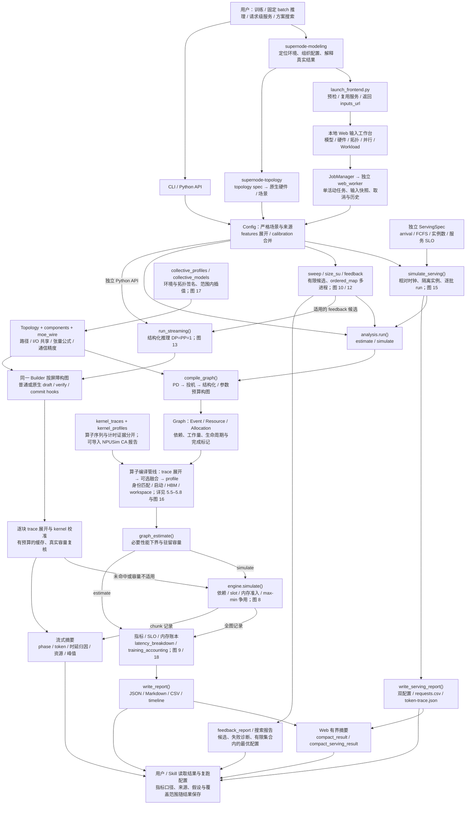
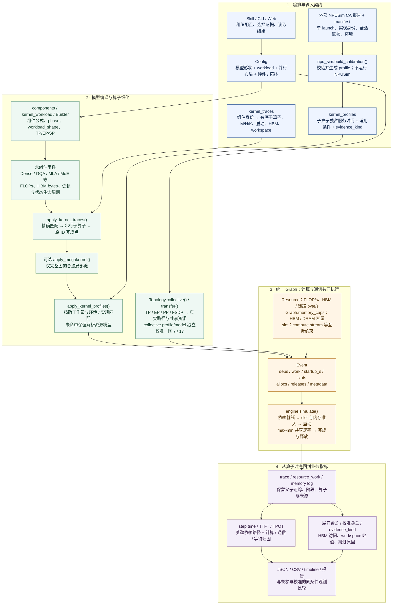
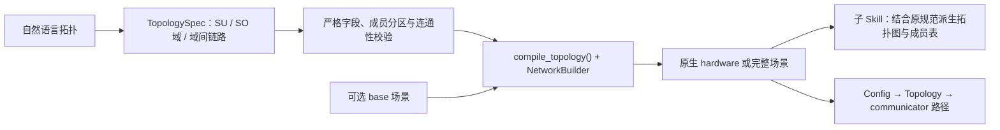

# 超节点流量仿真系统整体架构设计

系统通过 `supernode-modeling` skill、CLI / Python API 和本地 Web 工作台接入同一 `supernode_sim` 数值内核，将模型、负载、并行策略与 SU/SO 拓扑编译为资源事件图，分析存储、计算、通信需求及 SLO。整体采用“交互与任务编排 + 严格配置 + 统一事件语义 + 全图下界 / 离散事件执行 / 受限结构化流式执行 + 可追溯报告”的分层架构。

设计基线：当前仓库实现；更新日期：2026-11-03；引擎版本：`0.1.0`；配置与结果 schema：`1.0`。适用读者为模型与网络架构分析人员、仿真引擎开发者和 Skill 维护者。第 11 节列出演进建议，其余章节描述当前能力及使用约束。

配套文件：[函数级仿真流程图](simulation-function-flows.md)。图中区分真实函数调用、函数内部控制流和运行时事件依赖；各张图也提供独立 `.mmd` 源文件。

本文与仓库中的 [supernode-modeling skill](../skills/supernode-modeling/SKILL.md) 及当前源码同步，覆盖请求级服务、子算子展开、环境/拓扑约束校准、逐流 ECMP、多进程搜索、流式投机、时延拆解和训练 FLOPs 账本。完整流程见配套的 18 张主流程图与 3 张算子案例图；普通固定 batch、请求级服务与流式摘要的输入、指标及导出边界分别说明。

## 1. 整体定位

项目是面向超节点架构分析的**配置驱动、算子粒度的解析模型与离散事件仿真器**。它把模型结构、硬件拓扑、并行策略和负载编译成事件 DAG，再计算容量、计算/访存/通信需求、执行时序及 SLO。

`supernode-modeling` skill 是面向使用者的编排和解释层：收集参数、选择场景、调用命令、检查输出、解释假设。数值计算由 Python 包执行。Skill 目录没有独立仿真引擎。仓库另提供仅绑定本机的 HTTP 工作台，任务由独立、可取消的 Python worker 运行同一引擎；不提供远程 worker 协议。

父 skill 可接收独立 topology spec，包含 SU 结构、SO 域的 SU 成员分区与有向域间链路。嵌套子 skill [`supernode-topology`](../skills/supernode-modeling/subskills/supernode-topology/SKILL.md) 将自然语言转为规范，`build_topology.py` 编译成原生显式图，再进入同一 `Config` / `Topology` / 数值执行流程。它是配置生成器，不是另一套流量仿真器。生成的 `routing_policy: su_so` 防止 NPU 通信经其他链路类别绕行；旧显式图默认仍用 `shortest_hop`。

### 1.1 设计目标与问题闭环

系统承接 [超节点网络需求建模需求](../supernode_network_requirements.md) 中的“硬件形态 → 场景 → 模型与特性 → SLO → 存储 / 通信 / 计算约束”流程，并将分析结果反馈到硬件、并行布局或优化特性选择。

| 目标 | 具体交付 | 判断依据 |
|---|---|---|
| 判断资源能否承载场景 | 驻留容量、执行峰值、资源争用、失败诊断 | 配置约束与仿真结果 |
| 分析通信需求和瓶颈 | 语义 payload、逐跳物理流量、链路与注入资源负载 | 同一事件图的路径和资源账本 |
| 比较方案与 SU 规模 | 参数扫描、有限候选内的可行方案 | 保留负载变化及每个候选的失败原因 |
| 支持复现与校准 | 解析后配置、来源、假设、版本和输出明细 | 数值由代码执行，Skill 解释实际输出 |
| 支持按模块扩展 | 统一 Graph、组件公式、拓扑映射和报告接口 | 新能力进入引擎与对应验证点 |

原始需求中的 Agentic Serving 在线调度和 expert offload 尚未形成当前执行模型。PD 分离支持固定 batch 的独立双池与同 TP/EP 布局交接；投机推理支持显式成本与接受数驱动的同步 batch 轮次模型，不复现具体 DSpark 算法。当前训练分析针对声明的训练步与执行策略。

可选特性输入采用顶层 `features` 或 CLI `--features`：`features.resolve_feature_input` 在严格配置验证前展开为 canonical 字段，重复字段冲突会报错，resolved config 不保留输入简写。`feature_catalog` 给出能力清单，`build_feature_plan` 写入结果和报告。完整字段及可重跑小示例见 [features 说明](../skills/supernode-modeling/references/features.md)。

`disaggregated.build_disaggregated` 复用 Builder 的 prefill/decode 阶段构图，保留全物理拓扑并增加状态/token ID 交接事件；两池各有常驻权重，源状态在传输完成后释放。`megakernel.apply_megakernel` 在 kernel 校准之前融合合法局部链，保留工作量和保守内存生命周期，另报实际匹配覆盖；无匹配不改变性能。两者当前仅用于普通图，不在 streaming 中静默降级。

`sparse_attention.py` 实现 CSA/HCA 参数之外的 attention、indexer、压缩、选择及状态模型，`components.py` 提供相应参数/activation/保存状态，`structured.py` 将其映射至计算、HBM、TP collective 和生命周期。`speculative.py` 提供草稿准备、draft/verify/accept/replay/commit 计划，借助 `Builder.inference` 的轮次 hook 构图，再使用统一 `analysis`/`engine` 执行。普通图与 `run_streaming()` API 均支持该投机路径；流式复用相同 draft/verify/commit hooks，按组件屏障执行并保存状态快照/回滚。Feedback 仍将投机候选路由至普通图。该路径支持等长同步 batch、DP=PP=1，不含在线请求调度或完整 V4 的 mHC/indexer 辅助训练目标。

### 1.2 核心概念

| 概念 | 系统口径 |
|---|---|
| SU 域 | 一组通过 scale-up 网络互联的 NPU；`su_size` 是每个 SU 域的卡数 |
| SO 域 | 一组 SU 域组成的 scale-out 分区；其成员数量是超节点数，不能与 `su_size` 混用 |
| rank 放置 | 并行逻辑 rank 到物理 NPU 的映射，决定 communicator 实际经过哪些网络 |
| 资源事件图 | 描述依赖、计算 / 访存 / 传输工作量与张量生命周期的 DAG |
| 可行 | 声明的执行策略可完成且满足容量约束；SLO 是否满足还需独立检查 |
| 来源与校准 | 公开规格、用户输入、合成假设和实测值分别记录，型号名称不等于性能校准 |

### 1.3 总体组件与数据流



上图是职责与数据流视图，不表示每个入口都遍历全部节点。`analysis.run()` **总是先完整构图并执行 `graph_estimate()`**，只有 `mode='simulate'` 时才继续执行全图仿真；`run_streaming()` 直接使用结构化 Builder 按 barrier 输出小图并调用同一执行器，不经过完整 `compile_graph()` / `graph_estimate()` / `write_report()` 链。Web 提交 estimate / simulate / serve；服务分支逐批调用 `analysis.run()`，使用独立 `write_serving_report()`。feedback 可由 CLI / Python API 发起，并通过 `ordered_map()` 评估候选。流式缓存复用与真实 chunk 执行共同产生摘要；该摘要不是标准 `write_report()` 的输入。

## 2. 目录与分层职责

| 层次 | 文件 / 目录 | 主要职责与接口 |
|---|---|---|
| Skill 编排 | [`skills/supernode-modeling/SKILL.md`](../skills/supernode-modeling/SKILL.md) | 定位引擎、选资料、形成可重跑配置、先校验再计算、解释口径 |
| Skill 使用资料 | [`references/`](../skills/supernode-modeling/references/) | configuration、training、inference、topology、memory-breakdown、feedback、frontend、resource-usage 与 ascend950-kimi-k3 等说明 |
| 前端启动器 | [`launch_frontend.py`](../skills/supernode-modeling/scripts/launch_frontend.py) | 查找引擎/解释器、预检依赖与静态资源、复用或隐藏启动本地服务，返回实际输入页 URL |
| Skill 展示元数据 | [`agents/openai.yaml`](../skills/supernode-modeling/agents/openai.yaml) | 展示名称、简介和默认提示词；不实现任务调度 |
| 拓扑子 Skill | [`subskills/supernode-topology/`](../skills/supernode-modeling/subskills/supernode-topology/) | 生成独立 topology spec、原生 hardware / 场景、成员表与拓扑图 |
| 拓扑编译器 | [`build_topology.py`](../skills/supernode-modeling/subskills/supernode-topology/scripts/build_topology.py) | `TopologySpec`、`compile_topology()`；校验域划分、生成有向链路与共享瓶颈、合并 base 场景 |
| 配置与输入 | [`config.py`](../supernode_sim/config.py) | Pydantic 类型/交叉约束、YAML/JSON、校准合并、HF 模型片段导入 |
| 命令入口 | [`cli.py`](../supernode_sim/cli.py)、[`__main__.py`](../supernode_sim/__main__.py) | `snmodel` 与 `python -m supernode_sim`，命令分派、退出码和报告落盘 |
| 分析编排 | [`analysis.py`](../supernode_sim/analysis.py) | `compile_graph()`、`graph_estimate()`、`run()`、指标与 SLO、设备需求 |
| 本地 Web | [`web.py`](../supernode_sim/web.py)、[`web_static/`](../supernode_sim/web_static/) | loopback HTTP、配置编辑/校验、单活动任务、状态/日志/产物查询与取消 |
| 数值工作进程 | [`web_worker.py`](../supernode_sim/web_worker.py) | 重校验输入快照；分派普通分析或服务仿真，分别导出并生成有界 UI 摘要 |
| 请求级服务 | [`serving.py`](../supernode_sim/serving.py)、[`serving_report.py`](../supernode_sim/serving_report.py) | 独立 ServingSpec、显式 arrival、非抢占 FCFS 成批、隔离实例、相对时钟与请求级报告 |
| 模型组件 | [`components.py`](../supernode_sim/components.py) | 形状参数清单、优化器状态、activation、MLA/KDA/AttnRes 状态公式 |
| 结构化构图 | [`structured.py`](../supernode_sim/structured.py) | `Builder` 将显式组件结构编译为训练/推理事件图 |
| 参数预算构图 | [`training.py`](../supernode_sim/training.py)、[`inference.py`](../supernode_sim/inference.py) | 未提供 architecture 时，使用声明的参数预算和粗粒度层算子构图 |
| 拓扑映射 | [`topology.py`](../supernode_sim/topology.py)、[`routing.py`](../supernode_sim/routing.py)、[`moe_wire.py`](../supernode_sim/moe_wire.py) | 设备/链路/I/O 共享资源、确定性最短路或逐流 ECMP、非对称 MoE payload 与 collective 展开 |
| 中间表示 / 执行 | [`core.py`](../supernode_sim/core.py)、[`engine.py`](../supernode_sim/engine.py) | 统一 Graph 数据结构；确定性的多资源离散事件调度 |
| 子算子与形状 | [`operator_trace.py`](../supernode_sim/operator_trace.py)、[`kernel_workload.py`](../supernode_sim/kernel_workload.py) | 受结构与负载选择器约束的串行子算子、GEMM M/N/K、启动与局部 workspace |
| Kernel 校准 | [`calibration.py`](../supernode_sim/calibration.py) | 精确工作量及可选环境/结构约束匹配，服务时间与启动分开，保留资源争用 |
| Collective 校准 | [`collective_calibration.py`](../supernode_sim/collective_calibration.py) | exact profile 优先、同环境响应曲线区间内插值；签名锁定拓扑、rank 和 peer 比例 |
| 指标归因 | [`latency_breakdown.py`](../supernode_sim/latency_breakdown.py)、[`training_accounting.py`](../supernode_sim/training_accounting.py) | 请求关键依赖路径时延拆解；训练按 phase/role/dtype 区分模型、重算、优化器和辅助工作 |
| 内存归因 | [`memory_breakdown.py`](../supernode_sim/memory_breakdown.py) | 回放有序内存日志，计算组件×状态、池峰值和集群并发峰值 |
| 搜索与扫描 | [`search.py`](../supernode_sim/search.py)、[`parallel.py`](../supernode_sim/parallel.py) | 有限枚举、必要条件剪枝；ordered_map 在独立进程中评估候选并按原顺序收集 |
| 推理反馈搜索 | [`feedback.py`](../supernode_sim/feedback.py)、[`feedback_report.py`](../supernode_sim/feedback_report.py) | 固定模型/硬件的 TP/EP/SP × 输入长度 × batch 联合穷举、SLO、最优候选与前沿 |
| 结构化流式执行 | [`streaming.py`](../supernode_sim/streaming.py) | structured inference、DP=PP=1，按组件/层/token barrier 执行小图并保留持久状态 |
| 缓存预算 | [`cache.py`](../supernode_sim/cache.py) | `BoundedCache` 的 LRU、Python 对象计量预算与条目上限；供时序及路由复用 |
| 输出 | [`report.py`](../supernode_sim/report.py) | 中文报告、结构化结果、CSV、Trace；大图明细精简与导出清单 |
| 大实验辅助 | [`scripts/run_reference_experiment.py`](../scripts/run_reference_experiment.py) | 进度、完成态仿真检查点、流式重读与继续导出 |
| 场景与证据 | `examples/`、`profiles/hardware/`、`docs/sources/`、`tests/` | 合成场景、参考硬件片段、公开来源快照、回归测试 |

运行依赖为 Python 3.11+、Pydantic 2 和 PyYAML；测试依赖 pytest。`profiles/hardware/` 是参考数据文件，`load_config()` 不会仅凭硬件名称自动查找或继承 profile；实际值必须进入场景配置，或通过 `calibration` 的 hardware 覆盖合并。

分层的主要边界是：Skill 输出可执行配置；构图器输出 Graph；执行器消费 Graph 并输出 trace 与资源 / 内存日志；指标和报告层读取这些记录。模型公式与路径字节量进入代码，不能由 Skill 用文字推导替代正式数值结果。现有 `analysis.run()` 组合全图分析各阶段；`run_streaming()` 提供受限的流式数值入口，两者返回契约不同。Web 的任务层与数值 worker 分进程；HTTP 线程不执行仿真循环。

## 3. Skill 工作流与命令边界

Skill 默认先通过启动器准备本地前端，并由可用浏览器工具打开实际 `inputs_url`；明确只用 CLI 或运行环境不支持时按相应边界继续。准备页面本身不会提交数值任务。分析步骤是：定位本项目/已安装包 → 按问题读取参考资料 → 保留用户场景并补齐必要参数与来源 → `validate` → `estimate` / `simulate` / `serve` / `sweep` / `size-su` / `feedback` → 阅读数值输出并解释约束。

若输入为自然语言拓扑，先在子 skill 中形成独立规范并编译，再回到上述流程。仅生成拓扑时，不要求用户提供模型与负载。正式分析保留原场景与独立输出目录；容量失败也属于有效分析结果，不自动增加卡数、改变 DP 或调整 global batch 来掩盖失败。

| 命令 | 主调用链 | 结果与边界 |
|---|---|---|
| `schema` / `serving-schema` | `Config.model_json_schema()` / `ServingSpec.model_json_schema()` | 分别导出模型场景与服务负载 schema |
| `list-features` | `feature_catalog()` | 列出输入特性、支持组合和能力边界 |
| `import-hf` | `import_hf_config()` → `read_data()` | 输出模型片段、来源、`missing_fields`；不是完整可运行场景 |
| `validate` | `load_config()` → `Config.model_validate()` | 校验配置；不构图、不验证完整 DAG 或实际容量可行性 |
| `estimate` | `run(..., 'estimate')` | 构图、必要性能下界、驻留/乐观内存及资源需求；状态为 `estimated`，不判定 SLO 满足 |
| `simulate` | `run(..., 'simulate')` | 在同一图上做资源争用与内存准入仿真，再计算指标和 SLO |
| `sweep` | `search.sweep()` → 每候选 `run()` | 对 dotted-path 配置字段取笛卡尔积，逐项校验并保留失败候选 |
| `size-su` | `search.size_su()` → `run(estimate)` → 必要时 `run(simulate)` | 有限候选集合内搜索最小 SU；单域/多域分别报告 |
| `feedback` | `feedback()` → 每候选 `run_streaming(all)` 或 `run(simulate)` | 固定模型/硬件的有限联合搜索；需 TTFT、TPOT 和至少 2 个输出 token |
| `serve` | `simulate_serving()` → `_execute_batch()` → `run(simulate)` | 模型 Config + 独立 ServingSpec；FCFS 固定成批、隔离实例与服务 SLO |
| `web` | `web.main()` → HTTP / JobManager → 独立 `web_worker.main()` | 本地工作台支持 estimate / simulate / serve；搜索和独立 streaming 使用 CLI / Python API |

estimate / simulate / sweep / size-su / feedback 由 `write_report()` 导出；serve 使用独立 `write_serving_report()`，同时保存模型与服务两份 resolved 配置。Python API 的 `run()` 只返回字典，**不会自动写文件**。数值 CLI `main()` 暂停循环 GC，并在 `finally` 恢复原状态，这是大图内存管理优化；长期运行的 `web` 服务保留 GC，短生命周期 worker 单独应用暂停/恢复策略。

CLI 退出码：输入/图相关错误通常为 `2`，顶层 `infeasible` / `slo_failed` / `no_feasible_candidate` 为 `3`，正常完成为 `0`。扫描/搜索要继续检查候选与子搜索的 `status`：例如 `size-su` 无可行候选时，子结果为 `no_feasible_candidate`，顶层仍可为 `completed`，不能只看进程退出码。

配置校验、图校验、执行可行性与 SLO 是四个独立关口。`validate` 成功后，实际 communicator 仍可能没有可达路径；图有效后，运行仍可能因内存无法准入而失败；执行完成后，仍可能出现 `slo_failed`。

## 4. 配置协议与统一中间表示

### 4.1 Config 的六组业务输入

| 配置组 | 作用 | 关键约束 |
|---|---|---|
| `model` | 参数预算，或逐层 architecture 与张量形状 | 有 architecture 时派生 total/active 参数；公开四舍五入值放 `reported_*` |
| `hardware` | NPU/CPU、HBM/DRAM、SU/SO、host link、外部存储、显式链路 | `su_size` 整除总卡数；容量、速率、精度算力需有效 |
| `workload` | training/inference、batch、长度、累积步、训练步数 | 推理长度列表必须与 batch 一致，缺省由标量长度展开 |
| `execution` | TP/PP/EP/DP/FSDP、SP、rank 放置、精度、offload、optimizer | 普通模式 `TP × PP × EP × DP = NPU 数`；PD 为 `2 × TP × EP`、DP=PP=1；FSDP 整除 DP，SP 共享 TP ranks，均不再乘入总卡数 |
| `targets` | 吞吐、TTFT、TPOT、step time 和候选集合 | 场景区分训练与推理指标，候选数量受 `max_candidates` 限制 |
| `sources` / `assumptions` / `calibration` | 来源与假设、硬件校准覆盖 | 来源状态为 assumed/public/user/measured；校准仅接受 hardware 和 source |

`Spec` 禁止未知字段与非有限数值。`batch_size` 是每个 DP 副本的 batch，因此增加 DP 同时改变聚合负载。默认物理映射顺序为 `[dp, pp, ep, tp]`，`rank_order` 可重排物理设备。`sequence_parallel=true` 当前仅接受结构化推理、`TP>1` 且 `PP=1`；SP degree 为 TP，不是独立的 world-size 轴。

精度独立配置为 weight、compute、gradient、master、optimizer、kv、weight_transfer、activation、communication、recurrent，以及 MoE dispatch/combine wire 精度，并可单独指定 routed expert 的权重存储精度。不能从 FP8 权重驻留推导出 FP8 计算或 FP8 回传。

模型导入也是受约束的输入适配：`import_hf_config()` 输出模型片段与 `missing_fields`，硬件、负载和执行布局仍需进入完整场景。Kimi K3 适配器按形状推导文本 backbone，范围排除 vision tower / projector；非零 MTP 会列入缺失项。`reported_total_params` / `reported_active_params` 保存公开约数，与引擎使用的结构推导值分开。

### 4.2 core.py：Graph 是所有构图器与执行器之间的契约

| 数据结构 | 主要字段 | 语义 |
|---|---|---|
| `Allocation` | `id, pool, size_bytes, category, dtype, shape, metadata` | 一次存储分配，组件/层/状态归因放在 metadata |
| `Resource` | `id, capacity, unit, kind` | 连续服务资源，例如 FLOP/s、byte/s、IOPS |
| `Event` | `id, deps, work, startup_s, allocs, releases, metadata, slots` | DAG 节点；依赖、同时需要的各类资源工作量、启动延迟、生命周期和独占执行槽 |
| `Graph` | `resources, memory_caps, initial_allocations, events, metadata` | 资源速率、内存容量、驻留状态、事件图和指标标记 |

`Resource.capacity` 表达**速率**，`Graph.memory_caps` 表达**容量**，`slots` 表达**互斥**；三者分别建模。一个 kernel 可同时消耗 FLOPs 与 HBM 字节，并占用设备 compute slot。事件之间保存 ID 依赖，不使用对象反向引用。Graph / Event / Resource / Allocation 使用 `dataclass(slots=True)`，减少大图中逐对象属性字典的开销。

构图器生成 `step_end_events` 或 `sequence_token_completion_events` 等标记；指标层根据这些事件的实际结束时间计算训练步时和逐请求 token 延迟。图的 metadata 也携带组件清单、假设、模型近似和校准命中信息。

### 4.3 数据契约与不变量

| 边界 | 交付物 | 必须保持的约束 |
|---|---|---|
| Skill / 导入器 → Config | 完整场景与字段来源 | 未知结构保留缺失或假设；单位统一，未知字段报错 |
| topology spec → hardware | 显式有向链路、域网关、共享容量与来源 | 原规范保留 SO 成员分区；更换卡数须重编译 |
| 构图器 → Graph | 资源、池容量、分配、事件、完成标记 | ID 唯一、依赖存在且无环、工作量非负、资源与池存在 |
| Graph → 执行记录 | 事件时间、资源工作量、按序内存日志 | 准入分配原子化，释放按生命周期执行；同一共享组容量一致，工作量按经过的链路累计 |
| 执行记录 → 结果 / 报告 | 指标、归因、失败诊断、导出清单 | 失败不声明 SLO 可行；独立峰值不可当成并发峰值相加 |

Graph 本身是内存中的 Python 数据结构，当前没有独立的图文件协议或图缓存服务。可选的流式时序/驻留快照缓存只复用数值模板，不是完整 DAG 持久化；Web 通过任务目录保存配置、状态和产物。对外复跑使用配置与版本化结果；`config_sha256` 标识解析后输入，完整复现还需要保留引擎版本或源码修订。

## 5. 构图架构：特性路由与结构选择

`analysis.compile_graph()` 的路由顺序是本项目最关键的分层点：

| 条件 | 真实函数链 | 参数和存储口径 |
|---|---|---|
| PD enabled | `build_disaggregated()` | 同布局双池、双份驻留与状态/首 token ID 交接 |
| speculative enabled | `build_speculative()` → `configure_speculative()` → `Builder.inference()` | 显式 draft/verify/commit、接受数与快照/回滚 |
| `model.architecture != None`，training | `build_structured()` → `Builder.__init__()` → `Builder.training_graph()` | 由形状推导组件张量，再按 TP/EP/FSDP 放置 |
| `model.architecture != None`，inference | `build_structured()` → `Builder.__init__()` → `Builder.inference()` | 同一套组件定义，额外生成 KV/KDA/AttnRes 生命周期 |
| 无 architecture，training | `build_training()` → `_TrainingBuilder.__init__()` → `.build()` | 声明的总参数/活跃参数预算与粗粒度层算子 |
| 无 architecture，inference | `build_inference()` | 声明的参数预算与固定 batch 推理图 |

参数预算路径保留 `Unassigned` 归因，不把未知结构按百分比伪分配给具体组件。兼容路径中合并的 Adam m/v 驻留分配，会在 `compile_graph()` 中按实际实现拆分为 momentum/variance 两类。结构化路径使用 `parameter_inventory()`、`inventory_summary()`、`ParameterTensor.local_elements()`、`optimizer_states()`、`component_activations()` 等共同组件接口。

### 5.1 训练

两条训练路径都使用 `training.pipeline_schedule()` 生成非交错 1F1B 调度：warmup forward → forward/backward 交替 → drain backward。执行图按训练步、PP stage、microbatch、layer 构建，真实并发由依赖和资源执行器决定。

- 参数预算路径由 `_TrainingBuilder.build()` 串起 `initial_state()`、`phase()` 和 `optimizer()`。`phase()` 组织权重 gather、前后向 kernel、TP/EP 通信、重计算、梯度同步与 PP 传输，`add_gather()` 按配置的层数前瞻预取。
- 结构化路径：`Builder.training_graph()` → `initial()` → `gather()` / `kernel()` / `collective()` / `pipeline_transfer()`；activation checkpointing 调用 `recompute_layer()` 重放组件与必要 TP/EP 通信，最后调用 `optimizer()`。
- FSDP 控制权重与状态分片，`reshard_after_forward` 控制前向后的释放和反向重新 gather；`sync_each_microbatch` 控制梯度同步时机。
- optimizer offload 将状态置于 host，并生成梯度 D2H、CPU 更新、权重 H2D，传输精度与驻留精度分别计算。
- 结构化 optimizer 支持 Adam/Muon 参数组。Muon 包含 momentum、Newton–Schulz 工作量/暂存和辅助 Adam 状态；不是 distributed Muon 的全矩阵跨 rank 实现。`inflight_components_per_rank` 显式限制每 rank 同时在途的组件更新链。

当前 optimizer 在该步 backward 及同步依赖满足后执行，不与 backward 重叠。`inflight_components_per_rank` 的窗口控制位于结构化 optimizer；参数预算版训练未实现该窗口。两条路径共用资源执行器，但不能据此假设所有执行特性等价。

两条训练路径都支持有界 FSDP 多层预取和异步 PP 发送。接收方等待对应微批到达，发送方依 `overlap_pipeline_p2p` 决定能否先推进本地计算。梯度同步可与后续层反向重叠。实际时延取决于拓扑、通信槽、HBM 和可选的流量权重。[训练参数与结果口径](../skills/supernode-modeling/references/training.md)

### 5.2 推理

两条路径都构建**固定、可变长度 batch**：step 0 为 prefill，并产生每个序列首个输出 token；后续 step 为 decode，仅为尚未完成的序列计算。各 DP 副本、PP stage、layer 的依赖与 token 完成事件在构图时确定，没有请求到达队列和动态补入 batch。

序列完成后停止后续计算与 KV 读取，已分配 cache 的容量仍保留到本批次结束。FP8/INT8 activation 通信采用共享静态 scale 假设，不模拟逐消息动态 scale 交换；权重、KV 的量化元数据与 offload 搬运另行记账。

- 参数预算版 `build_inference()` 使用 `kv_layout_bytes()` 算标准/latent KV、量化 scale 与分页元数据；读侧 KV 转换在 attention 中融合建模。
- 结构化版 `Builder.inference()` 使用 `attention_state()` 区分 MLA KV、KDA recurrent/conv state；MLA KV 随上下文增长，KDA 状态不按上下文长度线性增长。
- KV offload 将部分持久 KV 放入 host/remote；decode 按需读取旧 KV，写回新 KV，传输包含 KV 数据与量化 scale；page table 只计驻留容量，不进入 KV 读写 payload。KDA recurrent/conv state 保留在 NPU，不参与 KV offload。结构化路径含显式旧 KV 解码 buffer 与释放依赖。
- MoE 使用 EP dispatch → 专家计算 → combine，TP 与 PP 通信按各路径的函数展开。Engram 在指定层产生查询、存储端资源需求和数据传输，受缓存命中假设影响。
- `component_order()` 控制结构化组件顺序；prefill 的 Output layer logits 只针对每个序列最后一个位置计算。
- 结构化 SP 在 TP ranks 上分片 norm / AttnRes / residual 的序列行；每个 EP 来源按 `ceil(valid_tokens / TP)` 填充等长块。attention / FFN 前执行 TP all-gather，之后以 reduce-scatter 替代普通 TP all-reduce；完整 gathered 输入保留到组件结束。pointwise kernel 处理填充行，attention / FFN / KV 只处理有效 token。Embedding 以 reduce-scatter 进入 SP，Output gather 选中的位置后做词表分片投影。SP MoE 在每条 TP lane 独立保留 latent dispatch / combine，不建模 fused DeepEP 或跨 lane 去重。

### 5.3 请求级服务

`simulate_serving(config, serving)` 接受 inference、DP=1 的模型场景和独立 `ServingSpec`。请求按 arrival 与输入顺序排列，选择最早可用实例，同样可用时选较小实例 ID；在 `max_batch_size` 和队头 `max_batch_wait_s` 内形成固定 batch，再加上声明的 scheduler overhead。每批以真实、有序的输入/输出长度向量调用原 `analysis.run()`；同一次调用中仅精确相同的长度向量可命中有预算缓存。每实例等待整批结束后再接纳下一批，短请求不会触发批内补位。

服务层清空每批原 `targets`，单独使用 `serving.slo`；原模型基线仍保存在结果中。所有内部时钟减去最早 arrival，避免大绝对时间原点吞掉小间隔。增加 `instance_count` 同时增加完整硬件副本，总卡数为 `instance_count × hardware.npu_count`，实例之间不共享网络/host 资源。失败批保留已耗时间并整批失败，不自动缩批或重试。该入口拒绝 speculative 与 PD；没有 continuous batching、token budget、抢占、动态 KV 淘汰或独立 P/D 队列。见 [服务流程图 15](simulation-function-flows.md#15-请求级服务fcfs-成批与隔离实例)。

### 5.4 编译后处理与校准

所有完整图依次经过 `apply_kernel_traces()` → 可选 `apply_megakernel()` → `apply_kernel_profiles()`。trace 按原 kernel、FLOPs/HBM bytes、phase/dtype、硬件及非空 metadata selector 选择；结构化 `workload_shape` 区分 prefill 长度分布、decode 上下文和训练微批。匹配后展开串行子算子，保留原 ID 作为末尾完成点、原 allocation 的保守生命周期，并为各子算子显式申请/释放局部 workspace。子算子 FLOPs 总和必须等于原组件，HBM 访问量不得低于原值；GEMM 校验 M/N/K 与 FLOPs。

原启动成本只折入首子算子一次，父组件的 profile 不自动转移到子算子。随后融合合法局部链，再进行 kernel 校准。kernel profile 按精确工作量和可选 dtype/phase、hardware_name、calibration_context、metadata_match 匹配；`duration_s` 不含启动，`startup_s` 给出时替换该事件启动值。匹配后保留真实工作量、HBM 争用与 compute slot，独立 timing resource 表达测得的独占服务时间；未匹配则保留解析路径，不能低于物理下界。

`model_metadata.operator_trace`、`megakernel`、`kernel_calibration` 分别报告实际匹配、分阶段覆盖、guarded/unguarded 和跳过原因。trace 细化不等于实测校准，覆盖率也不等于端到端准确率。streaming 对每个 chunk 共用 trace/profile 逻辑，但仍拒绝 megakernel 和 PD；CPU optimizer 使用 CPU FLOPs/DRAM 解析资源。图 16 展示完整处理顺序；通信服务时间在构图时应用，见第 6.2 节和图 17。

### 5.5 算子级架构详图：从组件到资源事件

算子级仿真的核心是**把每次算子调用表示为带形状、工作量、依赖和资源需求的事件，再由统一执行器求出完成时间**。Python 引擎不会执行真实 GEMM，也不运行模型权重；它执行的是工作量与资源的时序模型。外部 NPUSim 的周期信息作为校准证据导入，系统级调度仍由本项目完成。

独立图：[00a-operator-architecture.mmd](diagrams/00a-operator-architecture.mmd)。箭头表示数据交付与处理关系；流式路径跳过图中的 megakernel，按 chunk 使用相同展开、校准与执行逻辑。



| 抽象层次 | 当前表示及职责 | 如何连接下一层 |
|---|---|---|
| 模型 / 组件层 | `Builder` 根据 architecture、阶段和并行分片，生成 Dense、Attention、MoE 等组件事件；无 architecture 时使用参数预算 | 组件公式给出父 FLOPs、HBM 访问、状态容量及通信依赖 |
| 子算子层 | `kernel_traces` 显式给出有序 GEMM 等子算子，记录 M/N/K、额外启动和局部 workspace | 精确命中后将父事件替换为串行链，末尾保留原 ID |
| 资源 / 系统层 | `Event` 同时使用 compute、HBM、链路等速率资源，并受 slot 和内存池准入约束 | `engine.simulate()` 解出竞争后的开始 / 完成时间 |
| 内核内部时序证据 | 外部 CA 报告或同条件硬件测量，描述某个具体 kernel 的服务窗口 | `kernel_profiles` 约束对应事件的服务时间；本项目不重建指令流水 |

这种分层允许在同一场景中混合“已展开且校准的子算子”“仅展开的子算子”“未展开的解析组件”。因此，配置存在 trace/profile 不代表整个模型都已进入同一细化或校准等级，应读取实际命中和按阶段的覆盖。

### 5.6 三份输入契约与算子身份

`kernel_traces` 回答“执行哪些子算子、顺序和工作量是什么”；`kernel_profiles` 回答“这个具体调用的独占服务时间是多少”；`collective_profiles/models` 回答“这个通信调用在指定拓扑与环境中的服务时间是多少”。三个接口有不同匹配范围，分别维护。

| 接口 | 必需内容与主要保护条件 | 输出 / 未命中行为 |
|---|---|---|
| `hardware.kernel_traces.<父kernel>[]` | id/source、hardware_name、phase、dtype、父 FLOPs/HBM bytes、非空 metadata_match、operations；可附 calibration_context | 唯一命中后展开；无匹配或资源类型不支持时保留父事件并记录原因，多条命中报错 |
| `operations[]` | kernel、flops、memory_bytes；可附 matmul、startup_s、workspace_bytes、implementation | 子算子沿用父 dtype；可表达本地串行链，不自动生成中间张量 DAG |
| `hardware.kernel_profiles.<实际kernel>[]` | 精确 FLOPs/HBM bytes 与 duration_s；可选 phase/dtype、startup_s、硬件 / 环境 / metadata 约束、来源与 evidence_kind | 命中才添加服务时间约束；不匹配走解析路径；歧义或低于物理下界时报错 |
| `NPUSim summary + manifest` | 单 launch CA 窗口、哈希、版本、全活跃核与正确性声明、目标子算子和完整实现身份 | `npu_sim.build_calibration()` 生成上述 kernel profile 与导入报告；不调用外部仿真器 |
| `collective_profiles / collective_models` | collective 语义、payload、算法、计时 scope、硬件 / 环境 / 拓扑 / rank / peer 约束 | 构图时绑定通信服务时间；响应曲线只在同条件采样区间内插值，见图 17 |

结构化算子的身份由多组信息共同决定：

- **结构与放置**：`model_shape_signature`、component/layer、TP/EP/SP 度数，避免同名算子或相同 FLOPs 的不同模型误用校准。
- **阶段与负载**：phase、`workload_shape` 中 query/context tokens、长度平方和、已有 KV 与 `sequence_signature`。两个总 token 数相同的 prefill 可能有不同 attention 工作量；两个 Dense decode 的 GEMM 一样，整个调用上下文仍可能不同。
- **具体实现**：`matmul.m/n/k/batch` 描述数学形状；可选 `implementation` 描述 kernel binary、tiling、blockDim、输入输出 shape/dtype/format。NPUSim 导入要求实现身份；普通 trace 不强制。
- **运行环境**：hardware_name 与 calibration_context 限定设备、软件和计时边界。legacy kernel profile 可无这些保护，结果标为 unguarded；同工作量存在 guarded 条目但环境不符时，不用 legacy 条目绕过约束。

参数预算路径没有自动补全真实算子结构的能力。辅助工具 `build_operator_trace.py` 要求目标具有结构签名和 workload_shape；底层 schema 允许调用者声明 metadata selector，但选择器放得越宽，可保证的适用范围就越少。kernel profile 当前不做 shape 插值或跨环境外推。

### 5.7 一个算子如何变成耗时、流量与峰值

设某个本地算子的计算量为 F FLOPs、HBM 访问量为 B bytes，配置中的有效计算速率与 HBM 速率分别为 P_eff、BW_eff。未校准、无争用且只用这两类资源时，事件服务时间为：

```text
T_solo = startup_s + max(F / P_eff, B / BW_eff)
T_chain = Σ T_solo(op_i)               # 仅该局部串行链、无等待时
```

计算与访存在同一事件中按瓶颈资源共同约束，用 max 表达解析重叠假设；不把二者耗时直接相加。不同子算子通过依赖串行，所以分别计启动和服务时间。真实整网时延还取决于其他依赖、slot、内存准入和资源争用，不能对全部 rank 的算子时长求和。

匹配 profile 时，`calibration.py` 保留 F 与 B，将该事件的 compute 资源切换到对应 dtype 的配置峰值 P_peak，并添加专属 `kernel_limit:<event_id>` 资源，其工作量为 `duration_s`、速率为 1。无争用时：

```text
duration_s >= max(F / P_peak, B / BW_eff)  # 导入时的物理下界检查
T_solo = effective_startup + max(F / P_peak, B / BW_eff, duration_s)
```

这避免再用原计算效率重复折减已校准的服务时间。profile 的 `startup_s` 若显式给出，会替换该事件完整启动值；省略则保留原值。运行时，共享 HBM 等资源的可用速率会变化，`max_min_rates()` 按活动事件分配速率，完成时间可以大于独占 profile 窗口。

| 容易混淆的量 | 模型中如何记账 | 解释结果时看什么 |
|---|---|---|
| `memory_bytes` | HBM 读写访问量，进入 `Event.work`；同一数据可读写多次 | `resource_work`、HBM 利用与瓶颈；不能当作显存容量 |
| `workspace_bytes` | 单个子算子临时 HBM allocation，准入时申请、结束时释放 | 内存池峰值及 `operator_workspace`；串行 6 项各 512 B 不等于同时占 3,072 B |
| 父组件状态 / activation | 首子算子承接父 allocations，原 releases 由原 ID 完成点执行，其他原释放点保持 | 保守生命周期与设备池同一时刻峰值 |
| `working_set_bytes` | 保留父组件代理值再加局部 workspace，标记 `parent_component_proxy_plus_local_workspace` | 工作集需求代理；不是精确子算子 footprint 或 L1/L2/UB 容量 |
| `startup_s` / `duration_s` | 启动在服务前；duration 是不含外层启动的独占服务窗口 | 避免父启动重复分配、profile 启动重复相加 |
| `slots` | 互斥执行资格，与速率和容量分开 | 同 rank compute stream 的等待；不能由更多 FLOP/s 消除 |

事件就绪后，执行器先检查 slot 和内存是否可同时获得，再原子分配所需空间；启动结束才参与资源服务。完成后释放 slot、释放声明的 allocations，并唤醒后继。没有活动事件且所有就绪事件都被容量阻塞时，可返回 `memory_admission_deadlock`；算子展开增加 workspace 后可能影响可行性，而不仅改变时间。

### 5.8 与通信、外部校准和业务指标的衔接

在 TP Dense 或 EP MoE 中，`Builder` 已生成组件前后的 collective 依赖。trace 仅细化其中的本地计算事件：原前驱 → 子算子链 → 原 ID 完成点 → 原后继。这样，通信不会在最后一个子算子完成前提前读取结果；需要回收的父状态也不会因事件替换而过早释放。MoE dispatch / combine 仍通过 `Topology` 展开为路径传输和 buffer，不把网络当作一个 compute kernel。

有独立执行槽且依赖允许的计算、搬运和不同 rank 事件可以重叠，但它们仍会争用 HBM、NIC、PCIe 或共享上联。trace 没有新增独立 compute stream，也不自动允许其内部子算子并行；此类调度变化需要修改构图和资源语义。Megakernel 另在展开之后尝试融合合法局部链，检查实际匹配；父组件的 profile 不自动继承给子算子或融合后的新 kernel。

NPUSim 的 CA `kernel_total_clocks / (frequency_ghz × 1e9)` 已表达一个 launch 的设备窗口。它可以包含 MTE、CUBE、VECTOR 等内部流水重叠，不能再把各流水耗时相加、乘活跃核数，或重复添加内部搬运事件。HBM 访问量和 workspace 仍来自原算子模型，不由流水利用率猜测。导入器核验 manifest 与报告的一致性，不代替实际 golden 正确性比对、全核采集日志或二进制哈希核验；PV 功能仿真不能用于性能校准。

最终以 step/token 完成标记计算训练 step time、TTFT 和 TPOT；关键路径拆解包括计算、本地访存、通信以及等待。固定 batch 指标从模型开始执行计时；请求到达与排队由独立 `serve` 层处理。检查结果的顺序为：

1. `model_metadata.operator_trace`：命中了哪些父事件、生成多少子算子、各阶段覆盖、额外访问/启动及 skip_reasons。
2. `model_metadata.kernel_calibration` 和 `fidelity`：实际 kernel 命中、guarded/unguarded、measurement/simulator/synthetic/unspecified 的证据计数。展开覆盖与校准覆盖分母不同，不能相加。
3. `simulation` 与报告：资源工作量是否守恒，workspace 是否按期释放，峰值是否可容纳，关键路径为何改变。
4. 同条件留出观测：分别比较 step time、TTFT、TPOT 与覆盖范围；trace 更细、覆盖更多或 synthetic 一致性均不能直接证明实机误差下降。

配套流程的 [第 16 节](simulation-function-flows.md#16-子算子展开融合与-kernel-校准) 给出三个完整案例：训练六 GEMM 反向拆分、prefill/decode 分阶段绑定、NPUSim CA 窗口导入，包含文件、命令、本次复跑结果和检查项。案例全部为 synthetic；外部设计参考及与 ASTRA-sim、SimAI/AICB、Vidur 的映射见 [reference-simulators.md](../skills/supernode-modeling/references/reference-simulators.md)，NPUSim 的固定源码来源见 [npu-simulator.md](../skills/supernode-modeling/references/npu-simulator.md)。

## 6. 拓扑、下界与离散事件执行

### 6.1 拓扑输入与编译

原生场景可以直接指定 `hardware` 模板或显式图。自然语言与独立 topology spec 走以下适配路径：



编译器验证卡数整除、SO 域成员对 SU 域的完整且不重复分区，并在多 SO 域场景检查有向域间连接的强连通。原生链路中的 `domain` 是 SU / SO / H2D / D2H / remote 等类别；具体 SO 域身份由网关和链接体现，成员分区保留在原 topology spec 中。编译器只输出 YAML/JSON；拓扑图与成员表由子 skill 根据原规范和编译后的图派生。

SU 支持 full mesh、ring、mesh、Clos / Fat-tree 等配置；SO 支持其规范允许的网络形态和域间有向链路。独立规范中的带宽、效率、延迟、注入、双向共享、上联共享与 spine 数，经编译转为显式边和共享资源。双向是否共享一份容量必须显式表达，不能仅凭画出的双向箭头推断。

`--base` 合并会保留模型、负载、并行布局与 SLO，替换拓扑相关字段，解析并解除外部 calibration 引用，并校验完整场景。实际 communicator 路径需在后续构图中验证。Skill 工作流将结果保存为独立文件；编译器 CLI 可输出到指定文件或 stdout，API 返回配置字典。单独 hardware 片段还需要完整场景，不能直接用于 `simulate`。

子 skill 编译器默认以 `max_links=200000` 限制展开的有向链路数量；原生 explicit 输入不受该编译器限制。高层 full mesh 会展开平方规模的边；原生 full-mesh 模板则按需懒建链路。编译产物不生成全部 NPU 对的 routes 矩阵。

### 6.2 从通信语义到资源工作量

`Topology` 构建 NPU/CPU 计算资源、HBM/DRAM/外部存储资源与容量、host/NIC/injection 和链路资源。`populate()` 将初始资源写入 Graph；后续懒构造的路径资源在传输使用时加入共享资源表。

`Topology.collective()` 将 all-gather、reduce-scatter、all-reduce 展开为 ring 点对点轮次，all-to-all-v 按流量矩阵展开；`transfer()` 再调用 `path()`，给端点内存、沿途链路、注入带宽及共享组等资源记账，返回 Event。collective 的发送/接收临时 buffer 和 tx/rx slot 由 `collective()` 添加，普通点对点 buffer 由相应构图器管理。

`path()` 依次检查缓存、显式 routes、同 SU full_mesh 懒建直连，再按 `routing_algorithm` 选择最少 hop 搜索或 `ecmp_hash`。默认最少 hop 以有序边打破平局；ECMP 用物理 src/dst 与 routing_seed 在等 hop 路径中稳定选一路，显式 routes 仍优先。自动路由在模板拓扑或 `routing_policy=su_so` 下，同 SU NPU 通信限走 SU，跨 SU 限走 SO；人工 routes 只有在 `su_so` 下才检查该域约束。旧显式图默认允许混合链路路径，模板在默认策略下提供人工 routes 时也需自行检查绕行。路由不按实时负载选路。最短路径复用 BFS source tree，ECMP 复用 destination hop distance；缓存预算与 lazy full-mesh 的特殊语义见第 8.4 节。AG/RS 的 size 表示每 rank 完整张量大小，共 N−1 轮，每 rank 每轮发送 size/N；AR 为 RS→AG 两阶段，A2AV 的 pairwise 为按矩阵的 N−1 轮，各轮 terminal IDs 成为下一轮依赖；direct 为各非对角 peer 共享原始依赖，不占 collective tx/rx slot，仍受物理带宽和 buffer 准入约束。

`hardware.io_groups.members` 使用物理设备编号，按实际 SO/H2D/D2H 路径为端点计入独立或共享 NIC/PCIe 资源；共享组可表达 SO 与 offload 争用，不增加虚构物理链路字节。SO 分别受每卡注入、`host_injection_Bps` 每主机每方向聚合能力、共享上联和实际链路限制。A3 HiAM/SIO/HCCS 分层图由 `build_architecture_topology.py` 生成，各级速率和时延必须显式输入；高层 topology DSL 不自动提供 I/O/ECMP 字段，需在 canonical hardware 中配置后重校验。

MoE dispatch/combine 分别使用 `precision.moe_dispatch/moe_combine` 及 metadata 字节。`select_collective_timing_scope()` 优先选可用的 activation_collective 全调用边界，覆盖 pack→网络→unpack；否则尝试 transport，保留转换成本。`complete_collective_profile()` / `apply_collective_profile()` 先匹配 exact profile，再尝试 `collective_models` 同条件响应曲线：只在已测 payload 范围内精确取点或线性插值，范围外回退。硬件/环境、算法、物理 rank、路由与 peer 比例、shape/format 不符时不能外推。

校准保留原传输及争用，完成时间必须同时满足物理执行与服务时间约束，不能将慢物理路径裁短。`model_metadata.collective_calibration` 区分 exact/interpolated/out_of_range、unmatched 与 physical_limited；旧无适用签名的记录标为 unguarded。校准包生成及留出流程见 [多环境适配](../skills/supernode-modeling/references/ascend-runtime-adaptation.md)，不同环境分别拟合，不把公开估算或 synthetic 验证当作实测误差。

流量有不同视图：`transport_payload_bytes` 是展开后的传输 payload 总量；`physical_bytes_by_domain` 是沿路逐跳字节量；semantic（如 dispatch/combine）与 collective（如 all-to-all-v）是同一 payload 的不同分类，不能再相加。

例如一次 payload 为 B 的单向点对点传输经过 h 条 SO 链路，其 transport payload 是 B，SO 逐跳物理量是 h×B。资源账本还可能同时记入发送 / 接收内存、NIC、注入与共享上联，不能把所有资源工作量相加称为网络字节量。若要报告“某个 SO 域”的流量，需结合成员表与事件路径归因；当前原生汇总按链路类别统计，未直接提供完整 SO 域级矩阵。

### 6.3 graph_estimate()：解析下界

对每个事件，独占服务耗时近似为：

`startup_s + max(work[resource] / capacity[resource])`

沿依赖 DAG 求最早完成时间，得到 dependency-path 下界；累计每个资源的工作量除以容量，得到 resource 下界；二者最大值为 `duration_lower_bound_s`。

同时输出固定驻留内存与忽略争用/slot 的乐观内存时间线。**乐观时间线峰值不是通用容量下界，也不证明可行性**。`estimate` 模式的组件峰值归因仅基于初始驻留状态，不会伪造乐观时间线的组件构成。

### 6.4 engine.simulate()：实际调度循环

1. 校验事件/分配 ID、资源、依赖、无环性；提交初始驻留分配，超容量即返回 `infeasible`。
2. 在当前时刻先完成事件：释放 allocation 与 slot，更新后继依赖，记录 trace 与有序 `memory_log`。
3. 按事件 ID 排序检查 ready 集合：slot 可用且所有新增分配都可容纳时，原子准入并开始 startup；否则等待。
4. 对 startup 已结束的 active 事件调用 `max_min_rates()`，按其独占 roofline 进度速率做归一化 max-min 共享。
5. 时间跳到最近的 startup 结束或事件完成点，更新进度、资源工作量和 busy time，再进入循环。
6. 事件完成后释放已消费的后继邻接项，事件准入后移除其依赖计数；这些内部索引缩减不修改输入 Graph。全部完成返回 `feasible`；无 active 且 ready 事件因容量无法启动，返回 `status=infeasible`、`diagnostics.code=memory_admission_deadlock`；非法图、错误释放或其他无法推进情形返回 `error`。

一个事件对多个资源同时推进，因此 kernel 计算和访存服务时间采用 roofline 最大项，不简单相加。相同单链路上的不同大小流会先获得相同 byte/s，而不是相同完成时间。引擎是确定性流体近似，未实现包级排队、拥塞控制或周期级硬件行为。

slot 从事件准入起持有到完成，覆盖 startup 与工作阶段；当前排队和重叠行为由 DAG、slot、容量准入和共享速率共同决定。按 ID 准入是一种确定的调度策略，结果不表示所有可行调度策略中的最优值。路由在构图时确定，不随运行时拥塞调整。

## 7. 结果、指标与内存账本

`run()` 返回版本化结果，包含 resolved config、配置 SHA-256、units、sources、assumptions、model_metadata、estimate、requirements、metrics、slo、memory_breakdown；simulate 还包含 simulation。导出的 resolved config 已嵌入校准覆盖，`calibration` 置空，可独立重跑。

资源需求层按资源输出累计工作量、容量和必要平均速率。`required_average_rate_lower_bound` 的时间窗口只由全工作负载的训练 step-time / 吞吐目标或推理吞吐目标形成；TTFT / TPOT 对应不同的执行子区间，不能套用全图字节量除以这些目标来判定可行。

| 指标 | 计算口径 |
|---|---|
| 训练总 token | `batch_size × sequence_length × gradient_accumulation × DP × training_steps` |
| `step_time_s` | 完整 duration / training_steps；另列逐步、首次和后续平均步时 |
| 推理 TTFT | 每序列第一个 token 完成时刻；聚合取最大值，从执行起点计时 |
| 推理 TPOT | 每序列首 token 后相邻完成间隔的平均值；聚合取这些均值的最大值 |
| 推理吞吐 | 输出 token 总数 / 完整执行耗时；输入吞吐单列 |
| 单输出 token | 该序列 TPOT 为 `null`，聚合排除它；只有所有序列都输出 1 token 时，配置才拒绝 TPOT target |
| SLO | 吞吐必须 ≥ target，延迟必须 ≤ target；执行失败时不视为满足 |
| 服务 TTFT / TPOT | client TTFT 从 arrival 起计，包括 admission wait、scheduler overhead 与模型首 token；TPOT 是请求内平均 token 间隔 |
| 服务分位数 / goodput | P50/P90/P95/P99 是有限样本线性插值；吞吐窗口含等待、空闲与失败尝试，分子仅成功产出 |

`metrics.latency_breakdown` 沿决定 TTFT/TPOT 的请求关键依赖路径拆分计算、node 内/SU/SO/其他通信、显式同步、slot 等待、内存准入和资源争用；分项可加和，不累加并发 rank 或重复计入上游依赖。TTFT 与 TPOT 可由不同最慢请求决定；TPOT 先对该请求各输出间隔求分项平均。`tpop_s` 是 `tpot_s` 的同值别名。仅 estimate、训练、未完成执行或单 token 无定义指标标为不可用，不补零。服务排队与 overhead 由服务层单独计量，不混入固定 batch 的算子关键路径。

训练 `metrics.training_accounting` 根据实际计算资源及保留的 trace/fusion 元数据，分开模型 F+B、recompute、optimizer、auxiliary，另报 CPU 工作。`model_mfu` 仅以模型 F+B 为分子，按每种 dtype 的声明裸峰值折算后除以 NPU 数与完整执行耗时；`executed_compute_utilization` 包含全部 NPU 计算工作。两者是峰值归一工作比，不等于实测 busy fraction，也不能未经口径核对与外部论文 MFU 比较。详见图 18。

`build_memory_breakdown()` 根据 `memory_log.sequence` 与时间顺序回放实际分配/释放，而不是从排序后的 trace 猜测同时间点的先后。输出逻辑组件状态容量、物理张量账本、逐池/集群峰值与其**同一时刻构成**。

必须区分：逻辑参数状态、经过复制/分片后的驻留容量、执行期间的并发峰值。组件独立峰值和不同池独立峰值可能发生在不同时刻，不能相加冒充设备/集群峰值。执行中止时 mode 为 `observed_partial`，只代表已观察到的执行前缀。

| 输出文件 | 内容 |
|---|---|
| `report.md`、`result.json`、`config.resolved.json` | 中文解释、机器结果与来源、可重跑配置 |
| `resources.csv`、`memory.csv` | 资源工作量/容量/利用率、驻留与乐观/仿真峰值 |
| `latency_breakdown.csv` | TTFT / TPOT（TPOP）关键路径分项，单位秒；搜索保留逐候选标识 |
| `events.csv`、`timeline.json` | simulate 的事件明细；后者用于 Perfetto/Chrome Trace |
| `component_memory.csv`、`state_memory.csv` | 组件×状态和状态汇总，同时保留峰值时刻口径 |
| `tensors.csv` 或 `tensors.csv.gz`、`memory_peaks.csv` | allocation 生命周期、逐池峰值及构成；compact 导出保留张量超过 50,000 行时，张量 CSV 使用无损 gzip |
| `model_parameters.csv` | 存在组件清单时导出的逻辑参数张量和形状 |

feedback 使用独立导出分支，生成 `report.md`、`result.json`、`config.resolved.json`、`candidates.csv`，存在最优候选时增加 `best.config.json`。它保存每个候选的数值摘要与诊断，不为每个候选自动导出完整 trace / 张量账本。serve 单独导出 `report.md`、`result.json`、`config.resolved.json`、`serving.resolved.json`、`requests.csv` 和 `token-trace.json`，不复用普通事件报告契约。Web 任务另有 `input.config.json`、服务任务的 `input.serving.json`、`job.json`、`worker.log` 与 `ui.result.json`，详见第 9.1 节。

## 8. 搜索、大图、流式执行与缓存

### 8.1 有限候选搜索

`sweep()` 独立校验并运行每个组合，保留 `invalid_config` 等失败项。`size_su()` 枚举总卡数、SU size、并行布局；未给布局时保留 TP/PP/EP/FSDP，根据卡数推导 DP。

PD 搜索保持 DP=PP=1，以两池总量校验候选；显式 P/D 物理映射绑定场景，不自动随卡数候选重分配。

每个合法 SU 候选先跑 estimate：仅用**固定驻留内存**和**严格性能下界**剪枝。性能剪枝窗口只从训练 step-time/吞吐或推理吞吐导出，不把 TTFT/TPOT 当作全图 deadline。剩余候选重新调用 `run(..., 'simulate')`，因此当前实现会再构图一次。

可行候选按 `(su_size, npu_count, duration_s)` 排序，返回集合内最小值。多域模式需要 `total_npus` 或 `max_total_npus`；结果不声明全局最优，也不保证更大 SU 的性能单调。

`sweep`、`size-su`、`feedback` 的 `workers=1` 默认串行；`workers>1` 通过 spawn 进程池独立计算，`workers=0` 自动选择不超过 4 个且不超过候选数的 worker。`ordered_map()` 最多保留每 worker 两项在途任务，按输入顺序收集结果并保留失败；并发不会改变单候选语义，每个 worker 分别占用图和缓存内存。`size_su()` 未指定布局时会按总卡数推导 DP，这会改变聚合负载，比较结论需同时保留每个候选的解析配置。显式 `explicit_links` 绑定卡数、SU 分组与 SO 域成员；修改这些字段时，必须由拓扑规范逐候选重编译并验证，不能直接复用原图运行内置搜索。当前搜索未自动完成这种重编译。

### 8.2 Compact：大图执行记录与导出精简

全图路径有两层不同的精简策略，均不减少被仿真的事件或分配；不能把 compact 等同于流式构图：

- `run(full_detail=False)`：超过 50,000 个事件时，trace 不再复制 work/allocations/releases 负载字段；超过 50,000 个 allocation 时，内存账本不物化临时 buffers 的宽明细行。调度、资源总量和完整 memory_log 仍参与计算。
- `write_report(full_detail=False)`：trace、原始 allocation 或 memory_log 任一超过 50,000 行（或上游已省略临时张量行）时，保留 kernel、token/step 标记和保留模型张量的分配事件，仅省略非初始的 `state=buffers` 张量行及原始内存日志；`artifact_export` 记录原始/可用/保留/省略数量与实际文件名。保留张量明细仍超过 50,000 行时写 `tensors.csv.gz`。数值汇总、通信/资源总量及精确并发峰值构成不变。

Python `run()` 默认 `full_detail=True`，CLI `estimate/simulate` 默认 false，`write_report()` 默认 false。需要完整导出时，计算与导出两个阶段都必须保留 full detail；不能从已精简结果补回丢失字段；请求 full-detail 导出时若上游已省略 event payload 或临时 tensor rows，`write_report()` 会明确报错。compact 的 `result.json` 中 trace/tensors 可能是产物引用，不能当作完整 `run()` 结果再次交给 `write_report()`。

### 8.3 检查点与恢复

`run_reference_experiment.py` 包装 analysis 中的构图、下界、simulate 和内存归因函数，打印进度并在结束时恢复原函数。默认检查点路径为 `checkpoint/<fingerprint前20位>/`，`--full-detail` 使用独立的 `checkpoint/<fingerprint前20位>-full/`；记录由 `trace.jsonl.gz`、`memory_log.jsonl.gz` 和最后提交的 `manifest.json` 组成。compact 检查点不能补回已省略的 event payload，完整明细需以 full-detail 路径重跑或恢复其匹配检查点。

fingerprint 包含解析后配置及 core/config/features/components、sparse_attention/speculative/megakernel/disaggregated、structured/training/inference/topology/engine/calibration、operator_trace/kernel_workload/training_accounting/cache 源文件；报告与归因逻辑可在重读结果时重新执行。恢复会核验 fingerprint、文件大小和迭代记录数。

这是**已完成一次数值执行后的结果检查点**：恢复仍会构图、重新算下界并回放日志，只跳过 `engine.simulate()`。它不能从仿真循环中途的 event 进度继续；若尚未提交 manifest，需重新数值执行。大结果通过可重复迭代的 `JSONLRecords` 流式读取，避免一次性加载全部原始记录。

运行器通过临时包装 analysis 函数接入进度与恢复，适合独立进程的参考实验。若要嵌入并发服务，应改为显式执行接口；当前包装会改变进程内函数绑定。fingerprint 不包含 analysis、report 和 memory_breakdown，允许这些分析 / 展示层重新处理旧日志；当前列表也未包含 routing、moe_wire 和 collective_calibration；修改这些数值模块后不能仅依赖现有指纹复用旧结果，应使用新输出目录并重新执行。扩展数值依赖时需同步调整指纹范围。

### 8.4 有预算的缓存

`BoundedCache` 是对不可变容器快照的 LRU：同时限制条目数和估算 Python 对象字节量，超大条目直接不留存，预算为 0 可禁用；计量按条目递归去重，共享子对象跨条目重复计量以倾向提前淘汰。它限制缓存账面占用，**不限制进程 RSS**。

| 缓存 | 当前默认预算与作用 | 边界 |
|---|---|---|
| 流式 timing / 初始驻留快照 | 单次 `run_streaming()` 默认共用 64 MiB / 256 条；调用者可传同一个 `BoundedCache` 跨实验复用 | 传普通 dict 仍是不设预算的旧行为；Engram 开启时禁用初始驻留快照复用 |
| 静态拓扑 pair route | 每个 Topology 为 16 MiB / 65,536 条 | full_mesh 使用普通 dict 保留已查询 pair 的历史路径；此例外没有同一预算上限 |
| 路由 BFS trees / ECMP destination distances | 每种 unrestricted / SU / SO 模式、每类缓存分别为 16 MiB / 128 项 | 超大项不保留；边新增时失效相关模式的树、距离与邻接快照 |

### 8.5 结构化推理流式执行

`run_streaming(config, phase='all'|'prefill'|'decode', progress=None, cache=None)` 只接受有 architecture 的 inference 且 DP=PP=1。它利用原 Builder 的组件、层和 token barrier，将已完成的跨块依赖剥离成独立 Graph，逐块调用 `apply_kernel_traces()` → `apply_kernel_profiles()` 和同一 `engine.simulate()`，累计时间、资源与通信总量、逐池峰值及峰值分类。持久 allocation 按 pool/category/dtype 合并，其他存活 allocation 按 ID 跨块携带；不保留完整 DAG、逐事件 trace 或逐张量生命周期。

时序缓存键保留资源 ID/容量、精确工作量、startup、slot、依赖、dtype、分配及释放，仅规范化重复层前缀。先获得忽略容量限制的调度模板，只有模板峰值加上当前驻留量仍可装入真实容量时才复用；装不下则回到普通准入调度。可复用的组件宏还要求没有存活临时 allocation，且不释放已有命名状态；宏键包含 token index，每个 token 完成后清理。存在 kernel profile 或 kernel trace 时保留 layer 区别，避免跨层复用绕过适用条件。

`phase='all'` 执行完整 prefill+decode 并按同一 token 标记计算 TTFT/TPOT；`prefill` 在首 token 后结束且 TPOT 为 null；`decode` 要求最大输出长度至少为 2，仅播种 prefill 后的持久 KV/KDA 等状态，跳过 prefill 运算与临时内存，TTFT 为 null。独立 decode 可在完整 prefill 不可行时用于暖缓存实验，不能据此声明完整请求可行。普通路径返回 `execution_mode=structured_layer_streaming`，投机路径返回 `speculative_layer_streaming`，均为独立数值摘要（含 phase_metrics/chunks、时延拆解与校准覆盖），不是 `write_report()` 的输入，也不提供完整组件张量账本；`feedback` 只调用 phase=all。失败 chunk 会保留摘要、progress 与 diagnostics 后立即停止，TTFT/TPOT 保持 null；final_memory 来自最后成功的 chunk，失败块通信量不并入 phase 总量，因此失败结果只能按已观察前缀解读。

投机路径通过 `configure_speculative()` 安装与完整图相同的 draft/verify/commit hooks，按实际提交 token 数记录标记，保留状态快照/回滚并关闭初始驻留缓存。小 batch 按实际 EP 请求归属计状态；标量 draft profile 必须覆盖最大 local batch，并在所有 rank 计费。`run_streaming()` 仍明确拒绝 megakernel 与 PD，不能按普通 decode 静默替代这些语义。

### 8.6 固定模型与硬件的反馈搜索

`FeedbackSpec` 的轴为 TP、EP、SP 开关、prefill length 与 decode batch；模型、硬件/拓扑、PP、DP、FSDP、rank_order、精度和其他 features 保持基线。每个候选的输入长度在请求间统一，prefill 和 decode 使用同一固定 batch 与布局，候选逐项重新校验，保留 invalid_config、infeasible、slo_failed 与 error；不做单调性假定或 estimate 剪枝。未给定长度/batch 轴时，默认是基线边界内的 2 的幂加精确端点，不能解释为全部整数穷举。组合数超过显式或 targets.max_candidates 上限即报错。

必须同时提供 TTFT/TPOT 目标，`tpop_s` 是 TPOT 的输入别名；输出 token 数固定且至少为 2，ragged 输出需显式统一长度。`engine=auto` 对 structured DP=PP=1 且未开启投机、Megakernel 或 PD 的场景选择 streaming，其余选择全图 simulate；显式 streaming 不适用时拒绝。PD 搜索按每池卡数枚举 TP/EP，保留并重校验物理映射。全 prefill/decode 容量准入、两个延迟目标及已有吞吐目标均通过才计为可行。

目标为 `decode_throughput_tokens_s`：每序列除首 token 外的 token 总数，除以“最晚末 token − 最早首 token”窗口。DP>1 或 PP>1 时该窗口可能与其他请求剩余 prefill 重叠；两个输出 token 仅测得一个 decode 间隔。排序先最大化此吞吐，再优先长输入、大 batch、低 TTFT/TPOT、升序 TP/EP/SP。结果还保存以输入长度、batch、吞吐三者最大化的 Pareto 前沿与布局边界；某布局的最大长度和最大 batch 可来自不同候选，只有真实候选组合被联合验证。任何候选 error 都使 search_complete=false、顶层 status=error；最优性只限声明的有限网格与固定调度器。

## 9. 部署与运行架构

### 9.1 当前部署形态

CLI / Python API 在调用进程中执行；Web 由一个长期运行的本机 HTTP 服务与每任务独立数值 worker 组成。Skill 与引擎可分别安装，模拟 NPU、CPU 和网络不要求宿主机存在对应硬件。网页使用随 Python 包分发的 HTML / CSS / JavaScript，无需 Node / npm 构建。详细交互/API 见 [本地 Web 工作台](web-interface.md)。

`launch_frontend.py` 按显式项目根、SUPERNODE_SIM_ROOT、当前目录/脚本祖先定位仓库，优先选择项目 .venv，并预检 Python 3.11+、依赖、包来源及三个静态资源。它在默认 8765 起的 10 个候选端口内，验证 health 的 app/root/output、预设和静态响应后复用服务；占用者不匹配则尝试下一个端口。新服务以隐藏/分离进程启动，输出目录按端口隔离，锁与随机 launch token 区分并发启动及归属；超时只停止本次未就绪进程。返回实际 url / inputs_url / workspace_url，启动器自身不打开浏览器、不安装依赖、不提交仿真。Skill 再使用浏览器工具进入 `#inputs`，保留已有输入草稿。

`web.create_server()` 仅接受 localhost 或 IPv4 loopback，默认 127.0.0.1:8765。ThreadingHTTPServer 提供同源静态页面和 JSON API，检查 Host、写入请求的 Origin / Sec-Fetch-Site，并限制 JSON 为 2 MiB、网页 batch_size 为 100,000；配置拒绝 calibration 路径，要求已解析参数。预设从 examples 通过 load_config 解析后提供。

`JobManager` 同时只允许一个 queued/running 任务，新增提交不会排成长队。提交时保存 input.config.json 与 job.json，服务任务再保存 input.serving.json，再由管理线程启动 `python -m supernode_sim.web_worker`，解析 stdout 的阶段 JSON 并保留 worker.log。worker 重校验快照；普通模式执行 run → write_report → compact_result，服务模式执行 simulate_serving → write_serving_report → compact_serving_result，最后原子提交 ui.result.json；前端轮询任务、读取摘要和下载产物。取消会 terminate，必要时 kill worker；服务关闭会取消活动任务，重启发现旧活动任务则标为 failed，不恢复数值进度。

任务状态与物理结果独立：queued → running → completed / failed / cancelled；phase 另细分 validating、estimating / simulating / serving、exporting、summarizing。completed 表示产物和 UI 摘要成功生成，普通结果的 result_status 仍可能是 infeasible 或 slo_failed；服务结果可为 completed_with_failures，服务 SLO 再独立检查。UI 最多展示 240 个池、160 项资源、300 个采样事件，并限制解释性 metadata；精确数值表以产物为准，默认大图产物也受第 8.2 节 compact 策略约束。

| 运行方式 | 接口与责任 |
|---|---|
| 命令行分析 | snmodel / python -m supernode_sim，负责加载、计算、导出与退出码 |
| Python 集成 | load_config → run → 可选 write_report；或独立 run_streaming，调用者管理输出与异常 |
| 本地 Web | snmodel web / python -m supernode_sim.web；HTTP 管理配置/状态/取消，隔离 worker 执行 estimate / simulate / serve |
| Skill 前端准备 | launch_frontend.py 返回 started / reused 与实际输入页地址，Skill 负责浏览器打开及后续已授权操作 |
| 参考实验 | run_reference_experiment.py，增加阶段进度、完成态检查点与继续导出 |
| 多组独立实验 | 可由外部调度器启动独立进程与输出目录；Web 只提供本机单活动任务管理，不是分布式队列 |

当前状态存储为任务目录 JSON 与文件产物，没有数据库、远程 worker 协议或多用户认证部署层。本地 Web 的单活动任务限制与 `ServingSpec.instance_count` 是不同层次；服务实例是模拟的完整硬件副本，不是 Web worker 数量。

### 9.2 运行与复现

以下从仓库根目录执行；先安装 Python 3.11+ 和项目依赖。项目解释器可替换命令中的 `python`。

```powershell
python -m pip install -e ".[test]"
python -m supernode_sim --help
python -m supernode_sim validate examples/demo_training.yaml
python -m supernode_sim estimate examples/demo_training.yaml -o outputs/demo-training-estimate
python -m supernode_sim simulate examples/demo_training.yaml -o outputs/demo-training
python -m supernode_sim simulate examples/demo_inference.yaml -o outputs/demo-inference
python -m supernode_sim web --output outputs/web
```

全图单次分析复跑使用输出目录内的 `config.resolved.json`；feedback 的最优候选使用 `best.config.json`，完整搜索还须保留 search_space / 搜索参数与命令。归档同时保存配置 hash、引擎版本、源码修订、命令、来源与假设；仅保存模型 / 硬件名称不足以复现。每次实验使用独立目录，避免报告或检查点被其他实验覆盖。

### 9.3 规模、可观测性与失败处理

大图成本主要来自事件展开、DAG 与分配驻留、trace / 内存日志和归因导出。ring collective 的点对点事件数随 communicator rank 数平方增长；精简导出减少报告体积，未减少被执行的事件。参考检查点仅流式重读日志，全图路径仍完整构图；受限的 `run_streaming()` 则通过现有 barrier 逐块构图执行，适用范围见第 8.5 节。

| 失败阶段 | 可观测结果 | 处理方式 |
|---|---|---|
| 输入 / 配置 | CLI `invalid_input` 或导入 `missing_fields` | 补齐具体字段、修复单位和布局，不进入数值执行 |
| 构图 / 路径 | 不可达 communicator、非法资源或依赖错误 | 修复拓扑或构图逻辑；`validate` 成功不排除此类错误 |
| 容量 / 准入 | `infeasible`、池容量和 `memory_admission_deadlock` 等诊断 | 分析驻留与并发工作集，保留失败场景 |
| 指标目标 | `slo_failed` 与逐项 target / actual | 对瓶颈和目标做方案比较 |
| 导出中断 | 参考运行器已提交的 checkpoint、阶段进度、导出清单 | 校验匹配检查点后重建分析与导出；普通 CLI / Web 不自动创建此检查点 |
| Web worker / 服务中断 | job.json 的 failed / cancelled、phase、worker.log | 保留原快照与失败产物；重新提交形成新任务，不从已结束 worker 中途续算 |

时间线面向事件依赖与重叠分析，资源 CSV 面向负载和瓶颈，内存峰值表面向同一时刻的组件构成。三类结果来自同一图与执行记录，需要同时阅读。

## 10. 当前能力边界与扩展位置

| 需求 | 应修改 / 扩展的位置 |
|---|---|
| 新模型组件、形状与参数状态 | config 的结构字段 → components 的 inventory/state 公式 → structured 的 kernel/执行依赖 |
| 新训练/推理执行策略 | structured / training / inference 的构图逻辑；显式体现精度转换、allocation/release 与完成标记 |
| 新网络或共享瓶颈 | HardwareSpec → Topology 的资源、路径与 transfer/collective 映射 |
| 新实测 kernel 条目 | hardware.kernel_profiles → apply_kernel_profiles；精确工作量匹配，不按型号推测 |
| 新指标或目标 | 图 metadata 完成标记 → execution_metrics / evaluate_targets → report；搜索剪枝需另证明必要性 |
| 新报表视图 | memory_breakdown / report；保持并发峰值的可加性口径 |
| 新 Skill 分析场景 | SKILL.md 与 references；数值规则仍应进入引擎和测试 |
| 新反馈搜索轴 / 目标 | FeedbackSpec → 候选重校验与执行 → 排序 / 前沿 / feedback_report；说明有限网格与固定项 |
| 新流式执行范围 | structured barrier 与 streaming 状态交接；先验证依赖、容量准入、资源和指标等价性 |
| 新 Web 任务类型 / 展示 | web 的任务协议 → web_worker → 有界 UI 摘要 / 静态前端；保留原始配置与产物计数 |

当前限制包括：无异构 P/D 重分片或在线池调度、expert offload、continuous batching、动态 KV 抢占、包级与周期级模拟；serve 已支持显式 arrival、固定成批排队和有限样本 P99，不能承诺生产尾延迟；投机仅有输入接受数的同步轮次模型，megakernel 只融合合法局部链。原生 Clos/Fat-tree 模板使用简化单 spine；拓扑子 skill 编译器支持配置多个 spine 及上联共享约束，原生显式图可选 `ecmp_hash` 按物理设备对稳定选择一条等 hop 路径，不做 packet spraying 或随拥塞改路。MoE 默认均匀路由，稀疏 decode 权重读取按期望触达专家估算。缓存/MTE 输出是工作集和搬运需求，不可直接解释为精确 L1/L2/L3 容量或硬件通道数。

配置显式拒绝的组合还包括无 architecture 的 Muon、跨 PP 的 tied embedding 和 AttnRes、非权重状态使用 FP4，以及非结构化推理 / TP=1 / PP>1 下的 SP。MLA compressed/expanded 的容量和访存均受布局影响，kernel 时延需要分别校准。

当前训练不支持 interleaved pipeline、pipeline zero2 schedule、activation offload 或 distributed Muon 正交化。两条推理构图路径的 KV 分片和量化 scale 取整公式也存在差异，尤其 TP 不能整除 KV heads 的场景，应以对应路径的输出为准，不把两条路线视为数值等价。

参考场景分为合成 demo/10T 容量锚点和含公开来源的 Kimi K3 / Ascend 950DT 场景。硬件型号、公开结构、运行时布局和效率假设的可信程度不同；同型号不能等同于实机性能复现。

## 11. 关键设计决策与演进建议

### 11.1 当前设计决策

| 决策 | 原因 | 代价或约束 |
|---|---|---|
| Skill 编排与数值引擎分离 | 自然语言理解与可重跑计算分别维护 | Skill 必须找到引擎并读取真实结果 |
| 构图路径统一到 Graph 事件语义 | 全图和流式 chunk 共享资源调度与准入 | 预算版与结构化版仍有不同策略；流式不保留完整归因记录 |
| 全图解析下界先行，必要时仿真 | 快速发现必要条件失败，并支持安全剪枝 | 下界不能证明 SLO 满足；搜索目前重复构图 |
| 速率、容量和执行槽分别建模 | 同时表达吞吐争用、内存峰值和互斥 | 抽象粒度不覆盖包级与周期级行为 |
| 拓扑规范独立编译 | 将 SO 域成员和高层网络描述转换为严格原生图 | 显式图规模变化必须重编译 |
| 完成态检查点与报告分离 | 数值执行完成后可恢复耗时的归因与导出 | 不支持仿真循环中途续算 |
| 本地 HTTP 与数值 worker 隔离 | 界面可轮询、下载与取消，不阻塞 HTTP 线程 | 单活动任务、文件状态；不提供远程/多用户部署协议 |
| 流式 barrier 与有预算缓存 | 限制可复用场景的常驻事件/模板规模 | 仅 structured DP=PP=1；缓存预算不是 RSS 限制，full_mesh pair 缓存为例外 |
| 来源、假设和校准命中随结果保存 | 将公开结构、合成参数与实测性能分开 | 正式选型仍需针对具体 kernel / collective 校准 |

### 11.2 建议演进顺序

以下是基于现有接口的演进建议，尚未作为当前能力提供。

| 优先级 | 演进项 | 实施位置与验收目标 |
|---|---|---|
| P1 | 显式拓扑候选重编译与 SO 域级流量归因 | search 对接 topology spec 编译器；每个候选校验成员与路径，按域汇总可与逐事件账本核对 |
| P1 | 执行 / 分析接口与完成态缓存解耦 | 拆出显式构图、执行、恢复与导出接口，复用同一 Graph，替代进程内函数包装 |
| P1 | 扩大目标环境实测与留出验证 | 在已有 exact profile / collective 响应曲线及签名约束上，增加不同负载、阶段和竞争模式的独立测量；分别报告覆盖率与误差 |
| P2 | 流式执行扩展与 collective 表达优化 | 在现有 DP1/PP1 推理流式路径外扩展更一般的依赖前沿，优化 ring 展开，并验证容量、时序和流量守恒 |
| P2 | 任务管理的规模化接口 | 在已有本地单活动任务和独立 worker 之外，按需求定义队列、并发/资源上限与恢复协议，保留底层配置契约 |
| P3 | 在线 serving 与新优化特性 | 在已有 arrival / FCFS 固定成批上扩展 continuous batching、token budget、抢占与异构 PD 队列；再扩展 expert offload、投机变长请求与实测接受分布 |

新执行特性应先确定张量和通信语义，再补配置、事件依赖、分配 / 释放、指标和校准验证。新增 SLO 或剪枝规则需说明其时间窗口，并验证是必要条件；不能仅在报告中添加名称就视为实现。

## 12. 源码导航与验证原则

| 主干问题 | 源码入口 | 已有测试证据 |
|---|---|---|
| CLI → 配置 → 路由 | [`cli._main()`](../supernode_sim/cli.py)、[`load_config()`](../supernode_sim/config.py)、[`compile_graph()`](../supernode_sim/analysis.py) | `test_integration.py`、`test_import_and_cache.py` |
| 训练与组件 | [`build_training()`](../supernode_sim/training.py)、[`Builder.training_graph()`](../supernode_sim/structured.py)、[`parameter_inventory()`](../supernode_sim/components.py) | `test_training.py`、`test_components.py`、`test_structured.py` |
| 推理与状态 | [`build_inference()`](../supernode_sim/inference.py)、[`Builder.inference()`](../supernode_sim/structured.py)、[`attention_state()`](../supernode_sim/components.py) | `test_inference.py`、`test_structured.py`、`test_component_integration.py` |
| 拓扑编译与域成员 | [`TopologySpec / compile_topology()`](../skills/supernode-modeling/subskills/supernode-topology/scripts/build_topology.py) | `test_topology_builder.py` |
| 拓扑映射与调度 | [`Topology.collective()`](../supernode_sim/topology.py)、[`simulate() / max_min_rates()`](../supernode_sim/engine.py) | `test_topology.py`、`test_engine.py` |
| 下界与指标 | [`graph_estimate() / execution_metrics()`](../supernode_sim/analysis.py)、[`size_su()`](../supernode_sim/search.py) | `test_integration.py`、`test_device_requirements.py` |
| 峰值与导出 | [`build_memory_breakdown()`](../supernode_sim/memory_breakdown.py)、[`write_report()`](../supernode_sim/report.py) | `test_memory_breakdown.py`、`test_report_export.py`、`test_compact_simulation.py` |
| 恢复 | [`fingerprint() / load_checkpoint()`](../scripts/run_reference_experiment.py) | `test_reference_checkpoint.py` |
| SP | [`ExecutionSpec / Config`](../supernode_sim/config.py)、[`Builder.inference()`](../supernode_sim/structured.py) | `test_sequence_parallel.py` |
| 流式与缓存 | [`run_streaming()`](../supernode_sim/streaming.py)、[`BoundedCache`](../supernode_sim/cache.py)、[`Topology.path()`](../supernode_sim/topology.py) | `test_streaming.py`、`test_streaming_initial_cache.py`、`test_cache_budgets.py`、`test_topology_route_cache.py`、`test_engine_memory_efficiency.py` |
| 反馈搜索 | [`feedback()`](../supernode_sim/feedback.py)、[`write_feedback_report()`](../supernode_sim/feedback_report.py) | `test_feedback.py` |
| 请求级服务 | [`simulate_serving()`](../supernode_sim/serving.py)、[`write_serving_report()`](../supernode_sim/serving_report.py) | `test_serving.py`、`test_serving_cli.py`、`test_web_serving.py`、`test_web_serving.cjs` |
| 子算子与工作形状 | [`apply_kernel_traces()`](../supernode_sim/operator_trace.py)、[`kernel_workload.py`](../supernode_sim/kernel_workload.py) | `test_operator_trace.py`、`test_operator_trace_builder.py`、`test_kernel_workload.py` |
| 校准与拓扑适用性 | [`collective_calibration.py`](../supernode_sim/collective_calibration.py)、[`routing.py`](../supernode_sim/routing.py) | `test_topology_calibration.py`、`test_runtime_calibration_builder.py`、`test_ecmp_routing.py`、`test_architecture_topology.py` |
| 时延 / 训练账本 / 多进程 | [`latency_breakdown.py`](../supernode_sim/latency_breakdown.py)、[`training_accounting.py`](../supernode_sim/training_accounting.py)、[`parallel.py`](../supernode_sim/parallel.py) | `test_latency_breakdown.py`、`test_streaming_latency.py`、`test_training_accounting.py`、`test_parallel_search.py` |
| 本地前端 / worker | [`launch()`](../skills/supernode-modeling/scripts/launch_frontend.py)、[`JobManager`](../supernode_sim/web.py)、[`web_worker.main()`](../supernode_sim/web_worker.py) | `test_frontend_launcher.py`、`test_web.py`、`test_web_input_edit.cjs` |

架构变更的验证以不变量和真实场景为中心：配置 / 拓扑校验覆盖非法字段、域分区和不可达路径；执行覆盖 DAG 依赖、共享速率、准入及释放；账本覆盖逻辑与物理容量、传输 payload 与逐跳字节量、同一时刻峰值构成；指标覆盖 token / step 完成标记、失败状态和 SLO；恢复覆盖指纹匹配、完成态提交和导出完整性；流式/缓存覆盖与全图执行的一致性、预算和容量回退；feedback 覆盖有限网格、失败保留与排序；Web 覆盖输入快照、单活动任务、取消、启动归属和展示限额。

文档维护需同步总体图、配套函数图和 Skill 引用，核对 CLI 与 Python 入口、相对链接及能力边界。上述测试文件是各层的回归验证入口；代码变更时运行受影响的测试，数值算法或公共契约变化再执行完整回归。新模型与硬件案例应分别标明公开结构、运行假设和实测校准范围。
