# 函数级仿真流程图

配套说明：[超节点仿真 Skill 架构](simulation-architecture.md)。依据当前源码整理，日期 2026-09-28。以下 11 张函数级图覆盖命令入口、两类训练/推理构图、优化器、通信、执行、归因导出、搜索和恢复。

2026-10-19 补充主链中的可选 PD/投机构图与 megakernel 变换；特性输入和具体支持边界见 [features.md](../skills/supernode-modeling/references/features.md)。

阅读约定：带 `()` 的节点标注源码中的真实函数/方法；标注“内部”的节点表示该函数体内的逻辑块，不是新函数。实线箭头表示调用顺序或控制流；循环是在 Python 中**编译事件图**，不是执行真实模型算子。运行时事件依赖由 `Event.deps` 表达，图 8 描述它们如何被执行。

Mermaid 代码块可在支持 Mermaid 的 Markdown 预览器中直接显示；每张图另存为 [`diagrams/`](diagrams/) 下的 `.mmd` 源文件，可继续编辑或导出 SVG/PDF。总体分层图位于架构文档，并提供 [`00-architecture.mmd`](diagrams/00-architecture.mmd)。

## 1. CLI 与单次仿真主链

源码：[`cli.main()`](../supernode_sim/cli.py#L84)、[`cli._main()`](../supernode_sim/cli.py#L42)、[`load_config()`](../supernode_sim/config.py#L453)、[`analysis.run()`](../supernode_sim/analysis.py#L244)、[`compile_graph()`](../supernode_sim/analysis.py#L21)。独立图：[01-entry-and-run.mmd](diagrams/01-entry-and-run.mmd)。

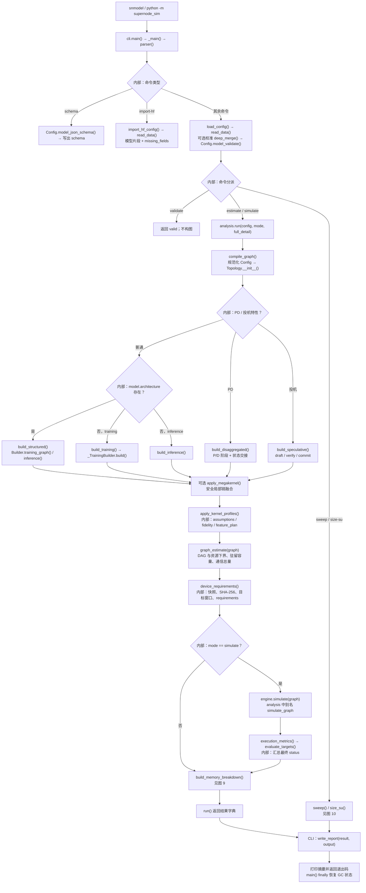

`run()` 是共享计算入口；Python 调用者自行决定是否调用 `write_report()`。simulate 失败也保留诊断与已观察的内存账本；输入/构图异常由 CLI 捕获并返回 `invalid_input`。`validate` 只运行配置层校验。

## 2. 参数预算版训练构图

源码：[`pipeline_schedule()`](../supernode_sim/training.py#L19)、[`_TrainingBuilder.build()`](../supernode_sim/training.py#L521)、[`.phase()`](../supernode_sim/training.py#L267)、[`.optimizer()`](../supernode_sim/training.py#L445)。独立图：[02-training-budget.mmd](diagrams/02-training-budget.mmd)。

```mermaid
flowchart TD
    ENTRY["training.build_training(config, topology)"] --> INIT["_TrainingBuilder.__init__()<br/>内部：rank / stage 映射与 dense / expert 参数预算"]
    INIT --> BUILD["build() → initial_state()<br/>驻留 weights / gradients / master / Adam / runtime"]
    BUILD --> STEP["内部：遍历 training step"]
    STEP --> STAGE["内部：遍历 PP stage<br/>pipeline_schedule(stage, stages, microbatches)"]
    STAGE --> PHASE["phase(step, stage, F或B, micro)<br/>phase_previous() 建立前驱"]
    PHASE --> LAYER["内部：按 F 正序 / B 逆序遍历层"]
    LAYER --> GATHER["按 FSDP / reshard 条件 add_gather()<br/>可选一层前瞻预取"]
    GATHER --> DISPATCH["可选 collective(EP dispatch)<br/>内部：权重精度转换、activation 生命周期"]
    DISPATCH --> CK{"内部：B 且 activation checkpointing？"}
    CK -->|是| RECOMP["kernel(forward=True)<br/>重放 TP / EP 通信"]
    CK -->|否| KERNEL["kernel(..., forward=F)<br/>创建计算与 HBM work 的 Event"]
    RECOMP --> KERNEL
    KERNEL --> COMM["collective(TP attention / MLP all_reduce)<br/>可选 EP combine"]
    COMM --> SYNC{"内部：B 到达梯度同步点？"}
    SYNC -->|是| GRAD["collective()<br/>dense EP AR → FSDP RS → replica DP AR"]
    SYNC -->|否| DONE["barrier(layer done)<br/>释放本层已消费临时分配"]
    GRAD --> DONE
    DONE --> MOREL{"内部：还有层？"}
    MOREL -->|是| LAYER
    MOREL -->|否| PDONE["barrier(phase done)"]
    PDONE --> SEND["有相邻 PP stage 时：<br/>内部可选 pack → Topology.transfer() → 可选 unpack<br/>send.done 供接收方依赖"]
    SEND --> MOREP{"内部：还有 phase / stage？"}
    MOREP -->|是| STAGE
    MOREP -->|否| OPT["optimizer(step)<br/>图 4：Adam 与可选 CPU offload"]
    OPT --> MORES{"内部：还有 step？"}
    MORES -->|是| STEP
    MORES -->|否| RETURN["内部：写 schedule / logical_memory / step_end_events<br/>返回 Graph"]
```

`phase.done` 与 PP `send.done` 是不同标记。发送方后续计算可以只依赖 phase 完成，接收方必须等待 incoming send；因此图中“创建 send 后继续构图”不表示运行时发送阻塞发送方计算。checkpoint 小段画的是运行时依赖：重算 kernel 与 TP/EP 重放完成后才能执行 backward；实际 Python 构图先创建 backward Event，引用稍后才追加的 `recompute.done`。`kernel()` 构造 Event；预算版不支持 Muon。

## 3. 结构化训练构图

源码：[`build_structured()`](../supernode_sim/structured.py#L792)、[`Builder.training_graph()`](../supernode_sim/structured.py#L577)、[`.gather()`](../supernode_sim/structured.py#L192)、[`.recompute_layer()`](../supernode_sim/structured.py#L335)。独立图：[03-training-structured.mmd](diagrams/03-training-structured.mmd)。

```mermaid
flowchart TD
    ENTRY["build_structured() → Builder.__init__()<br/>Topology.populate() + parameter_inventory()"]
    ENTRY --> INIT["training_graph() → initial()<br/>states() / state_dtype() / local_elements()"]
    INIT --> STEP["内部：step → PP stage<br/>pipeline_schedule() → F或B / microbatch"]
    STEP --> LAYER["内部：按阶段方向遍历 stage layers"]
    LAYER --> GATHER["按 FSDP / reshard 条件 gather()<br/>collective(all_gather)"]
    GATHER --> ACT["activation_rows() → component_activations()<br/>内部：B 时建立或复用 gradient buffers"]
    ACT --> CK{"内部：B 且 checkpoint？"}
    CK -->|是| RECOMP["recompute_layer()<br/>kernel() + TP / EP + 临时状态"]
    CK -->|否| ORDER["component_order(layer)<br/>F 正序 / B 逆序遍历组件"]
    RECOMP --> ORDER
    ORDER --> DISPATCH["MoE 时 collective(EP dispatch)"]
    DISPATCH --> KERNEL["逐 rank kernel()<br/>权重转换、FLOPs/HBM、activation/state allocs/releases"]
    KERNEL --> COMM["MoE 时 collective(combine)<br/>attention / FFN 后 collective(TP all_reduce)"]
    COMM --> MOREC{"内部：还有组件？"}
    MOREC -->|是| ORDER
    MOREC -->|否| SYNC{"内部：B 到达梯度同步点？"}
    SYNC -->|是| GRAD["collective()<br/>FSDP RS → replica AR → dense EP AR"]
    SYNC -->|否| DONE["barrier(layer.done)<br/>释放 gather / gradient / recompute 临时项"]
    GRAD --> DONE
    DONE --> MOREL{"内部：还有层？"}
    MOREL -->|是| LAYER
    MOREL -->|否| PHASE["barrier(phase 完成)<br/>释放消费完的 PP receive 等状态"]
    PHASE --> SEND["有下游时 pipeline_transfer()<br/>可选 pack → Topology.transfer() → 可选 unpack<br/>内部：stage_previous 指向发送完成"]
    SEND --> MOREP{"内部：还有 phase / stage？"}
    MOREP -->|是| STEP
    MOREP -->|否| OPT["optimizer(step, stage tails)<br/>见图 4"]
    OPT --> MORES{"内部：还有 step？"}
    MORES -->|是| STEP
    MORES -->|否| ANNOTATE["annotate_collective_allocations()<br/>返回 Graph"]
```

结构化路径没有 FSDP lookahead prefetch；配置阶段会拒绝该开关。其 stage 后继依赖可能等待 PP send，因此与图 2 的异步发送语义有区别。checkpoint 仍产生前向完整临时工作集，只改变保存与重计算策略。

## 4. 训练优化器与 offload

源码：[`_TrainingBuilder.optimizer()`](../supernode_sim/training.py#L445)、[`Builder.optimizer()`](../supernode_sim/structured.py#L720)、[`optimizer_states()`](../supernode_sim/components.py#L262)。独立图：[04-optimizer-offload.mmd](diagrams/04-optimizer-offload.mmd)。

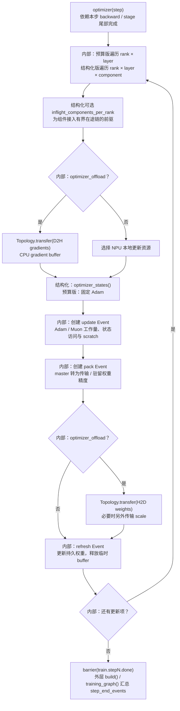

图中的更新项依赖形成事件链；Python 构图循环本身不表示各项运行时完全串行。Muon 正交化是解析工作量与 workspace 近似，当前没有跨 rank 全矩阵组装与 distributed Muon；优化器也不与本步 backward 重叠执行。

## 5. 结构化推理：prefill / decode 与状态生命周期

源码：[`Builder.inference()`](../supernode_sim/structured.py#L386)、[`.kernel()`](../supernode_sim/structured.py#L216)、[`attention_state()`](../supernode_sim/components.py#L410)、[`attnres_state()`](../supernode_sim/components.py#L386)。独立图：[05-inference-structured.mmd](diagrams/05-inference-structured.mmd)。

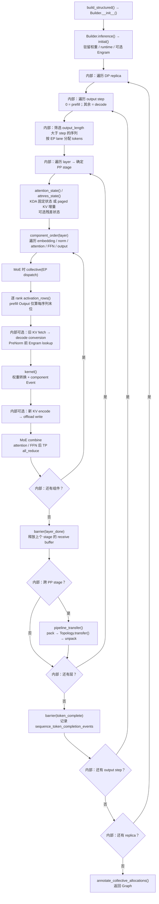

KDA recurrent/conv state 不随上下文线性增长；MLA cache 可用 compressed/expanded 布局。非 KDA 的旧 KV 转换具有显式解码 buffer。各序列完成后停止后续计算和 KV 读取，cache 保留至本次固定批次结束。同一 replica 按 token→layer 构图，不使用训练的 1F1B。

## 6. 参数预算版推理

源码：[`build_inference()`](../supernode_sim/inference.py#L46)、[`kv_layout_bytes()`](../supernode_sim/inference.py#L18)。独立图：[06-inference-budget.mmd](diagrams/06-inference-budget.mmd)。

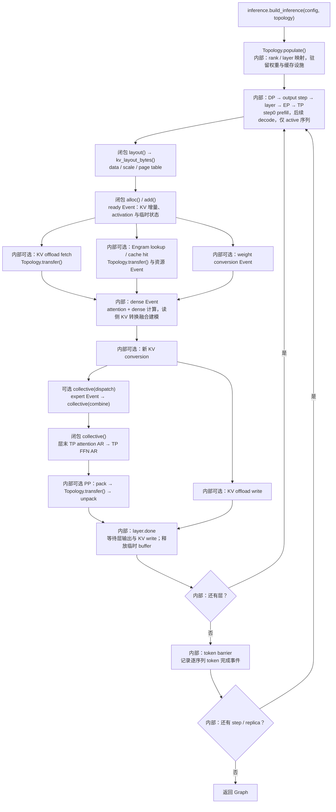

从 ready 发出的可选分支在依赖满足时可重叠执行；关闭时相应节点退化为直通依赖。该路径把读侧 KV 转换融合于 attention，不分配完整旧 KV 解压缓存；两次 TP reduction 都位于层末。两条推理路径的事件粒度和通信顺序有区别。

## 7. Collective 与拓扑路由展开

源码：[`Builder.collective()`](../supernode_sim/structured.py#L102)、[`Topology.collective()`](../supernode_sim/topology.py#L254)、[`.transfer()`](../supernode_sim/topology.py#L206)、[`.path()`](../supernode_sim/topology.py#L163)。独立图：[07-collective-topology.mmd](diagrams/07-collective-topology.mmd)。

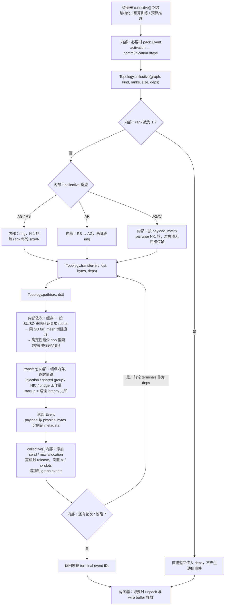

`transfer()` 本身返回资源化的 Event；collective 的 staging buffer/slot 在 `collective()` 内添加，普通点对点 buffer 由对应构图器管理。AG/RS/AR 的 `size` 是每 rank 完整张量大小。所有同轮 transfer 的完成 ID 作为下一轮依赖，图表达的是明确的通信算法，而非一个总字节量常数。

## 8. 离散事件执行器与 max-min 资源共享

源码：[`engine.simulate()`](../supernode_sim/engine.py#L56)、[`max_min_rates()`](../supernode_sim/engine.py#L18)。独立图：[08-event-engine.mmd](diagrams/08-event-engine.mmd)。

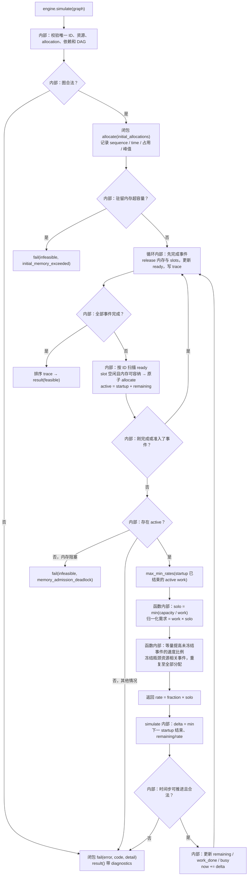

事件启动时原子分配内存并占用 slot，事件结束时执行 release。相同时间点先释放再准入新事件。资源同时服务，计算/访存耗时取 roofline 瓶颈。图中为便于阅读将若干校验错误合并到 `fail(error, ...)`，具体 code 以 diagnostics 为准。

## 9. 内存归因与报告导出

源码：[`build_memory_breakdown()`](../supernode_sim/memory_breakdown.py#L118)、[`write_report()`](../supernode_sim/report.py#L355)、[`_prepare_export()`](../supernode_sim/report.py#L249)。独立图：[09-memory-and-report.mmd](diagrams/09-memory-and-report.mmd)。

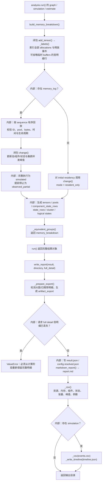

此图按职责组织输出节点；`write_report()` 的具体写文件顺序是 result/Markdown/config → resources/memory → events/timeline → 组件等内存 CSV。明细过滤不改变所有事件参与计算得到的资源总量或并发峰值。不同组件/不同池的独立峰值不允许直接相加。

## 10. 参数扫描与最小 SU 搜索

源码：[`sweep()`](../supernode_sim/search.py#L42)、[`size_su()`](../supernode_sim/search.py#L71)。独立图：[10-sweep-and-su-search.mmd](diagrams/10-sweep-and-su-search.mmd)。

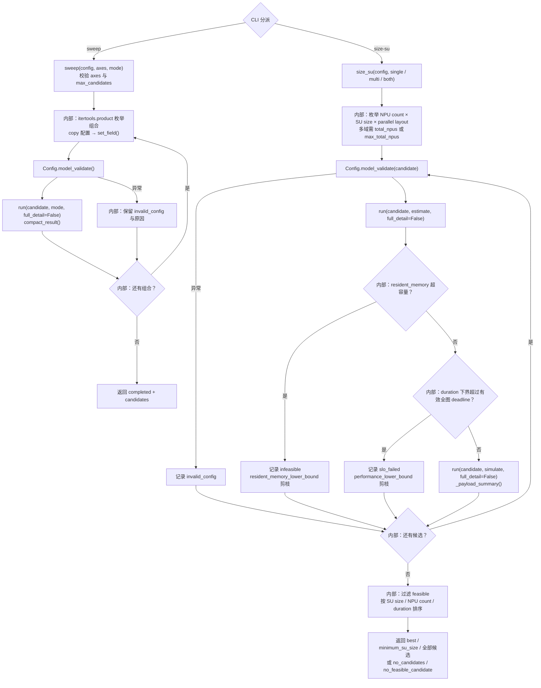

图中合并了 single/multi 两个子搜索的外层循环。无并行候选时保留 TP/PP/EP/FSDP 并推导 DP。只使用必要下界剪枝；忽略争用的乐观内存峰值和全图 TTFT/TPOT deadline 不用于这种剪枝。`run(estimate)` 与 `run(simulate)` 各自构图，当前未共享候选 Graph。

启用 PD 时搜索按双池总卡数校验，保持 DP=PP=1；显式 P/D 映射随候选重新验证，不自动派生新的 DP 或物理放置。

## 11. 大型参考实验检查点与恢复

源码：[`scripts/run_reference_experiment.py`](../scripts/run_reference_experiment.py)、[`fingerprint()`](../scripts/run_reference_experiment.py#L55)、[`load_checkpoint()`](../scripts/run_reference_experiment.py#L64)。独立图：[11-reference-checkpoint.mmd](diagrams/11-reference-checkpoint.mmd)。

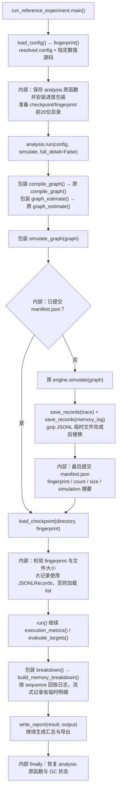

`JSONLRecords.__iter__()` 在迭代结束时核验记录条数。恢复只跳过已完成的数值执行，仍需重建图和回放日志；不支持在数值执行中途恢复 active/ready/remaining 状态。精简 `result.json` 不能替代原始检查点。

## 核对范围

函数名称、关键分支及源文件位置已按本工作区源码核对。流程图按可读性省略字段构造、少量 barrier 和重复 rank 循环，不能用作精确框架执行 trace。此次只生成与静态核对文档，未执行仿真或测试，也未通过 Mermaid 渲染器验证排版。
