# 函数级仿真流程图

配套说明：[超节点仿真架构](simulation-architecture.md)。依据仓库中的 [supernode-modeling skill](../skills/supernode-modeling/SKILL.md) 与当前源码整理，更新日期 2026-11-03。以下 18 张主流程图与图 16 的 3 张案例图覆盖 CLI/Web、训练/推理、请求级服务、拓扑通信、子算子与校准、完整图/流式执行、指标账本、搜索及恢复。

阅读约定：带 `()` 的节点标注源码中的真实函数/方法；标注“内部”的节点表示函数体内逻辑块，不是新函数。实线箭头表示调用顺序或控制流。完整图路径中的循环在 Python 中编译事件图，运行依赖由 `Event.deps` 表达；图 13 的 streaming 在结构屏障处交替构图与数值执行，均不执行真实模型算子。源码链接定位文件，函数/方法名用于检索，以免代码迭代使行号链接失效。

新增图 15–18 分别展开 FCFS 服务调度、子算子/kernel 校准、collective 响应曲线和时延/训练账本。图 7、10、12–14 同步逐流 ECMP、I/O 共享、多进程候选、流式投机与 Web 双输入快照。特性组合见 [features.md](../skills/supernode-modeling/references/features.md)。

Mermaid 代码块可在支持 Mermaid 的 Markdown 预览器中显示；每张图另存为 [`diagrams/`](diagrams/) 下的 `.mmd` 源文件。总体分层图位于架构文档，并提供 [`00-architecture.mmd`](diagrams/00-architecture.mmd)。

快速导航：图 1–6 为入口与模型构图，图 7–9 为通信/执行/导出，图 10–14 为搜索/恢复/流式/Web，图 15–18 为服务/子算子/通信校准/指标账本。

算子级专题：[架构设计 5.5–5.8](simulation-architecture.md#55-算子级架构详图从组件到资源事件) · [执行总流程](#161-从组件事件到系统时延) · [训练反向拆分](#162-案例-a训练-dense-反向拆为六个-gemm) · [推理分阶段绑定](#163-案例-bprefilldecode-按真实负载分别绑定) · [NPUSim 导入](#164-案例-c将-npusim-ca-窗口绑定到一个子算子)。

## 1. CLI 与单次仿真主链

源码：[`cli.main()`](../supernode_sim/cli.py)、[`cli._main()`](../supernode_sim/cli.py)、[`load_config()`](../supernode_sim/config.py)、[`analysis.run()`](../supernode_sim/analysis.py)、[`compile_graph()`](../supernode_sim/analysis.py)。独立图：[01-entry-and-run.mmd](diagrams/01-entry-and-run.mmd)。

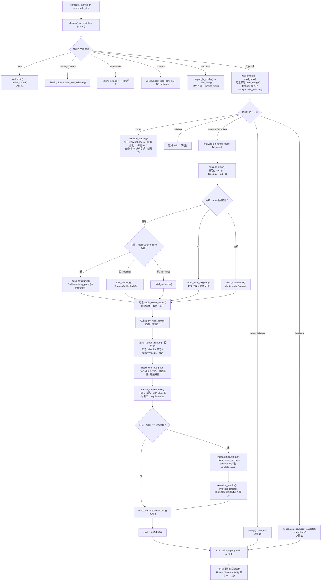

`run()` 是完整构图路径的共享入口，Python API 默认 `full_detail=True`；CLI 的 estimate/simulate 默认传 `False`，可用 `--full-detail` 保留全部详情。精简计算仍执行所有事件：事件数超过 50,000 时，仅省略 trace 行中 `work/allocations/releases` 的副本；allocation 数超过 50,000 时，仅省略临时 `state=buffers` 的宽张量明细行。内存日志、指标、通信总量和精确峰值仍完整计算。这与图 13 的分块 streaming 是两种保留策略。

`run()` 不写文件，调用者决定是否调用 `write_report()`。`serve` 走独立 `simulate_serving()` 和 `write_serving_report()`，每批仍复用 `run(simulate)`；模型 Config 与请求 ServingSpec 分别校验。simulate 失败仍保留诊断与已观察的内存账本；输入/构图异常由 CLI 捕获并返回 `invalid_input`。`validate` 只运行配置层校验。Web CLI 入口保留 HTTP 服务的 GC 策略，worker 自行临时禁用并恢复 GC。

## 2. 参数预算版训练构图

源码：[`pipeline_schedule()`](../supernode_sim/training.py)、[`_TrainingBuilder.build()`](../supernode_sim/training.py)、[`.phase()`](../supernode_sim/training.py)、[`.optimizer()`](../supernode_sim/training.py)。独立图：[02-training-budget.mmd](diagrams/02-training-budget.mmd)。

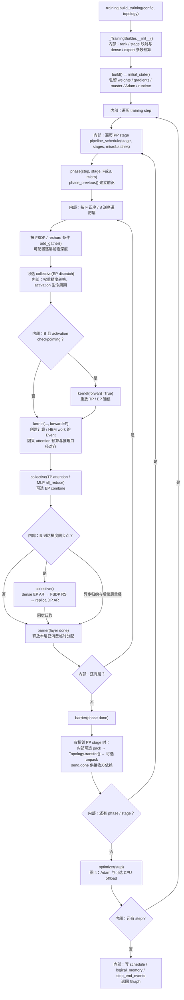

`phase.done` 与 PP `send.done` 是不同标记。发送方后续计算可以只依赖 phase 完成，接收方必须等待 incoming send；因此图中“创建 send 后继续构图”不表示运行时发送阻塞发送方计算。checkpoint 小段画的是运行时依赖：重算 kernel 与 TP/EP 重放完成后才能执行 backward；实际 Python 构图先创建 backward Event，引用稍后才追加的 `recompute.done`。`kernel()` 构造 Event；预算版不支持 Muon。因果 attention 的前/反向 FLOPs 与推理口径对齐；模型 F+B、重算、优化器和辅助工作最终进入图 18 的训练账本。

## 3. 结构化训练构图

源码：[`build_structured()`](../supernode_sim/structured.py)、[`Builder.training_graph()`](../supernode_sim/structured.py)、[`.gather()`](../supernode_sim/structured.py)、[`.recompute_layer()`](../supernode_sim/structured.py)。独立图：[03-training-structured.mmd](diagrams/03-training-structured.mmd)。

```mermaid
flowchart TD
    ENTRY["build_structured() → Builder.__init__()<br/>Topology.populate() + parameter_inventory()"]
    ENTRY --> INIT["training_graph() → initial()<br/>states() / state_dtype() / local_elements()"]
    INIT --> STEP["内部：step → PP stage<br/>pipeline_schedule() → F或B / microbatch"]
    STEP --> LAYER["内部：按阶段方向遍历 stage layers"]
    LAYER --> GATHER["按 FSDP / reshard 条件 gather()<br/>collective(all_gather)"]
    GATHER --> ACT["activation_rows() → component_activations()<br/>内部：B 时建立或复用 gradient buffers"]
    ACT --> CK{"内部：B 且 checkpoint？"}
    CK -->|是| RECOMP["recompute_layer()<br/>kernel() + TP / EP + 临时状态"]
    CK -->|否| ORDER["component_order(layer)<br/>F 正序 / B 逆序遍历组件"]
    RECOMP --> ORDER
    ORDER --> DISPATCH["MoE 时 collective(EP dispatch)"]
    DISPATCH --> KERNEL["逐 rank kernel()<br/>workload_shape、权重转换、FLOPs/HBM<br/>activation/state allocs/releases"]
    KERNEL --> COMM["MoE 时 collective(combine)<br/>attention / FFN 后 collective(TP all_reduce)"]
    COMM --> MOREC{"内部：还有组件？"}
    MOREC -->|是| ORDER
    MOREC -->|否| SYNC{"内部：B 到达梯度同步点？"}
    SYNC -->|是| GRAD["collective()<br/>FSDP RS → replica AR → dense EP AR"]
    SYNC -->|否| DONE["barrier(layer.done)<br/>释放 gather / gradient / recompute 临时项"]
    GRAD -->|同步归约| DONE
    SYNC -->|异步归约与后续层重叠| DONE
    DONE --> MOREL{"内部：还有层？"}
    MOREL -->|是| LAYER
    MOREL -->|否| PHASE["barrier(phase 完成)<br/>释放消费完的 PP receive 等状态"]
    PHASE --> SEND["有下游时 pipeline_transfer()<br/>接收方等待发送完成"]
    PHASE -->|异步发送| MOREP
    SEND --> MOREP{"内部：还有 phase / stage？"}
    MOREP -->|是| STEP
    MOREP -->|否| OPT["optimizer(step, stage tails)<br/>见图 4"]
    OPT --> MORES{"内部：还有 step？"}
    MORES -->|是| STEP
    MORES -->|否| ANNOTATE["annotate_collective_allocations()<br/>返回 Graph"]
```

结构化组件携带 `model_shape_signature` 和 `workload_shape`，训练微批与 phase 用于图 16 的 trace/profile 适用性校验。两条训练路径均支持有界 FSDP 多层预取、异步 PP 发送和层间梯度同步重叠。checkpoint 仍产生前向完整临时工作集，只改变保存与重计算策略。

## 4. 训练优化器与 offload

源码：[`_TrainingBuilder.optimizer()`](../supernode_sim/training.py)、[`Builder.optimizer()`](../supernode_sim/structured.py)、[`optimizer_states()`](../supernode_sim/components.py)。独立图：[04-optimizer-offload.mmd](diagrams/04-optimizer-offload.mmd)。

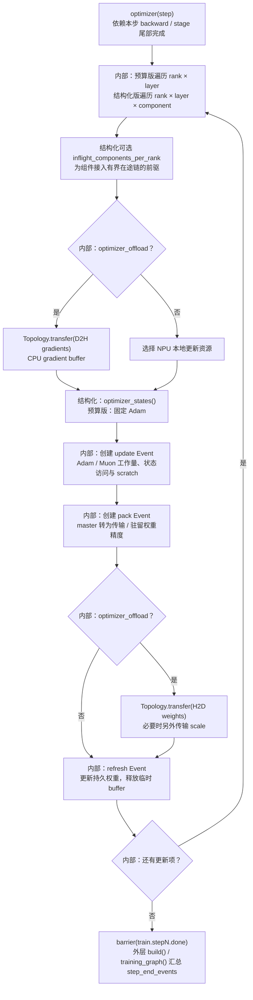

图中的更新项依赖形成事件链；Python 构图循环本身不表示各项运行时完全串行。Muon 正交化是解析工作量与 workspace 近似，当前没有跨 rank 全矩阵组装与 distributed Muon；优化器也不与本步 backward 重叠执行。

## 5. 结构化推理：prefill / decode、SP 与状态生命周期

源码：[`Builder.inference()`](../supernode_sim/structured.py)、[`.kernel()`](../supernode_sim/structured.py)、[`attention_state()`](../supernode_sim/components.py)、[`attnres_state()`](../supernode_sim/components.py)。独立图：[05-inference-structured.mmd](diagrams/05-inference-structured.mmd)。

```mermaid
flowchart TD
    ENTRY["build_structured() → Builder.__init__()"] --> INIT["Builder.inference() → initial()<br/>驻留权重 / runtime / 可选 Engram"]
    INIT --> DP["内部：遍历 DP replica"]
    DP --> TOKEN["内部：遍历 output step<br/>0 = prefill；其余 = decode"]
    TOKEN --> ACTIVE["内部：筛选 output_length 大于 step 的序列<br/>按 EP lane 分配 tokens；SP 计算 padded rows"]
    ACTIVE --> LAYER["内部：遍历 layer → 确定 PP stage"]
    LAYER --> STATE["attention_state() / attnres_state()<br/>KDA 固定状态 或 paged KV 增量<br/>可选残差状态"]
    STATE --> COMPONENT["component_order(layer)<br/>内部可选 streaming component-before hook"]
    COMPONENT --> SP["SP 时 attention / FFN / Output 前<br/>barrier() 分配 padded input → collective(all_gather)"]
    SP --> DISPATCH["MoE 时 collective(EP dispatch)"]
    DISPATCH --> ACT["逐 rank activation_rows()<br/>norm / AttnRes 用 SP 局部 rows<br/>prefill Output 仅算每序列末位"]
    ACT --> READ["内部可选：旧 KV fetch → decode conversion<br/>PreNorm 前 Engram lookup"]
    READ --> KERNEL["kernel()<br/>权重转换 + component Event"]
    KERNEL --> WRITE["内部可选：新 KV encode → offload write"]
    WRITE --> COMM["MoE 时 collective(combine)<br/>attention / FFN 后 TP AR；SP 时改为 RS<br/>SP WordEmbedding 后也执行 RS"]
    COMM --> RELEASE["barrier() 释放 SP gather buffer<br/>内部可选 streaming component-after hook"]
    RELEASE --> MOREC{"内部：还有组件？"}
    MOREC -->|是| COMPONENT
    MOREC -->|否| DONE["barrier(layer_done)<br/>释放上个 stage 的 receive buffer"]
    DONE --> PP{"内部：跨 PP stage？"}
    PP -->|是| SEND["pipeline_transfer()<br/>pack → Topology.transfer() → unpack"]
    PP -->|否| MOREL{"内部：还有层？"}
    SEND --> MOREL
    MOREL -->|是| LAYER
    MOREL -->|否| COMPLETE["barrier(token_complete)<br/>记录 sequence_token_completion_events"]
    COMPLETE --> MORET{"内部：还有 output step？"}
    MORET -->|是| TOKEN
    MORET -->|否| MORED{"内部：还有 replica？"}
    MORED -->|是| DP
    MORED -->|否| RETURN["build_structured() 调用<br/>annotate_collective_allocations() → 返回 Graph"]
```

SP 共用 TP ranks，度数为 TP，不能额外乘入设备数；配置只接受结构化推理、TP > 1、PP = 1。SP 显式计入 padding、all-gather 输入与 reduce-scatter 输出；无 SP 时保持 TP all-reduce。图中 hooks 是 `run_streaming()` 安装的回调；普通完整构图不安装这些 hooks。状态分配后也有可选的 streaming state hook（见图 13）。

KDA recurrent/conv state 不随上下文线性增长；MLA cache 可用 compressed/expanded 布局。非 KDA 的旧 KV 转换具有显式解码 buffer。各序列完成后停止后续计算和 KV 读取，cache 保留至本次固定批次结束。同一 replica 按 token→layer 构图，不使用训练的 1F1B。

## 6. 参数预算版推理

源码：[`build_inference()`](../supernode_sim/inference.py)、[`kv_layout_bytes()`](../supernode_sim/inference.py)。独立图：[06-inference-budget.mmd](diagrams/06-inference-budget.mmd)。

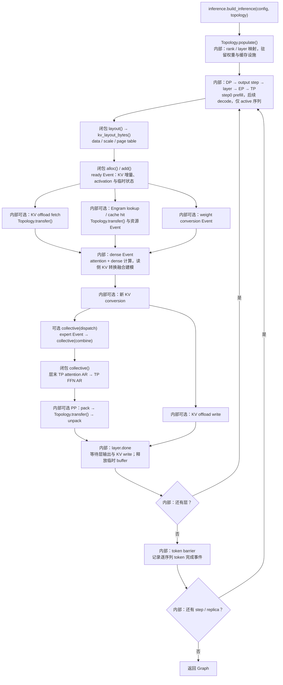

从 ready 发出的可选分支在依赖满足时可重叠执行；关闭时相应节点退化为直通依赖。该路径把读侧 KV 转换融合于 attention，不分配完整旧 KV 解压缓存；两次 TP reduction 都位于层末。两条推理路径的事件粒度和通信顺序有区别。

## 7. Collective 与拓扑路由展开

源码：[`Builder.collective()`](../supernode_sim/structured.py)、[`Topology.collective()`](../supernode_sim/topology.py)、[`.transfer()`](../supernode_sim/topology.py)、[`.path()`](../supernode_sim/topology.py)。独立图：[07-collective-topology.mmd](diagrams/07-collective-topology.mmd)。

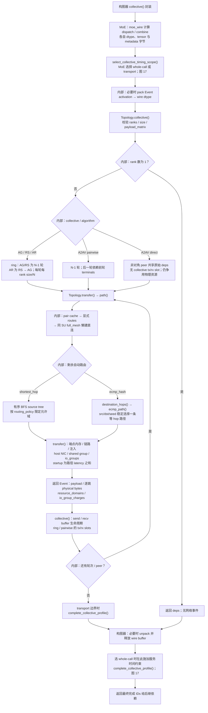

`Topology.path()` 对静态拓扑的 pair route cache 使用 16 MiB / 65,536 项预算；每种路由模式（不限域、SU、SO）的 BFS source-tree 和 ECMP destination-distance 缓存分别使用 16 MiB / 128 项预算。显式 routes 优先；`ecmp_hash` 仅按物理 src/dst/seed 稳定选一条等 hop 路径，不随拥塞改路或逐包分流。超预算项仍服务本次查询但不保留。full_mesh 的 pair cache 使用普通字典，以保留懒建链路后已有 pair 的历史路由；缓存预算不等同于拓扑总内存上限。零字节 transfer 不查询路径。

`transfer()` 本身返回资源化的 Event；collective 的 staging buffer/slot 在 `collective()` 内添加，普通点对点 buffer 由对应构图器管理。AG/RS/AR 的 `size` 是每 rank 完整张量大小。ring / pairwise 中所有同轮 transfer 的完成 ID 作为下一轮依赖；A2AV direct 让各 peer 共享原始 deps，省去 tx/rx slot 串行约束，但仍消耗真实链路、NIC/HBM 和临时 buffer。图表达具体通信算法，而非总字节量常数。

`io_groups` 根据物理成员和实际 SO/H2D/D2H 路径计入共享 NIC/PCIe 争用；`host_injection_Bps` 单独表达每主机每方向聚合能力。MoE dispatch/combine 的 wire 精度与 metadata 字节分别输入；所选 whole-call/transport 校准边界见图 17。

## 8. 离散事件执行器与 max-min 资源共享

源码：[`engine.simulate()`](../supernode_sim/engine.py)、[`max_min_rates()`](../supernode_sim/engine.py)。独立图：[08-event-engine.mmd](diagrams/08-event-engine.mmd)。

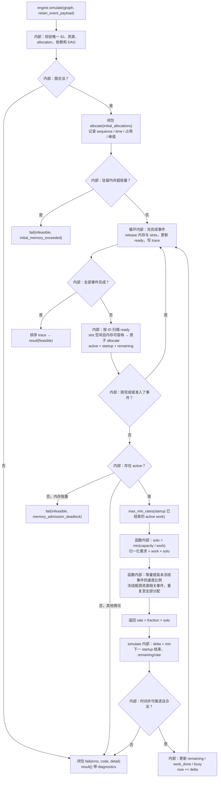

`retain_event_payload=False` 仅省略 trace 行的 work/allocations/releases 副本，仍保留每个已完成事件的 ID、时间、metadata、slots，以及完整 memory_log；它不改变调度、内存准入与数值结果，也不将完整图执行变成 streaming。

事件启动时原子分配内存并占用 slot，事件结束时执行 release。相同时间点先释放再准入新事件。资源同时服务，计算/访存耗时取 roofline 瓶颈。图中为便于阅读将若干校验错误合并到 `fail(error, ...)`，具体 code 以 diagnostics 为准。

## 9. 内存归因与报告导出

源码：[`build_memory_breakdown()`](../supernode_sim/memory_breakdown.py)、[`write_report()`](../supernode_sim/report.py)、[`_prepare_export()`](../supernode_sim/report.py)、`_write_event_artifacts()`、`_write_result_json()`。独立图：[09-memory-and-report.mmd](diagrams/09-memory-and-report.mmd)。

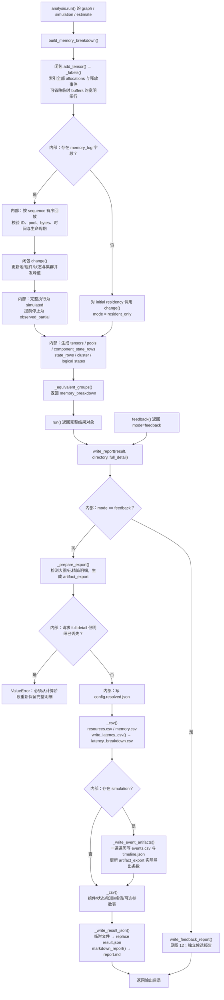

`write_latency_csv()` 将普通及搜索结果的时延拆解按候选与指标导出，训练或不可用指标保留空值；图 18 给出指标来源。服务报告使用图 15 的独立输出函数。

`write_report()` 的标准输入是仍持有可迭代 trace 与张量列表的 `run()` 结果；已写出且引用过滤产物的 `result.json` 不能直接重新导出。checkpoint 的 `JSONLRecords` 可流式导出；`run_streaming()` 的紧凑结果不是该接口的完整输入。

自动导出阈值为 50,000 行，比较 trace、原始 tensor、memory_log 的最大条数。大表在非 full 模式下保留模型 kernel、token/step marker、保留模型张量的分配事件，省略临时 buffer 张量行与原始内存日志；保留张量表仍超过 50,000 行时使用 `tensors.csv.gz`。事件 CSV 与 Perfetto timeline 共用一遍遍历，计数后再写 `result.json`，对 JSON 使用临时文件替换；这不是整个输出目录的原子事务。

过滤只修改浅层导出视图，不改 API 所有的数组及完整计算得到的指标、通信/资源总量与并发峰值。完整详情要求计算阶段保留事件 payload 和全部张量行。不同组件/不同池的独立峰值不允许直接相加。feedback 使用独立格式，且无胜者时删除旧 `best.config.json`。

## 10. 参数扫描与最小 SU 搜索

源码：[`sweep()`](../supernode_sim/search.py)、[`size_su()`](../supernode_sim/search.py)。独立图：[10-sweep-and-su-search.mmd](diagrams/10-sweep-and-su-search.mmd)。

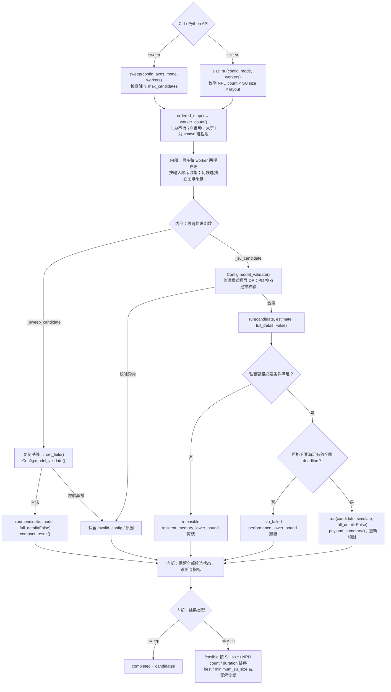

图中合并了 single/multi 两个子搜索的外层循环。`workers=1` 默认串行；`workers=0` 自动选择最多 4 个进程；其他值受候选数和平台限制。`ordered_map()` 使用 spawn 进程池、最多每 worker 两项在途任务，并保持候选顺序和失败诊断。并发只改变宿主机执行方式，各 worker 独立持有图和缓存。无并行候选时保留 TP/PP/EP/FSDP 并推导 DP。只使用必要下界剪枝；忽略争用的乐观内存峰值和全图 TTFT/TPOT deadline 不用于这种剪枝。`run(estimate)` 与 `run(simulate)` 各自构图，当前未共享候选 Graph。

启用 PD 时搜索按双池总卡数校验，保持 DP=PP=1；显式 P/D 映射随候选重新验证，不自动派生新的 DP 或物理放置。

## 11. 大型参考实验检查点与恢复

源码：[`scripts/run_reference_experiment.py`](../scripts/run_reference_experiment.py)、[`fingerprint()`](../scripts/run_reference_experiment.py)、[`load_checkpoint()`](../scripts/run_reference_experiment.py)。独立图：[11-reference-checkpoint.mmd](diagrams/11-reference-checkpoint.mmd)。

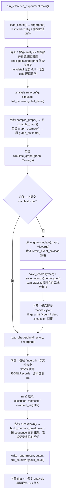

`fingerprint()` 覆盖已解析配置与指定数值源码，包括 feature/特殊构图器、operator_trace、kernel_workload、training_accounting 和 cache。当前列表未包含 routing、moe_wire、collective_calibration；更改这些模块时应在新输出目录重跑，不能仅凭现有指纹认定旧结果匹配。加载时核验 fingerprint 和文件大小；trace、allocation、memory_log 任一数量超过 50,000 时使用 `JSONLRecords`，其 `__iter__()` 在迭代结束时核验记录条数。`--full-detail` 使用独立 `-full` 目录，避免从精简 checkpoint 恢复已经省略的 payload。

检查点在一次数值调用返回后提交，也可以保留 infeasible/error 结果。恢复只跳过已完成的数值调用，仍需重建图、计算下界与指标并回放日志；不支持在数值执行中途恢复 active/ready/remaining 状态。精简 `result.json` 不能替代原始检查点；JSONL 流式读取也不同于图 13 的分块数值执行。

## 12. Feedback：固定模型与硬件的联合推理搜索

源码：[`feedback.py`](../supernode_sim/feedback.py)（`FeedbackSpec`、`feedback()`、`_layouts()`、`_candidate_config()`、`_decode_metrics()`、`_rank()`、`_frontier()`）。独立图：[12-feedback-search.mmd](diagrams/12-feedback-search.mmd)。

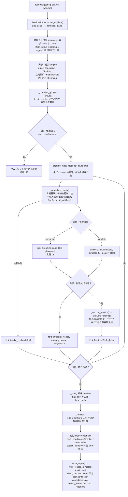

模型、硬件/拓扑、PP/DP/FSDP、rank order、精度与 features 固定，只搜索 TP、EP、SP、prefill 长度与固定批次。默认长度/批次网格是“不超过基线端点的 2 的幂 + 端点”，并非所有整数。TP/EP 默认由设备槽位与专家整除关系推导；显式不合法轴仍保留为 `invalid_config`。SP 共用 TP ranks。

`_feedback_candidate()` 经 `ordered_map()` 串行或多进程评估，结果按候选输入顺序归集。Feedback 的 `auto` / 显式 streaming 入口仍排除投机、megakernel 和 PD；投机虽然已由 `run_streaming()` 独立 API 支持，反馈搜索仍使用普通 simulate。

每个候选完整联合执行 prefill 与 decode，不使用 estimate 下界剪枝、分离阶段择优或 chunked prefill。decode throughput = 全部请求首 token 之后的输出 token 总数 /（最晚末 token − 最早首 token）；DP/PP > 1 时该窗口可能与其他请求 prefill 重叠。TTFT 取各请求首 token 时延的最大值，TPOT 取各请求平均输出间隔的最大值；output_length=2 只测一个 decode 间隔。除两项延迟目标外，已有 throughput 目标也必须通过。

最优项先最大化 decode throughput，同分依次偏向更长输入、更大批次、更小 TTFT/TPOT、较小 TP/EP/SP。frontier 同时最大化长度、批次、decode throughput；同一 layout 的最大长度与最大批次可能来自不同候选，实际 `best` 才是联合验证配置。出现 `error` 候选时整体 `status=error`、`search_complete=False`，即使已有 best 也不宣称搜索完成。

## 13. Streaming：结构屏障分块、精确准入与缓存

源码：[`streaming.py`](../supernode_sim/streaming.py)（`run_streaming()` 及其闭包）、[`cache.py`](../supernode_sim/cache.py)（`BoundedCache`、`_size_bytes()`）、[`engine.py`](../supernode_sim/engine.py)（`simulate()`）。独立图：[13-streaming-execution.mmd](diagrams/13-streaming-execution.mmd)。

```mermaid
flowchart TD
    ENTRY["run_streaming(config, phase, progress, cache)"] --> CHECK["内部：structured inference 且 DP=PP=1<br/>phase 为 all / prefill / decode<br/>明确拒绝 megakernel 与 PD"]
    CHECK --> BUILDER["Builder.__init__() + Topology.__init__()<br/>默认 timing cache = BoundedCache()"]
    BUILDER --> SPEC{"内部：投机模式？"}
    SPEC -->|是| CONFIGURE["configure_speculative(builder)<br/>原生 draft / verify / commit hooks<br/>关闭初始驻留缓存，保留快照 / 回滚"]
    CONFIGURE --> HOOKS
    SPEC -->|否| HOOKS["内部：安装 cached_initial() 与 state/component hooks<br/>graph.events 替换为 _EventSink"]
    HOOKS --> COMPILE["Builder.inference() → initial()<br/>普通且无 Engram 时可复用初始驻留缓存<br/>按现有 token → layer → component 生成事件"]
    COMPILE --> DECODE{"内部：standalone decode 且 step=0？"}
    DECODE -->|是| SEED["skip_prefill_kernel() / skip_prefill_collective()<br/>accept_event() 仅记录永久 KV/KDA 等状态"]
    SEED --> COMPILE
    DECODE -->|否| MACRO["before_component() → macro_key()<br/>尝试本 token 内同形组件宏重放"]
    MACRO --> ACCEPT["accept_event()<br/>state_hook() / after_component() 及 layer/token 屏障<br/>触发 flush()"]
    ACCEPT --> FLUSH["flush()<br/>验证跨块依赖均为已完成屏障<br/>带存活分配建立 chunk<br/>apply_kernel_traces() → apply_kernel_profiles()"]
    FLUSH --> KEY["内部：规范化层前缀构造 timing key<br/>保留容量/work、依赖、slot、dtype、alloc/release<br/>trace / profile 的形状与环境约束不被缓存绕过"]
    KEY --> HIT{"内部：已有 template 或宏？"}
    HIT -->|否且可缓存| TEMPLATE["simulate(unconstrained, retain_event_payload=False)<br/>记录 duration / work / peak与final delta"]
    HIT -->|是| FIT{"内部：当前驻留 + template peak delta<br/>满足所有真实 pool capacity？"}
    TEMPLATE --> FIT
    HIT -->|否且不缓存| SIM["simulate(chunk, retain_event_payload=False)<br/>完整 slot / memory admission"]
    FIT -->|否| SIM
    FIT -->|是| REPLAY["内部：复用时间与资源结果<br/>按当前驻留恢复真实 peak / final / 分类"]
    SIM --> MERGE["内部：累计 duration / work / busy / peaks / phase / chunks<br/>可选 progress 回调"]
    REPLAY --> MERGE
    MERGE --> STATUS{"内部：chunk feasible？"}
    STATUS -->|否| STOP["内部：以 _Stop 结束构图<br/>失败保留诊断；prefill 到目标后正常停止"]
    STATUS -->|是| CARRY["内部：累计本块通信；按 releases 更新 named 存活项<br/>永久状态按 pool/category/dtype 合并<br/>满足条件时保存组件宏"]
    CARRY --> TOKEN{"内部：token complete？"}
    TOKEN -->|是| MARK["内部：按实际提交 token 记录 marker<br/>保存窗口时延拆解，清理宏与旧屏障"]
    TOKEN -->|否| CONT["内部：清空 sink，继续构图"]
    MARK --> PREFILL{"内部：phase=prefill 且 token0 完成？"}
    PREFILL -->|是| STOP
    PREFILL -->|否| CONT
    CONT --> COMPILE
    STOP --> CLEAN["内部 finally：移除 hooks 与闭包引用，清空 sink"]
    COMPILE -->|正常结束| CLEAN
    CLEAN --> METRIC["可行且有 token 标记时派生指标<br/>all 用 execution_metrics()；prefill 仅 TTFT<br/>decode 仅 TPOT；失败 TTFT/TPOT=null"]
    METRIC --> OUT["返回紧凑数值结果<br/>simulation / phase_metrics / chunks / 时延拆解<br/>operator_trace / kernel 与 collective 校准覆盖"]
```

投机模式先通过 `configure_speculative()` 安装与完整图共用的 draft/verify/commit hooks，保留状态快照、回滚和按实际提交 token 的完成标记，并关闭初始驻留缓存；标量 draft profile 必须覆盖最大 local batch，各 rank 均计费。该 API 仍拒绝 megakernel 和 PD。

分块使用既有 state/component/layer/token 屏障，保留原 kernel、collective、placement、slot 竞争与内存准入；跨块不能引用尚未完成的依赖。永久分配按 pool/category/dtype 折叠，仍保持各池容量约束；临时存活分配按 ID 跨块携带。时序模板只在当前驻留加峰值增量适配真实容量时复用，否则回退正常准入调度；无约束模板本身不是可行性结论。组件宏仅在没有新存活项且未释放已有 named 项时保存，每个 token 后清理。

默认初始驻留与 timing 模板共用 LRU，预算为 64 MiB / 256 项；超大项跳过保留。调用者可传 `BoundedCache` 跨实验共用预算，普通 dict 则延续无界行为。`_size_bytes()` 按 Python 对象估算条目占用并计入 LRU 额外额度，并非进程 RSS 上限；宏、拓扑、当前 chunk、metadata 和摘要另有占用。

`phase=all` 完整执行 prefill+decode，也是 feedback 使用的唯一 streaming 模式。`phase=prefill` 在首 token 屏障后结束；`phase=decode` 直接播种 prefill 完成后留下的永久 KV/KDA 等状态，跳过 prefill 执行与瞬时内存，要求至少两个输出 token，TTFT 为 null。暖缓存 decode 可用于 prefill 不可行时的独立实验，不能证明联合请求可行。

chunk 失败会保留已观察 duration/work/peak、该 chunk 摘要和诊断并停止；失败 chunk 通信不并入成功执行的 phase 汇总，`memory_final_bytes` 保留最后成功 chunk 的值。progress 回调异常向外传播，finally 仍拆除引用环。返回值含 phase/chunk、时延拆解及 operator/kernel/collective 覆盖；普通与投机路径的 execution_mode 分别为 structured_layer_streaming / speculative_layer_streaming。返回值没有逐事件 trace/张量生命周期，不是完整 `run()` 或标准 `write_report()` 输入。

## 14. Skill 前端入口、Web 作业与隔离 worker

源码：[`launch_frontend.py`](../skills/supernode-modeling/scripts/launch_frontend.py)（`launch()`）、[`web.py`](../supernode_sim/web.py)（`create_server()`、`WebHandler._route()`、`validate_config()`、`JobManager`）、[`web_worker.py`](../supernode_sim/web_worker.py)（`main()`、`compact_result()`）。独立图：[14-web-worker.mmd](diagrams/14-web-worker.mmd)。

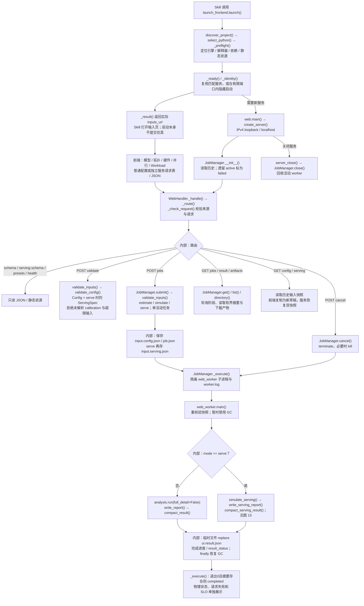

launcher 只负责定位、检查、复用/启动并返回地址，不打开浏览器、不启动仿真；Skill 打开返回的 `inputs_url`（`#inputs`）后，用户可修改输入再校验/提交。历史配置复制为当前编辑副本；serve 从 input.config.json 与 input.serving.json 恢复双快照，提交时统一经过 validate_inputs() 校验。

HTTP 层检查 Host 与修改请求来源，JSON 请求体上限 2 MiB，输入必须已解析，不能通过 calibration 路径让服务端读取文件。Web 提供 estimate/simulate/serve 作业；服务请求表、成批参数和 SLO 使用独立 ServingSpec，网页请求数上限 10,000。feedback/独立 streaming 使用 CLI 或 Python API。

`completed` 表示 worker 已完成报告和 UI 摘要；普通结果的物理不可行或 SLO 不满足通过独立 `result_status` 呈现；服务结果另外区分 completed_with_failures 和 goodput/SLO，任务完成不表示所有请求成功。UI 最多展示 240 个 memory pools、160 个 resources、均匀采样的 300 个 events，解释 metadata 也有上限；报告保留完整数值汇总，下载明细仍遵循图 9 的默认 compact 规则。服务重启不会恢复正在执行的作业。

## 15. 请求级服务：FCFS 成批与隔离实例

源码：[`simulate_serving()`](../supernode_sim/serving.py)、`_execute_batch()`、`_validated_execution()`、[`write_serving_report()`](../supernode_sim/serving_report.py)、`token_trace()`。独立图：[15-serving-scheduler.mmd](diagrams/15-serving-scheduler.mmd)。

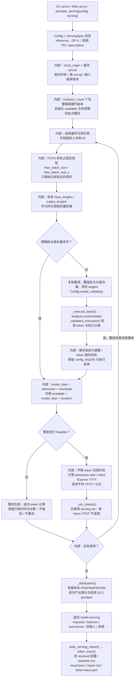

模型场景与服务负载分别输入，不把 requests 或调度字段塞入 Config。每批清空原 targets，使用 serving.slo；总硬件为 instance_count × 每实例硬件，实例间无共享资源争用。增加实例不代表同资源加速。

调度和指标使用相对 clock_origin_s 的时钟，绝对时间仅供展示。client TTFT = admission wait + scheduler overhead + 模型 TTFT；server TTFT 包含 overhead。单 token 的 TPOT 为 null。等待分位数包含失败请求，其他延迟分位数仅包含成功且指标可定义的请求；请求平均 TPOT 的 P99 不等于 pooled token ITL 的 P99。吞吐窗口从最早 arrival 至最后批次结束，包含空闲、等待、overhead 与失败尝试，分子只计成功请求/tokens。

该模型是 FCFS 非抢占固定成批：实例整批结束后再接纳下一批，没有 continuous batching、token budget、动态 KV 抢占、异构 PD 队列或投机请求调度。有限样本 P99 仅对声明输入与策略成立。输出保留双 resolved 配置、requests.csv 和模拟 token trace；全失败且零时长时 token trace 为 null，不伪造窗口。完整契约见 [serving.md](../skills/supernode-modeling/references/serving.md)。

## 16. 子算子展开、融合与 kernel 校准

源码：[`apply_kernel_traces()`](../supernode_sim/operator_trace.py)、[`kernel_workload.py`](../supernode_sim/kernel_workload.py)、[`apply_megakernel()`](../supernode_sim/megakernel.py)、[`apply_kernel_profiles()`](../supernode_sim/calibration.py)。独立图：[16-operator-and-kernel-calibration.mmd](diagrams/16-operator-and-kernel-calibration.mmd)。

### 16.1 从组件事件到系统时延

这里的“算子执行”是对声明的工作量做离散事件仿真。构图器先生成组件，trace 再将有依据的组件展开为子算子；profile 提供其中某些事件的独占服务时间。CPU/NPU 不执行实际矩阵乘，真实计算与通信的先后和重叠由图中依赖、资源和内存准入决定。详细资源公式见 [架构 5.7](simulation-architecture.md#57-一个算子如何变成耗时流量与峰值)。

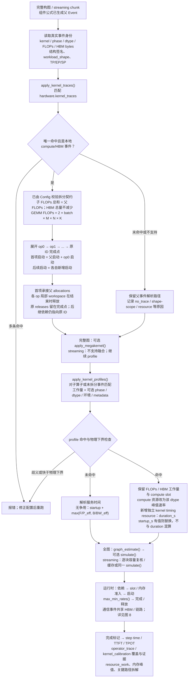

先按精确原工作量与结构/负载匹配 trace，再展开子算子，之后才融合和校准。原事件 ID 作为最后完成点，后继仍等待它；原 allocation 从首子算子开始并保守保留到原释放点，workspace 仅在对应子算子内存活。当前 trace 是串行描述，不能表达任意算子内部并行 DAG 或跨子算子的中间张量生命周期。

子算子新增启动/访存可能增加耗时；trace 不代表已校准，父组件 profile 不自动下传。kernel duration_s 不包含 startup_s，后者显式给出时替换完整事件启动值；模糊匹配或快于物理下界会报错。存在同工作量的 guarded 条目但环境不符时，不通过 legacy profile 绕过约束。

完整图和 streaming 共享展开/校准器，streaming 不支持 megakernel。operator_trace 覆盖率以父组件事件计，kernel_calibration 以实际 kernel 事件计，两者不能相加。阶段、M/N/K、workload_shape 和版本条件应按真实来源填写，synthetic 示例只验证接口。详见 [operator-traces.md](../skills/supernode-modeling/references/operator-traces.md)。

### 16.2 案例 A：训练 Dense 反向拆为六个 GEMM

这个案例解释“一个父组件怎样被替换、后继为什么仍然正确、细化增加的成本怎样入账”。输入来自 [synthetic-training.yaml](../examples/features/synthetic-training.yaml)，拆分列表来自 [operator-trace.synthetic.json](../skills/supernode-modeling/assets/operator-trace.synthetic.json)，绑定工具为 [build_operator_trace.py](../skills/supernode-modeling/scripts/build_operator_trace.py)。

场景为单卡、单层、batch=1、序列长度 8、hidden=16、Dense intermediate=32、BF16；activation checkpointing 与 CPU Adam offload 保持开启。该列表仅拆分 Dense backward 的 GEMM 预算，非线性反向没有新增计算，不能当作完整真实 autograd。以下工作量都是明确的 synthetic 模型输入。

独立图：[16a-training-dense-trace.mmd](diagrams/16a-training-dense-trace.mmd)。上半部分为离线绑定与构图，下半部分为运行时 `Event.deps`；虚线表示描述或生成关系。

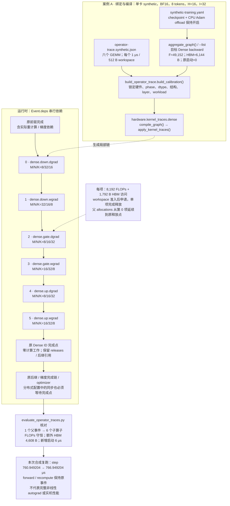

绑定目标是 `train.s0.p0.backward.m0.l0.npu0.Dense`，原工作量 49,152 FLOPs、6,144 B HBM 访问、启动 0。各 GEMM 均满足 `2 × M × N × K = 8,192`：

| 顺序 | 子算子 | M / N / K | HBM 访问 | 新增启动 / 局部 workspace |
|---|---|---|---|---|
| 0 | `dense.down.dgrad` | 8 / 32 / 16 | 1,792 B | 1 μs / 512 B |
| 1 | `dense.down.wgrad` | 32 / 16 / 8 | 1,792 B | 1 μs / 512 B |
| 2 | `dense.gate.dgrad` | 8 / 16 / 32 | 1,792 B | 1 μs / 512 B |
| 3 | `dense.gate.wgrad` | 16 / 32 / 8 | 1,792 B | 1 μs / 512 B |
| 4 | `dense.up.dgrad` | 8 / 16 / 32 | 1,792 B | 1 μs / 512 B |
| 5 | `dense.up.wgrad` | 16 / 32 / 8 | 1,792 B | 1 μs / 512 B |

六项合计仍为 49,152 FLOPs，HBM 访问变为 10,752 B，比父组件增加 4,608 B。512 B workspace 在每个子算子完成时释放；这是 6 次局部分配，不能将 3,072 B 直接加到同一时刻的峰值。父 allocations 从第 0 项开始，原 releases 仍在完成点执行，原后继始终引用父 ID，因此梯度依赖、同步与更新不会被提前放行。

从仓库根目录先检查实际目标，再生成可合并的 trace 片段：

```powershell
python skills/supernode-modeling/scripts/build_operator_trace.py examples/features/synthetic-training.yaml --list --kernel dense --phase backward
python skills/supernode-modeling/scripts/build_operator_trace.py examples/features/synthetic-training.yaml --event-id train.s0.p0.backward.m0.l0.npu0.Dense --operators skills/supernode-modeling/assets/operator-trace.synthetic.json -o outputs/operator-traces/training.calibration.json
```

`training.calibration.json` 是校准片段，不能直接作为完整场景运行。下面的脚本自动完成训练和推理两组场景的绑定、配置合并与前后仿真，省去手工拼配置：

```powershell
python skills/supernode-modeling/scripts/evaluate_operator_traces.py --output outputs/operator-traces
python -m supernode_sim validate outputs/operator-traces/training.operators.config.json
python -m supernode_sim simulate outputs/operator-traces/training.operators.config.json -o outputs/operator-traces/training-report
```

2026-11-03 复跑：仅 1 个 backward 父事件展开为 6 个子算子；forward/recompute 保持原模型。训练 step 从 **760.949204 μs → 766.949204 μs**，新增 6 μs 与声明的启动成本一致；本例计算仍是该局部链瓶颈。整个场景的 BF16 compute 资源工作量均为 197,632 FLOPs，HBM 访问从 64,384 B → 68,992 B；该 compute 项不含另列的 FP32 辅助工作与 CPU optimizer。时间增加是成本被显式计入，不能解读为实机变慢或预测误差提高/降低。

### 16.3 案例 B：prefill/decode 按真实负载分别绑定

同一 [evaluate_operator_traces.py](../skills/supernode-modeling/scripts/evaluate_operator_traces.py) 将基线转换为单卡固定推理 batch=1、输入长度 8、输出长度 3，并关闭 checkpoint / optimizer offload。每轮 Dense 展开为 `up → gate → down`，前后仍是原来的 Attention、KV 访问/转换及 token 完成依赖。

独立图：[16b-inference-operator-trace.mmd](diagrams/16b-inference-operator-trace.mmd)。顶部实线表示推理轮次，虚线表示各轮分别生成选择器；完整图与 streaming 是两个独立运行的比较分支。

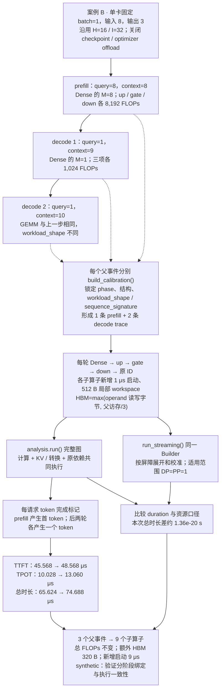

| 轮次 | query / context / 已有 KV tokens | up、gate 的 M/N/K；down 的 M/N/K | 父 FLOPs → 三项 FLOPs | 父 HBM → 子项 HBM 总和 |
|---|---|---|---|---|
| Prefill，产生第 1 个 token | 8 / 8 / 0 | 8/32/16；8/16/32 | 24,576 → 3 × 8,192 | 5,120 → 5,376 B |
| Decode 1，产生第 2 个 token | 1 / 9 / 8 | 1/32/16；1/16/32 | 3,072 → 3 × 1,024 | 3,328 → 3,360 B |
| Decode 2，产生第 3 个 token | 1 / 10 / 9 | 1/32/16；1/16/32 | 3,072 → 3 × 1,024 | 3,328 → 3,360 B |

脚本按 `max((M×K + K×N + M×N)×2, 父HBM/3)` 为每个 BF16 GEMM 声明 HBM 访问，另加 1 μs 启动和 512 B workspace；这是可复现的访问代理，不是实测 HBM transaction。两个 decode 的 GEMM 工作量相同，但 context/KV 和 sequence_signature 不同，因此分别绑定两条 trace，不以相同 FLOPs 推断整个运行形状一致。

沿用案例 A 的复现命令，或独立导出推理标准报告：

```powershell
python -m supernode_sim validate outputs/operator-traces/inference.operators.config.json
python -m supernode_sim simulate outputs/operator-traces/inference.operators.config.json -o outputs/operator-traces/inference-report
```

2026-11-03 复跑，1 个 prefill 和 2 个 decode 父事件共生成 9 个子算子；整个推理 compute 工作量保持 55,232 FLOPs，HBM 访问 27,824 B → 28,144 B，新增启动共 9 μs：

| 指标 | 父组件基线 | 子算子展开后 |
|---|---|---|
| TTFT | 45.568 μs | 48.568 μs |
| TPOT，即第 1 个 token 后两个间隔的平均值 | 10.028 μs | 13.060 μs |
| 完整执行时长 | 65.624 μs | 74.688 μs |

额外 0.064 μs 超过新增的 9 μs 启动，来自本例访存约束变化；prefill 局部 Dense 仍偏计算瓶颈，decode 的小 GEMM 更容易被访存限制。输出长度 3 对应 1 次 prefill 和 2 次 decode，不能当作 3 次 decode。适用的 `run_streaming()` 与完整图总时长差为约 `1.36e-20 s`，属于浮点误差；对比记录保存在 `comparison.json` 与 `inference.streaming.result.json`。这一例验证阶段绑定和执行一致性，没有请求到达队列或硬件实测准确率含义。

### 16.4 案例 C：将 NPUSim CA 窗口绑定到一个子算子

本例在已展开的六 GEMM 训练链中，仅为 `dense.down.dgrad` 导入一个 synthetic 服务窗口。输入位于 [examples/npu_sim/](../examples/npu_sim/)，解析和绑定逻辑位于 [npu_sim.py](../supernode_sim/npu_sim.py)，命令入口为 [build_npu_sim_calibration.py](../skills/supernode-modeling/scripts/build_npu_sim_calibration.py)。fixture 无需安装 CANN；真实外部报告的采集方法及固定参考源码见 [npu-simulator.md](../skills/supernode-modeling/references/npu-simulator.md)。

独立图：[16c-npusim-calibration.mmd](diagrams/16c-npusim-calibration.mmd)。离线部分读取既有报告并生成 profile，在线部分消费它，不会在每轮仿真中重新运行 NPUSim。

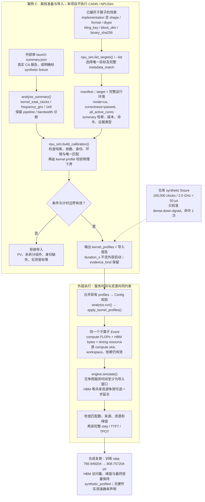

这组 fixture 的 `kernel_total_clocks=100000`、`frequency_ghz=2.0`，所以 `duration_s=100000/(2.0×1e9)=0.00005`，即 **50 μs**。活跃核数 2 用于匹配采集声明，不将 50 μs 乘二；CUBE 与 MTE 利用率也不能相加成新的耗时。

从项目根目录执行：

```powershell
python skills/supernode-modeling/scripts/build_npu_sim_calibration.py examples/npu_sim/synthetic.config.json --list
python skills/supernode-modeling/scripts/build_npu_sim_calibration.py --analyze --summary examples/npu_sim/summary.synthetic.json
python skills/supernode-modeling/scripts/build_npu_sim_calibration.py examples/npu_sim/synthetic.config.json --summary examples/npu_sim/summary.synthetic.json --manifest examples/npu_sim/manifest.synthetic.json -o outputs/npu-sim/calibration.json
python skills/supernode-modeling/scripts/evaluate_npu_sim.py --output outputs/npu-sim
```

`--analyze` 只验证报告字段及单位，不证明采集模式、正确性或实现身份。实际导入要求 manifest 锁定 CA、正确性声明、全活跃核采集、summary 哈希、设备/软件环境和目标子算子；implementation 包含 binary_sha256、tiling_key、block_dim 及输入输出形状/格式。采集者仍须保存真实日志、golden 对比及二进制证据，工具不会代替这些操作。PV、整个未展开 Dense、collective 或无实现身份的事件不接受此入口的绑定。

2026-11-03 复跑：profile 精确命中 **1 个子算子**，训练 step **766.949204 μs → 808.757204 μs**；HBM 工作量、内存峰值和最终占用均保持。原子算子独占计算时间为 8.192 μs，校准服务窗口改为 50 μs，差额 41.808 μs；原 1 μs 启动继续保留，因此不能把整个训练 step 改成 50 μs，也不能把 50 μs 再叠加到原服务时间上。

导入结果标为 `synthetic_profiled`，实际硬件 measurement 命中为 0。真实 CA 报告应标 `simulator`，同条件硬件观测才可使用 measurement；NPUSim 导入器拒绝将报告来源标成 measured。无争用时 kernel 服务时间受 50 μs 窗口约束，有外部资源竞争时仍可能更长。

### 16.5 三个案例的检查清单与参考映射

案例复跑目录分别保存 baseline / operators 或 profiled 的完整配置与结果、comparison；调用脚本不会自动生成标准 Markdown/CSV 报告，需使用上述 `simulate -o` 命令导出。本文数值来自 2026-11-03 本地复跑，复跑产物位于 `outputs/operator-docs-20261103/`，不作为公开硬件 benchmark。

| 要核对的证据 | 对应输出 | 本文案例验证内容 |
|---|---|---|
| 父事件匹配与子算子数量 | `model_metadata.operator_trace` 的 matched_events、generated_operations、by_phase | A 为 1→6；B 为 3→9；其余未命中事件仍保留解析路径 |
| 工作量与新增成本 | `simulation.resource_work`、additional_memory_bytes、additional_startup_s | FLOPs 不丢失；HBM 额外读写和启动显式增加 |
| 生命周期和可行性 | `simulation.memory_peaks_bytes`、memory_final_bytes、status；标准报告的内存明细 | workspace 按子算子释放；容量约束仍执行，不能从访问字节推峰值 |
| 校准适用性与来源 | `kernel_calibration`、`fidelity`、C 的 `kernel.report.json` | C 命中 1 个 synthetic profile；不会将整条链标为硬件实测 |
| 业务时延 | metrics.step_time_s、ttft_s、tpot_s 与关键路径拆解 | 区分单算子、局部串行链与整网指标，不累计并行 rank 时长 |
| 完整图与流式一致性 | B 的 `comparison.json` 和 streaming result | 仅对受支持的同配置路径比较，不能推广到 PD/megakernel |

外部方法的借鉴与当前可运行案例对应如下；详细来源已在仓库参考文档中列出：

| 参考 | 在本系统中解释什么 | 使用边界 |
|---|---|---|
| [ASTRA-sim](../skills/supernode-modeling/references/reference-simulators.md#astra-sim把依赖资源和服务时间分开) | 图 16 的事件依赖、资源准入、服务时间分层 | 使用本项目 Graph；没有 Chakra 自动导入 |
| [SimAI / AICB](../skills/supernode-modeling/references/reference-simulators.md#simai--aicb训练流程和通信工作量) | 案例 A 的阶段、微批、训练计算与通信工作量 | 六 GEMM 是合成描述，非框架 autograd trace；没有 AICB workload 自动转换 |
| [Vidur](../skills/supernode-modeling/references/reference-simulators.md#vidur按算子输入性质选择校准维度) | 案例 B 的 token、sequence、prefill/decode 特征区分 | 本项目做精确匹配；没有 kernel 回归预测或 continuous batching |
| [CANN NPUSim](../skills/supernode-modeling/references/npu-simulator.md#固定来源) | 案例 C 的实现身份、CA 单 launch 窗口与内部流水诊断 | 外部仿真结果导入，不等于硬件测量，也不代替整网通信仿真 |

## 17. Collective 服务时间与多环境响应曲线

源码：[`Topology.select_collective_timing_scope()`](../supernode_sim/topology.py)、`.complete_collective_profile()`、[`collective_calibration.py`](../supernode_sim/collective_calibration.py)、[`build_runtime_calibration.py`](../skills/supernode-modeling/scripts/build_runtime_calibration.py)。独立图：[17-collective-calibration.mmd](diagrams/17-collective-calibration.mmd)。

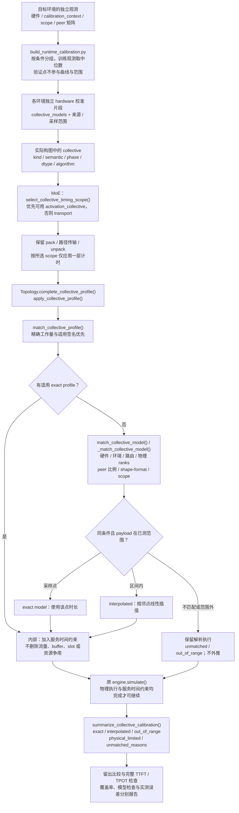

图中上半段是离线校准包构建，下半段是引擎消费配置的运行路径，不会在每次仿真时重新拟合。每个环境单独保存 SKU、CANN/HCCL/驱动、runtime、transport、mode 与计时边界。训练与验证观测隔离；同条件响应曲线只在采样 payload 范围内取点或插值，不跨 rank 数、拓扑、peer 比例或环境外推。

MoE 先选择可用 activation_collective 全调用边界，覆盖 pack→网络→unpack；否则尝试 transport，只约束网络且保留 pack/unpack。所选边界内 exact profile 优先于响应曲线；一次 collective 只加一层计时，避免双重收费。guarded 签名锁定硬件、物理 ranks、路由、peer 矩阵/比例及 shape/format，旧无签名 profile 标为 unguarded。

服务时间 timer 与真实物理传输并行约束，后继等待两者都完成，不能把慢物理路径裁短。报告分别列出 exact_profile、exact_model、interpolated、out_of_range、unmatched 与 physical_limited。来源计时的 device_only/whole_call 与引擎 dependency-ready→完成边界要分别核对；覆盖率和 synthetic 检查不能代替目标环境留出实测。详见 [多环境适配](../skills/supernode-modeling/references/ascend-runtime-adaptation.md) 与 [硬件拓扑拟合](../skills/supernode-modeling/references/hardware-topology-fitting.md)。

## 18. 请求关键路径时延与训练 FLOPs 账本

源码：[`execution_metrics()`](../supernode_sim/analysis.py)、[`build_latency_breakdown()`](../supernode_sim/latency_breakdown.py)、`_WindowAttributor.window()`、[`training_accounting()`](../supernode_sim/training_accounting.py)、[`write_latency_csv()`](../supernode_sim/report.py)。独立图：[18-metrics-and-accounting.mmd](diagrams/18-metrics-and-accounting.mmd)。

```mermaid
flowchart TD
    ENTRY["analysis.run() / 完整流式摘要"] --> VALID{"完整可行执行且指标适用？"}
    VALID -->|否| UNAVAILABLE["推理时延 / 训练利用率不可用<br/>保留 null / 原因；不补零"]
    VALID -->|是| METRIC["execution_metrics()<br/>读取 token / step 完成标记"]
    METRIC --> SCENARIO{"场景"}
    SCENARIO -->|inference| REQUEST["内部：每请求 TTFT、平均 TPOT / ITL<br/>聚合分别取最慢请求；TPOP 为别名"]
    REQUEST --> STREAM{"已有 streaming 拆解？"}
    STREAM -->|是| REUSE["读取逐块累计的 latency_breakdown"]
    STREAM -->|否| BREAKDOWN["build_latency_breakdown()<br/>_WindowAttributor.window()"]
    BREAKDOWN --> PATH["沿关键依赖路径与 token 间隔归因<br/>compute / node / SU / SO / other communication<br/>sync / slot / memory wait / contention / other"]
    PATH --> MEAN["mean_breakdowns() 平均请求各 decode 间隔<br/>TTFT 与 TPOT 分别选决定聚合指标的请求"]
    REUSE --> TARGET["evaluate_targets()<br/>时延 / 吞吐 / step time 与目标比较"]
    MEAN --> TARGET
    SCENARIO -->|training| ACCOUNT["training_accounting()<br/>扫描实际 compute FLOP 资源<br/>识别 trace 原组件和融合成员"]
    ACCOUNT --> ROLE["_model_work() / _optimizer_work()<br/>分开模型 F+B / recompute / optimizer / auxiliary<br/>CPU 单独统计"]
    ROLE --> DTYPE["内部：按 dtype 的声明裸峰值归一<br/>model_mfu 仅模型 F+B<br/>executed_compute_utilization 包括全部 NPU 工作"]
    DTYPE --> TARGET
    TARGET --> RESULT["metrics + slo + status<br/>再做内存账本与报告；图 9"]
    UNAVAILABLE --> RESULT
    RESULT --> CSV["write_latency_csv() / 报告 / Web<br/>JSON/CSV 用秒，展示用毫秒<br/>服务排队指标由图 15 单独计算"]
```

TTFT 和 TPOT 各自选择决定聚合最大值的请求，可能不是同一请求。每个请求的 TPOT 先对相邻 token 窗口分别归因，再平均；不能把不同请求的最大分项拼到一起。关键路径分项可加和为对应总时延，不累加并发 rank 或把上游依赖重复记为同步等待。通信按实际限制资源归因；slot 与内存同时阻塞时优先计 slot，资源争用独立列出。

流式运行在释放 chunk 前保存窗口归因，之后复用摘要；仅有 token marker 无法重建算子服务和等待。estimate、执行失败、训练的推理指标、独立 decode 的 TTFT、单 token 的 TPOT 都不能补零。普通及搜索结果通过 latency_breakdown.csv 保留逐候选标识；服务层 arrival 排队和 overhead 另见图 15。

训练按实际 compute FLOP 资源计量，利用保留的原组件或融合成员元数据区分模型 F+B、recompute、optimizer 与辅助工作，CPU 单列。model_mfu 只含模型 F+B；executed_compute_utilization 含所有 NPU 计算工作，均按 dtype 裸峰值、总 NPU 数和完整耗时归一。phase 与 role 是不同视图，模型/重算字段是子集，不能再次累加；timer 资源不计 FLOPs。这些工作比不是实测 busy fraction 或未经对齐的论文 MFU。详见 [时延拆解](../skills/supernode-modeling/references/latency-breakdown.md) 与 [训练账本来源](../skills/supernode-modeling/references/zhanlu-training.md)。

## 核对范围

函数名称、关键分支、支持范围与接口按本工作区源码核对。流程图为可读性省略字段构造、部分 barrier 与重复 rank 循环，不能替代精确执行 trace。内嵌图与独立 Mermaid 文件保持同步。2026-11-03 复跑了图 16 的训练/推理 trace 与 NPUSim 导入案例；所列数值来自实际输出，证据均为 synthetic，只验证拆分、计时绑定、资源保留及执行一致性，不证明真实硬件预测精度。
