# 函数级仿真流程图

配套说明：[超节点仿真架构](simulation-architecture.md)。依据当前源码整理，日期 2026-10-16。以下 14 张函数级图覆盖 CLI/Web 入口、训练/推理构图、优化器、通信、完整图与流式执行、归因导出、搜索和恢复。

阅读约定：带 `()` 的节点标注源码中的真实函数/方法；标注“内部”的节点表示函数体内逻辑块，不是新函数。实线箭头表示调用顺序或控制流。完整图路径中的循环在 Python 中编译事件图，运行依赖由 `Event.deps` 表达；图 13 的 streaming 在结构屏障处交替构图与数值执行，均不执行真实模型算子。源码链接定位文件，函数/方法名用于检索，以免代码迭代使行号链接失效。

2026-10-19 补充主链中的可选 PD/投机构图与 megakernel 变换；特性输入和具体支持边界见 [features.md](../skills/supernode-modeling/references/features.md)。

Mermaid 代码块可在支持 Mermaid 的 Markdown 预览器中显示；每张图另存为 [`diagrams/`](diagrams/) 下的 `.mmd` 源文件。总体分层图位于架构文档，并提供 [`00-architecture.mmd`](diagrams/00-architecture.mmd)。

## 1. CLI 与单次仿真主链

源码：[`cli.main()`](../supernode_sim/cli.py)、[`cli._main()`](../supernode_sim/cli.py)、[`load_config()`](../supernode_sim/config.py)、[`analysis.run()`](../supernode_sim/analysis.py)、[`compile_graph()`](../supernode_sim/analysis.py)。独立图：[01-entry-and-run.mmd](diagrams/01-entry-and-run.mmd)。

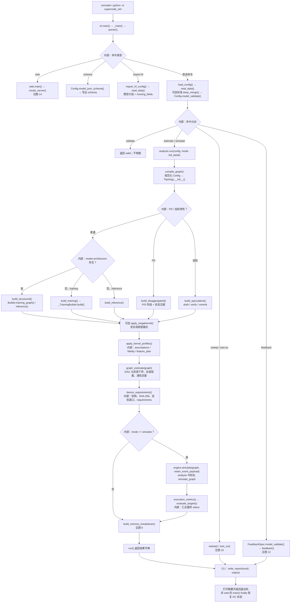

`run()` 是完整构图路径的共享入口，Python API 默认 `full_detail=True`；CLI 的 estimate/simulate 默认传 `False`，可用 `--full-detail` 保留全部详情。精简计算仍执行所有事件：事件数超过 50,000 时，仅省略 trace 行中 `work/allocations/releases` 的副本；allocation 数超过 50,000 时，仅省略临时 `state=buffers` 的宽张量明细行。内存日志、指标、通信总量和精确峰值仍完整计算。这与图 13 的分块 streaming 是两种保留策略。

`run()` 不写文件，调用者决定是否调用 `write_report()`。simulate 失败仍保留诊断与已观察的内存账本；输入/构图异常由 CLI 捕获并返回 `invalid_input`。`validate` 只运行配置层校验。Web CLI 入口保留 HTTP 服务的 GC 策略，worker 自行临时禁用并恢复 GC。

## 2. 参数预算版训练构图

源码：[`pipeline_schedule()`](../supernode_sim/training.py)、[`_TrainingBuilder.build()`](../supernode_sim/training.py)、[`.phase()`](../supernode_sim/training.py)、[`.optimizer()`](../supernode_sim/training.py)。独立图：[02-training-budget.mmd](diagrams/02-training-budget.mmd)。

```mermaid
flowchart TD
    ENTRY["training.build_training(config, topology)"] --> INIT["_TrainingBuilder.__init__()<br/>内部：rank / stage 映射与 dense / expert 参数预算"]
    INIT --> BUILD["build() → initial_state()<br/>驻留 weights / gradients / master / Adam / runtime"]
    BUILD --> STEP["内部：遍历 training step"]
    STEP --> STAGE["内部：遍历 PP stage<br/>pipeline_schedule(stage, stages, microbatches)"]
    STAGE --> PHASE["phase(step, stage, F或B, micro)<br/>phase_previous() 建立前驱"]
    PHASE --> LAYER["内部：按 F 正序 / B 逆序遍历层"]
    LAYER --> GATHER["按 FSDP / reshard 条件 add_gather()<br/>可选一层前瞻预取"]
    GATHER --> DISPATCH["可选 collective(EP dispatch)<br/>内部：权重精度转换、activation 生命周期"]
    DISPATCH --> CK{"内部：B 且 activation checkpointing？"}
    CK -->|是| RECOMP["kernel(forward=True)<br/>重放 TP / EP 通信"]
    CK -->|否| KERNEL["kernel(..., forward=F)<br/>创建计算与 HBM work 的 Event"]
    RECOMP --> KERNEL
    KERNEL --> COMM["collective(TP attention / MLP all_reduce)<br/>可选 EP combine"]
    COMM --> SYNC{"内部：B 到达梯度同步点？"}
    SYNC -->|是| GRAD["collective()<br/>dense EP AR → FSDP RS → replica DP AR"]
    SYNC -->|否| DONE["barrier(layer done)<br/>释放本层已消费临时分配"]
    GRAD --> DONE
    DONE --> MOREL{"内部：还有层？"}
    MOREL -->|是| LAYER
    MOREL -->|否| PDONE["barrier(phase done)"]
    PDONE --> SEND["有相邻 PP stage 时：<br/>内部可选 pack → Topology.transfer() → 可选 unpack<br/>send.done 供接收方依赖"]
    SEND --> MOREP{"内部：还有 phase / stage？"}
    MOREP -->|是| STAGE
    MOREP -->|否| OPT["optimizer(step)<br/>图 4：Adam 与可选 CPU offload"]
    OPT --> MORES{"内部：还有 step？"}
    MORES -->|是| STEP
    MORES -->|否| RETURN["内部：写 schedule / logical_memory / step_end_events<br/>返回 Graph"]
```

`phase.done` 与 PP `send.done` 是不同标记。发送方后续计算可以只依赖 phase 完成，接收方必须等待 incoming send；因此图中“创建 send 后继续构图”不表示运行时发送阻塞发送方计算。checkpoint 小段画的是运行时依赖：重算 kernel 与 TP/EP 重放完成后才能执行 backward；实际 Python 构图先创建 backward Event，引用稍后才追加的 `recompute.done`。`kernel()` 构造 Event；预算版不支持 Muon。

## 3. 结构化训练构图

源码：[`build_structured()`](../supernode_sim/structured.py)、[`Builder.training_graph()`](../supernode_sim/structured.py)、[`.gather()`](../supernode_sim/structured.py)、[`.recompute_layer()`](../supernode_sim/structured.py)。独立图：[03-training-structured.mmd](diagrams/03-training-structured.mmd)。

```mermaid
flowchart TD
    ENTRY["build_structured() → Builder.__init__()<br/>Topology.populate() + parameter_inventory()"]
    ENTRY --> INIT["training_graph() → initial()<br/>states() / state_dtype() / local_elements()"]
    INIT --> STEP["内部：step → PP stage<br/>pipeline_schedule() → F或B / microbatch"]
    STEP --> LAYER["内部：按阶段方向遍历 stage layers"]
    LAYER --> GATHER["按 FSDP / reshard 条件 gather()<br/>collective(all_gather)"]
    GATHER --> ACT["activation_rows() → component_activations()<br/>内部：B 时建立或复用 gradient buffers"]
    ACT --> CK{"内部：B 且 checkpoint？"}
    CK -->|是| RECOMP["recompute_layer()<br/>kernel() + TP / EP + 临时状态"]
    CK -->|否| ORDER["component_order(layer)<br/>F 正序 / B 逆序遍历组件"]
    RECOMP --> ORDER
    ORDER --> DISPATCH["MoE 时 collective(EP dispatch)"]
    DISPATCH --> KERNEL["逐 rank kernel()<br/>权重转换、FLOPs/HBM、activation/state allocs/releases"]
    KERNEL --> COMM["MoE 时 collective(combine)<br/>attention / FFN 后 collective(TP all_reduce)"]
    COMM --> MOREC{"内部：还有组件？"}
    MOREC -->|是| ORDER
    MOREC -->|否| SYNC{"内部：B 到达梯度同步点？"}
    SYNC -->|是| GRAD["collective()<br/>FSDP RS → replica AR → dense EP AR"]
    SYNC -->|否| DONE["barrier(layer.done)<br/>释放 gather / gradient / recompute 临时项"]
    GRAD --> DONE
    DONE --> MOREL{"内部：还有层？"}
    MOREL -->|是| LAYER
    MOREL -->|否| PHASE["barrier(phase 完成)<br/>释放消费完的 PP receive 等状态"]
    PHASE --> SEND["有下游时 pipeline_transfer()<br/>可选 pack → Topology.transfer() → 可选 unpack<br/>内部：stage_previous 指向发送完成"]
    SEND --> MOREP{"内部：还有 phase / stage？"}
    MOREP -->|是| STEP
    MOREP -->|否| OPT["optimizer(step, stage tails)<br/>见图 4"]
    OPT --> MORES{"内部：还有 step？"}
    MORES -->|是| STEP
    MORES -->|否| ANNOTATE["annotate_collective_allocations()<br/>返回 Graph"]
```

结构化路径没有 FSDP lookahead prefetch；配置阶段会拒绝该开关。其 stage 后继依赖可能等待 PP send，因此与图 2 的异步发送语义有区别。checkpoint 仍产生前向完整临时工作集，只改变保存与重计算策略。

## 4. 训练优化器与 offload

源码：[`_TrainingBuilder.optimizer()`](../supernode_sim/training.py)、[`Builder.optimizer()`](../supernode_sim/structured.py)、[`optimizer_states()`](../supernode_sim/components.py)。独立图：[04-optimizer-offload.mmd](diagrams/04-optimizer-offload.mmd)。

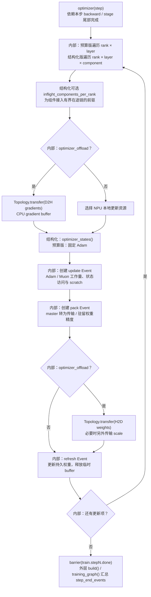

图中的更新项依赖形成事件链；Python 构图循环本身不表示各项运行时完全串行。Muon 正交化是解析工作量与 workspace 近似，当前没有跨 rank 全矩阵组装与 distributed Muon；优化器也不与本步 backward 重叠执行。

## 5. 结构化推理：prefill / decode、SP 与状态生命周期

源码：[`Builder.inference()`](../supernode_sim/structured.py)、[`.kernel()`](../supernode_sim/structured.py)、[`attention_state()`](../supernode_sim/components.py)、[`attnres_state()`](../supernode_sim/components.py)。独立图：[05-inference-structured.mmd](diagrams/05-inference-structured.mmd)。

```mermaid
flowchart TD
    ENTRY["build_structured() → Builder.__init__()"] --> INIT["Builder.inference() → initial()<br/>驻留权重 / runtime / 可选 Engram"]
    INIT --> DP["内部：遍历 DP replica"]
    DP --> TOKEN["内部：遍历 output step<br/>0 = prefill；其余 = decode"]
    TOKEN --> ACTIVE["内部：筛选 output_length 大于 step 的序列<br/>按 EP lane 分配 tokens；SP 计算 padded rows"]
    ACTIVE --> LAYER["内部：遍历 layer → 确定 PP stage"]
    LAYER --> STATE["attention_state() / attnres_state()<br/>KDA 固定状态 或 paged KV 增量<br/>可选残差状态"]
    STATE --> COMPONENT["component_order(layer)<br/>内部可选 streaming component-before hook"]
    COMPONENT --> SP["SP 时 attention / FFN / Output 前<br/>barrier() 分配 padded input → collective(all_gather)"]
    SP --> DISPATCH["MoE 时 collective(EP dispatch)"]
    DISPATCH --> ACT["逐 rank activation_rows()<br/>norm / AttnRes 用 SP 局部 rows<br/>prefill Output 仅算每序列末位"]
    ACT --> READ["内部可选：旧 KV fetch → decode conversion<br/>PreNorm 前 Engram lookup"]
    READ --> KERNEL["kernel()<br/>权重转换 + component Event"]
    KERNEL --> WRITE["内部可选：新 KV encode → offload write"]
    WRITE --> COMM["MoE 时 collective(combine)<br/>attention / FFN 后 TP AR；SP 时改为 RS<br/>SP WordEmbedding 后也执行 RS"]
    COMM --> RELEASE["barrier() 释放 SP gather buffer<br/>内部可选 streaming component-after hook"]
    RELEASE --> MOREC{"内部：还有组件？"}
    MOREC -->|是| COMPONENT
    MOREC -->|否| DONE["barrier(layer_done)<br/>释放上个 stage 的 receive buffer"]
    DONE --> PP{"内部：跨 PP stage？"}
    PP -->|是| SEND["pipeline_transfer()<br/>pack → Topology.transfer() → unpack"]
    PP -->|否| MOREL{"内部：还有层？"}
    SEND --> MOREL
    MOREL -->|是| LAYER
    MOREL -->|否| COMPLETE["barrier(token_complete)<br/>记录 sequence_token_completion_events"]
    COMPLETE --> MORET{"内部：还有 output step？"}
    MORET -->|是| TOKEN
    MORET -->|否| MORED{"内部：还有 replica？"}
    MORED -->|是| DP
    MORED -->|否| RETURN["build_structured() 调用<br/>annotate_collective_allocations() → 返回 Graph"]
```

SP 共用 TP ranks，度数为 TP，不能额外乘入设备数；配置只接受结构化推理、TP > 1、PP = 1。SP 显式计入 padding、all-gather 输入与 reduce-scatter 输出；无 SP 时保持 TP all-reduce。图中 hooks 是 `run_streaming()` 安装的回调；普通完整构图不安装这些 hooks。状态分配后也有可选的 streaming state hook（见图 13）。

KDA recurrent/conv state 不随上下文线性增长；MLA cache 可用 compressed/expanded 布局。非 KDA 的旧 KV 转换具有显式解码 buffer。各序列完成后停止后续计算和 KV 读取，cache 保留至本次固定批次结束。同一 replica 按 token→layer 构图，不使用训练的 1F1B。

## 6. 参数预算版推理

源码：[`build_inference()`](../supernode_sim/inference.py)、[`kv_layout_bytes()`](../supernode_sim/inference.py)。独立图：[06-inference-budget.mmd](diagrams/06-inference-budget.mmd)。

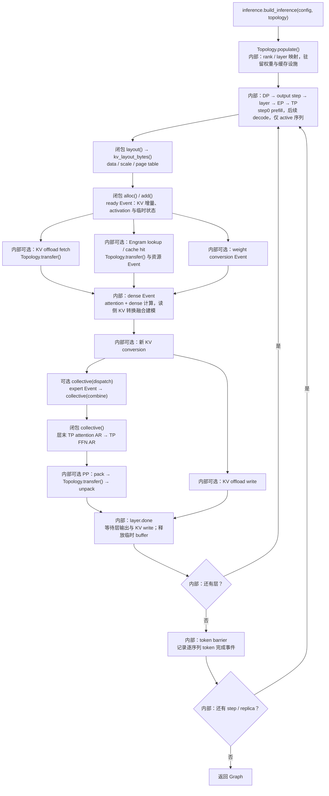

从 ready 发出的可选分支在依赖满足时可重叠执行；关闭时相应节点退化为直通依赖。该路径把读侧 KV 转换融合于 attention，不分配完整旧 KV 解压缓存；两次 TP reduction 都位于层末。两条推理路径的事件粒度和通信顺序有区别。

## 7. Collective 与拓扑路由展开

源码：[`Builder.collective()`](../supernode_sim/structured.py)、[`Topology.collective()`](../supernode_sim/topology.py)、[`.transfer()`](../supernode_sim/topology.py)、[`.path()`](../supernode_sim/topology.py)。独立图：[07-collective-topology.mmd](diagrams/07-collective-topology.mmd)。

`Topology.path()` 对静态拓扑的 pair route cache 使用 16 MiB / 65,536 项预算，每种路由模式（不限域、SU、SO）的 BFS source-tree cache 各使用 16 MiB / 128 项预算。超预算项仍服务本次查询但不保留。full_mesh 的 pair cache 使用普通字典，以保留懒建链路后已有 pair 的历史路由；缓存预算不等同于拓扑总内存上限。零字节 transfer 不查询路径。

`transfer()` 本身返回资源化的 Event；collective 的 staging buffer/slot 在 `collective()` 内添加，普通点对点 buffer 由对应构图器管理。AG/RS/AR 的 `size` 是每 rank 完整张量大小。所有同轮 transfer 的完成 ID 作为下一轮依赖，图表达的是明确的通信算法，而非一个总字节量常数。

## 8. 离散事件执行器与 max-min 资源共享

源码：[`engine.simulate()`](../supernode_sim/engine.py)、[`max_min_rates()`](../supernode_sim/engine.py)。独立图：[08-event-engine.mmd](diagrams/08-event-engine.mmd)。

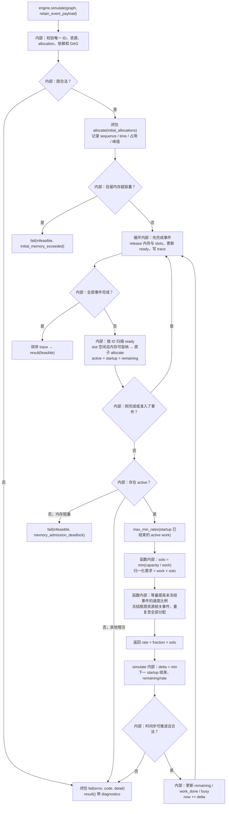

`retain_event_payload=False` 仅省略 trace 行的 work/allocations/releases 副本，仍保留每个已完成事件的 ID、时间、metadata、slots，以及完整 memory_log；它不改变调度、内存准入与数值结果，也不将完整图执行变成 streaming。

事件启动时原子分配内存并占用 slot，事件结束时执行 release。相同时间点先释放再准入新事件。资源同时服务，计算/访存耗时取 roofline 瓶颈。图中为便于阅读将若干校验错误合并到 `fail(error, ...)`，具体 code 以 diagnostics 为准。

## 9. 内存归因与报告导出

源码：[`build_memory_breakdown()`](../supernode_sim/memory_breakdown.py)、[`write_report()`](../supernode_sim/report.py)、[`_prepare_export()`](../supernode_sim/report.py)、`_write_event_artifacts()`、`_write_result_json()`。独立图：[09-memory-and-report.mmd](diagrams/09-memory-and-report.mmd)。

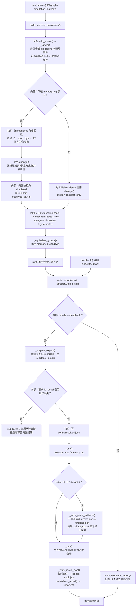

`write_report()` 的标准输入是仍持有可迭代 trace 与张量列表的 `run()` 结果；已写出且引用过滤产物的 `result.json` 不能直接重新导出。checkpoint 的 `JSONLRecords` 可流式导出；`run_streaming()` 的紧凑结果不是该接口的完整输入。

自动导出阈值为 50,000 行，比较 trace、原始 tensor、memory_log 的最大条数。大表在非 full 模式下保留模型 kernel、token/step marker、保留模型张量的分配事件，省略临时 buffer 张量行与原始内存日志；保留张量表仍超过 50,000 行时使用 `tensors.csv.gz`。事件 CSV 与 Perfetto timeline 共用一遍遍历，计数后再写 `result.json`，对 JSON 使用临时文件替换；这不是整个输出目录的原子事务。

过滤只修改浅层导出视图，不改 API 所有的数组及完整计算得到的指标、通信/资源总量与并发峰值。完整详情要求计算阶段保留事件 payload 和全部张量行。不同组件/不同池的独立峰值不允许直接相加。feedback 使用独立格式，且无胜者时删除旧 `best.config.json`。

## 10. 参数扫描与最小 SU 搜索

源码：[`sweep()`](../supernode_sim/search.py)、[`size_su()`](../supernode_sim/search.py)。独立图：[10-sweep-and-su-search.mmd](diagrams/10-sweep-and-su-search.mmd)。

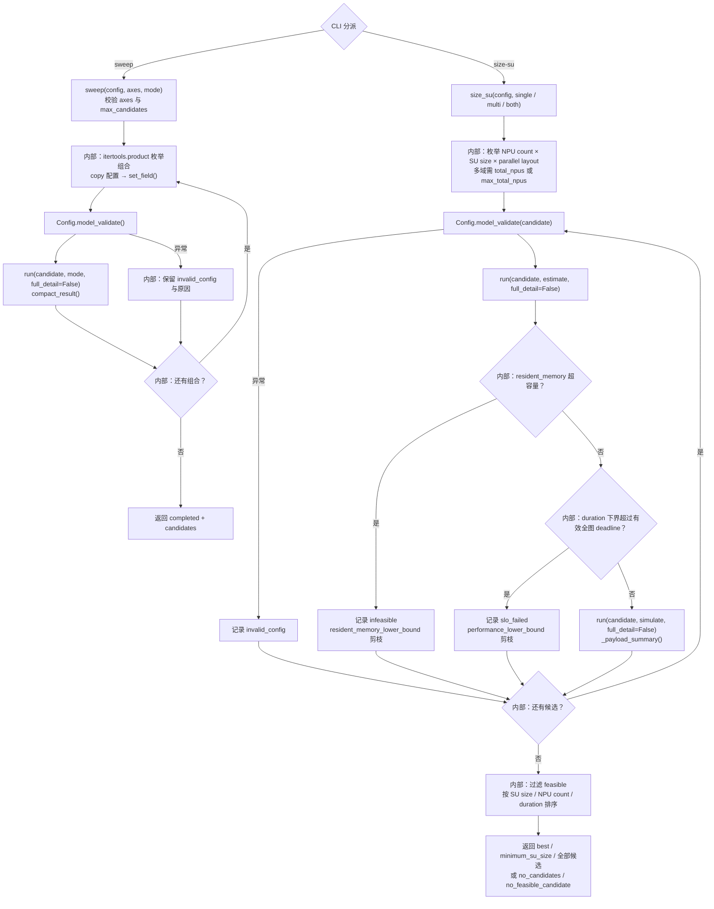

图中合并了 single/multi 两个子搜索的外层循环。无并行候选时保留 TP/PP/EP/FSDP 并推导 DP。只使用必要下界剪枝；忽略争用的乐观内存峰值和全图 TTFT/TPOT deadline 不用于这种剪枝。`run(estimate)` 与 `run(simulate)` 各自构图，当前未共享候选 Graph。

启用 PD 时搜索按双池总卡数校验，保持 DP=PP=1；显式 P/D 映射随候选重新验证，不自动派生新的 DP 或物理放置。

## 11. 大型参考实验检查点与恢复

源码：[`scripts/run_reference_experiment.py`](../scripts/run_reference_experiment.py)、[`fingerprint()`](../scripts/run_reference_experiment.py)、[`load_checkpoint()`](../scripts/run_reference_experiment.py)。独立图：[11-reference-checkpoint.mmd](diagrams/11-reference-checkpoint.mmd)。

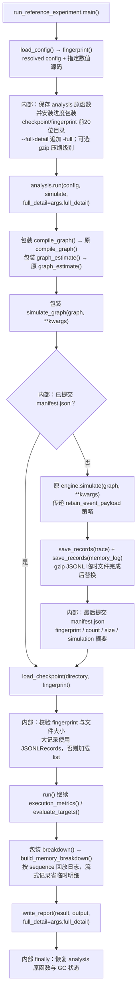

`fingerprint()` 覆盖已解析配置与指定数值源码（含 `cache.py`）。加载时核验 fingerprint 和文件大小；trace、allocation、memory_log 任一数量超过 50,000 时使用 `JSONLRecords`，其 `__iter__()` 在迭代结束时核验记录条数。`--full-detail` 使用独立 `-full` 目录，避免从精简 checkpoint 恢复已经省略的 payload。

检查点在一次数值调用返回后提交，也可以保留 infeasible/error 结果。恢复只跳过已完成的数值调用，仍需重建图、计算下界与指标并回放日志；不支持在数值执行中途恢复 active/ready/remaining 状态。精简 `result.json` 不能替代原始检查点；JSONL 流式读取也不同于图 13 的分块数值执行。

## 12. Feedback：固定模型与硬件的联合推理搜索

源码：[`feedback.py`](../supernode_sim/feedback.py)（`FeedbackSpec`、`feedback()`、`_layouts()`、`_candidate_config()`、`_decode_metrics()`、`_rank()`、`_frontier()`）。独立图：[12-feedback-search.mmd](diagrams/12-feedback-search.mmd)。

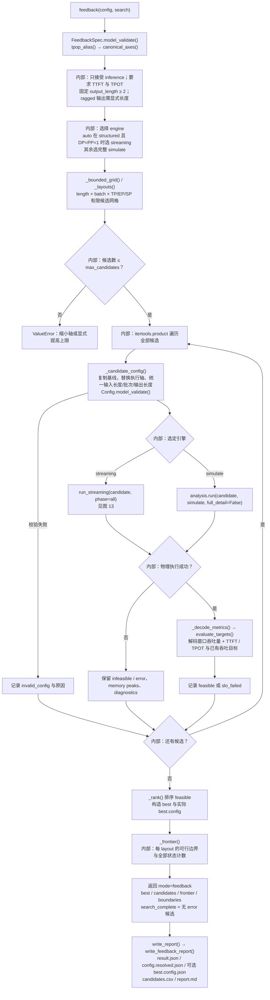

模型、硬件/拓扑、PP/DP/FSDP、rank order、精度与 features 固定，只搜索 TP、EP、SP、prefill 长度与固定批次。默认长度/批次网格是“不超过基线端点的 2 的幂 + 端点”，并非所有整数。TP/EP 默认由设备槽位与专家整除关系推导；显式不合法轴仍保留为 `invalid_config`。SP 共用 TP ranks。

每个候选完整联合执行 prefill 与 decode，不使用 estimate 下界剪枝、分离阶段择优或 chunked prefill。decode throughput = 全部请求首 token 之后的输出 token 总数 /（最晚末 token − 最早首 token）；DP/PP > 1 时该窗口可能与其他请求 prefill 重叠。TTFT 取各请求首 token 时延的最大值，TPOT 取各请求平均输出间隔的最大值；output_length=2 只测一个 decode 间隔。除两项延迟目标外，已有 throughput 目标也必须通过。

最优项先最大化 decode throughput，同分依次偏向更长输入、更大批次、更小 TTFT/TPOT、较小 TP/EP/SP。frontier 同时最大化长度、批次、decode throughput；同一 layout 的最大长度与最大批次可能来自不同候选，实际 `best` 才是联合验证配置。出现 `error` 候选时整体 `status=error`、`search_complete=False`，即使已有 best 也不宣称搜索完成。

## 13. Streaming：结构屏障分块、精确准入与缓存

源码：[`streaming.py`](../supernode_sim/streaming.py)（`run_streaming()` 及其闭包）、[`cache.py`](../supernode_sim/cache.py)（`BoundedCache`、`_size_bytes()`）、[`engine.py`](../supernode_sim/engine.py)（`simulate()`）。独立图：[13-streaming-execution.mmd](diagrams/13-streaming-execution.mmd)。

```mermaid
flowchart TD
    ENTRY["run_streaming(config, phase, progress, cache)"] --> CHECK["内部：structured inference 且 DP=PP=1<br/>phase 为 all / prefill / decode"]
    CHECK --> BUILDER["Builder.__init__() + Topology.__init__()<br/>默认 timing cache = BoundedCache()"]
    BUILDER --> HOOKS["内部：安装 cached_initial() 与 state/component hooks<br/>graph.events 替换为 _EventSink"]
    HOOKS --> COMPILE["Builder.inference() → initial()<br/>无 Engram 时可复用折叠初始驻留缓存<br/>按现有 token → layer → component 生成事件"]
    COMPILE --> DECODE{"内部：standalone decode 且 step=0？"}
    DECODE -->|是| SEED["skip_prefill_kernel() / skip_prefill_collective()<br/>accept_event() 仅记录永久 KV/KDA 等状态"]
    SEED --> COMPILE
    DECODE -->|否| MACRO["before_component() → macro_key()<br/>尝试本 token 内同形组件宏重放"]
    MACRO --> ACCEPT["accept_event()<br/>state_hook() / after_component() 及 layer/token 屏障<br/>触发 flush()"]
    ACCEPT --> FLUSH["flush()<br/>验证跨块依赖均为已完成屏障<br/>带存活分配建立 chunk → apply_kernel_profiles()"]
    FLUSH --> KEY["内部：规范化层前缀构造 timing key<br/>保留容量/work、依赖、slot、dtype、alloc/release"]
    KEY --> HIT{"内部：已有 template 或宏？"}
    HIT -->|否且可缓存| TEMPLATE["simulate(unconstrained, retain_event_payload=False)<br/>记录 duration / work / peak与final delta"]
    HIT -->|是| FIT{"内部：当前驻留 + template peak delta<br/>满足所有真实 pool capacity？"}
    TEMPLATE --> FIT
    HIT -->|否且不缓存| SIM["simulate(chunk, retain_event_payload=False)<br/>完整 slot / memory admission"]
    FIT -->|否| SIM
    FIT -->|是| REPLAY["内部：复用时间与资源结果<br/>按当前驻留恢复真实 peak / final / 分类"]
    SIM --> MERGE["内部：累计 duration / work / busy / peaks / phase / chunks<br/>可选 progress 回调"]
    REPLAY --> MERGE
    MERGE --> STATUS{"内部：chunk feasible？"}
    STATUS -->|否| STOP["内部：以 _Stop 结束构图<br/>失败保留诊断；prefill 到目标后正常停止"]
    STATUS -->|是| CARRY["内部：累计本块通信；按 releases 更新 named 存活项<br/>永久状态按 pool/category/dtype 合并<br/>满足条件时保存组件宏"]
    CARRY --> TOKEN{"内部：token complete？"}
    TOKEN -->|是| MARK["内部：记录 marker；清理本 token 的宏与旧屏障"]
    TOKEN -->|否| CONT["内部：清空 sink，继续构图"]
    MARK --> PREFILL{"内部：phase=prefill 且 token0 完成？"}
    PREFILL -->|是| STOP
    PREFILL -->|否| CONT
    CONT --> COMPILE
    STOP --> CLEAN["内部 finally：移除 hooks 与闭包引用，清空 sink"]
    COMPILE -->|正常结束| CLEAN
    CLEAN --> METRIC["可行且有 token 标记时派生指标<br/>all 用 execution_metrics()；prefill 仅 TTFT<br/>decode 仅 TPOT；失败 TTFT/TPOT=null"]
    METRIC --> OUT["返回紧凑数值结果<br/>simulation / phase_metrics / chunks / marker派生指标"]
```

分块使用既有 state/component/layer/token 屏障，保留原 kernel、collective、placement、slot 竞争与内存准入；跨块不能引用尚未完成的依赖。永久分配按 pool/category/dtype 折叠，仍保持各池容量约束；临时存活分配按 ID 跨块携带。时序模板只在当前驻留加峰值增量适配真实容量时复用，否则回退正常准入调度；无约束模板本身不是可行性结论。组件宏仅在没有新存活项且未释放已有 named 项时保存，每个 token 后清理。

默认初始驻留与 timing 模板共用 LRU，预算为 64 MiB / 256 项；超大项跳过保留。调用者可传 `BoundedCache` 跨实验共用预算，普通 dict 则延续无界行为。`_size_bytes()` 按 Python 对象估算条目占用并计入 LRU 额外额度，并非进程 RSS 上限；宏、拓扑、当前 chunk、metadata 和摘要另有占用。

`phase=all` 完整执行 prefill+decode，也是 feedback 使用的唯一 streaming 模式。`phase=prefill` 在首 token 屏障后结束；`phase=decode` 直接播种 prefill 完成后留下的永久 KV/KDA 等状态，跳过 prefill 执行与瞬时内存，要求至少两个输出 token，TTFT 为 null。暖缓存 decode 可用于 prefill 不可行时的独立实验，不能证明联合请求可行。

chunk 失败会保留已观察 duration/work/peak、该 chunk 摘要和诊断并停止；失败 chunk 通信不并入成功执行的 phase 汇总，`memory_final_bytes` 保留最后成功 chunk 的值。progress 回调异常向外传播，finally 仍拆除引用环。返回值没有逐事件 trace/张量生命周期，不是完整 `run()` 或标准 `write_report()` 输入。

## 14. Skill 前端入口、Web 作业与隔离 worker

源码：[`launch_frontend.py`](../skills/supernode-modeling/scripts/launch_frontend.py)（`launch()`）、[`web.py`](../supernode_sim/web.py)（`create_server()`、`WebHandler._route()`、`validate_config()`、`JobManager`）、[`web_worker.py`](../supernode_sim/web_worker.py)（`main()`、`compact_result()`）。独立图：[14-web-worker.mmd](diagrams/14-web-worker.mmd)。

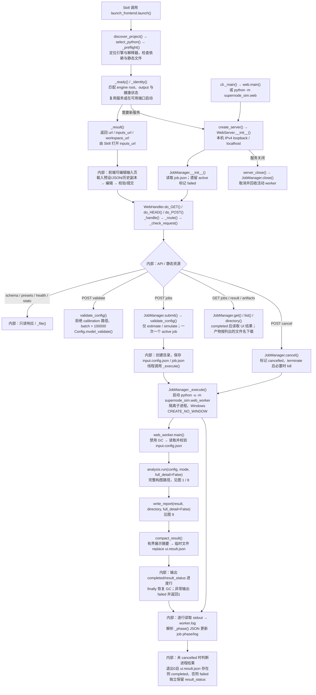

launcher 只负责定位、检查、复用/启动并返回地址，不打开浏览器、不启动仿真；Skill 打开返回的 `inputs_url`（`#inputs`）后，用户可修改输入再校验/提交。历史配置复制为当前编辑副本，不覆写旧任务的输入快照；提交时统一经过服务端配置校验。

HTTP 层检查 Host 与修改请求来源，JSON 请求体上限 2 MiB，输入必须已解析，不能通过 calibration 路径让服务端读取文件。Web 仅提供 estimate/simulate 作业，不提供 feedback/独立 streaming 入口。

`completed` 表示 worker 已完成报告和 UI 摘要；物理不可行或 SLO 不满足通过独立 `result_status` 呈现。UI 最多展示 240 个 memory pools、160 个 resources、均匀采样的 300 个 events，解释 metadata 也有上限；报告保留完整数值汇总，下载明细仍遵循图 9 的默认 compact 规则。服务重启不会恢复正在执行的作业。

## 核对范围

函数名称、关键分支、支持范围与接口按本工作区源码静态核对。流程图为可读性省略字段构造、部分 barrier 与重复 rank 循环，不能替代精确执行 trace。内嵌图与独立 Mermaid 文件同步生成；本次为文档更新，未据此声称新增数值验证结果。
