# 超节点资源与通信建模技术方案 PPT 内容文档

本方案面向模型、系统与网络架构团队，说明 supernode-modeling Skill 如何将模型、负载、并行策略与 SU/SO 拓扑转换为可重跑配置，并通过 supernode_sim 的统一事件图分析存储、计算、通信、执行时序与 SLO。核心判断是容量是否可承载、目标是否满足、瓶颈在哪里，以及哪些受控变量能够改善方案。

用途：后续 PPT 生成的内容输入与讲解底稿。汇报时长：25–30 分钟。主讲 24 页，建议讲述合计 26.25 分钟；另有 8 页技术附录与 R01 来源页供问答使用。末尾 12 份 Mermaid 图源属于绘图素材，不另算幻灯片。

内容日期：2026 年 10 月 12 日。架构资料基线为 2026 年 10 月 9 日，函数流程说明标注日期为 2026 年 9 月 28 日；架构说明记录引擎版本 0.1.0，配置与结果 schema 1.0。版本信息用于标识本稿依据，不替代后续实际运行所用的源码修订。

## 一 PPT 生成约定

每页的“核心结论”确定讲述目的，“上屏文案”进入正文，“图表与布局”指导绘图，“讲解备注”进入 speaker notes，“来源”进入页脚。展示数据以本稿明确提供的值和实际引擎产物为准。细节保留在备注与附录，不能把整段备注复制到页面。

建议采用 16:9、白底、微软雅黑、深蓝标题与蓝色强调。标题 24–28 pt，正文不小于 20 pt，图中标签 16–18 pt，来源 12–14 pt。每页 3 条主要文案和 1 个主要图表；采用统一页边距和左对齐。用文字和形状共同说明状态，避免只靠颜色区分。超过 15 页的主讲在顶部显示章节导航：问题与方案、系统架构、模型与执行、资源与结果、方案比较、应用与边界。

图源可导出为 SVG，或重绘为可编辑形状。主讲依据裁剪指引简化长图，完整函数流程保留在附录素材。函数名、关键依赖、路由与失败分支不得因简化而改变含义。图例统一如下：

- 职责与数据流图表示组件交付关系，不表示运行时先后。
- 带 () 的节点为真实函数或方法；“内部”节点为函数体逻辑块。
- 构图循环编译 Event DAG，不能据此推断运行时完全串行。
- 运行时依赖由 Event.deps 表达，还需通过内存与 slot 准入。

正式数值页应附配置、单位和来源。10T 是合成的全参数 Adam 逻辑容量锚点；Kimi K3 与 Ascend 950DT 场景区分公开结构、公开规格和运行假设。主稿没有填入未给出的仿真耗时、吞吐、误差或目标达成率。需要加入结果图时，从对应 report.md/result.json/CSV 读取同场景数据。

可直接给 PPT 生成工具的指令：

```text
请根据此文档生成中文技术方案 PPT，主讲严格采用 01–24 页顺序，适合 25–30 分钟。
每页使用结论式标题、上屏文案和一个主要图表；讲解备注放入 speaker notes，来源放页脚。
图表按图源编号 G00–G11 和裁剪指引绘制，完整 Mermaid 源码见文末。
保留函数控制流、事件依赖、容量与性能下界、运行假设的区别。
第 19 页仅使用给定的 10T 逻辑静态容量数据，不能画成实际设备峰值。
第 20 页展示公开事实与假设的边界，不能补造实机性能。
A01–A08 与 R01 作为备查附录，默认不进入主讲；原始图源代码不是额外幻灯片。
作者、单位和联系方式未提供时省略，不使用虚构信息或空白占位符。
以第 24 页结论结束主讲并停留用于问答。
```

## 二 主讲顺序与时间

| 页码 | 章节 | 结论式标题 | 建议分钟 |
|---|---|---|---:|
| 01 | 问题与方案 | 超节点资源与通信建模技术方案 | 0.5 |
| 02 | 问题与方案 | 系统回答给定场景能否承载以及瓶颈在哪里 | 1 |
| 03 | 问题与方案 | 模型策略与网络共同决定资源需求和执行时间 | 1 |
| 04 | 系统架构 | Skill 编排和数值引擎通过统一事件图衔接 | 1.5 |
| 05 | 系统架构 | 严格输入契约保证场景比较具有明确口径 | 1.5 |
| 06 | 系统架构 | 拓扑子 Skill 将自然语言编译为明确的链路与域成员 | 1 |
| 07 | 系统架构 | Graph 同时表达工作量依赖和张量生命周期 | 1 |
| 08 | 系统架构 | 下界先行筛查必要条件 仿真再检查执行与 SLO | 1 |
| 09 | 模型与执行 | 模型结构决定采用组件构图还是参数预算构图 | 0.75 |
| 10 | 模型与执行 | 训练构图连接流水调度通信和 activation 生命周期 | 1.5 |
| 11 | 模型与执行 | Optimizer offload 用主机容量换取搬运与更新开销 | 1.25 |
| 12 | 模型与执行 | 固定 batch 推理按 prefill 和活跃序列 decode 构图 | 1.5 |
| 13 | 模型与执行 | 组件与状态账本解释容量来自哪些张量 | 1 |
| 14 | 模型与执行 | MLA 缓存与 KDA 递归状态采用不同的容量模型 | 1.25 |
| 15 | 资源与结果 | 通信语义展开为算法轮次和实际路径资源 | 1.25 |
| 16 | 资源与结果 | 执行器在依赖内存和共享资源约束下推进事件 | 1.5 |
| 17 | 资源与结果 | 仿真执行峰值必须由同一时刻的内存日志构成解释 | 1 |
| 18 | 资源与结果 | 指标使用训练步和逐序列 token 的实际完成时间 | 1 |
| 19 | 方案比较 | 10T 容量锚点显示精度优化需要逐状态计算 | 1 |
| 20 | 方案比较 | Kimi K3 案例将公开结构和运行假设分别保存 | 1.25 |
| 21 | 方案比较 | 扫描与 SU 搜索在有限候选内保留可行方案和失败原因 | 1.25 |
| 22 | 应用与边界 | 配置来源校准命中和执行产物支持复跑与审计 | 0.75 |
| 23 | 应用与边界 | 结论适用于声明的负载模型拓扑和执行策略 | 0.75 |
| 24 | 应用与边界 | 统一事件图让资源约束与方案比较形成可追溯闭环 | 0.75 |

时间紧张时，可将第 09 页构图差异、第 14 页 KV/KDA 细节、第 19 页容量锚点移入备查，保留问题、架构、训练/推理主链、资源争用、峰值、SLO、搜索和结论。不能通过缩小字号压缩正文。

## 三 逐页内容

### 01 超节点资源与通信建模技术方案

**章节与时间** 问题与方案，0.5 分钟。

**核心结论** 用可重跑配置连接模型、负载、并行策略和硬件拓扑，形成容量、性能与通信分析闭环。

**上屏文案**

- supernode-modeling Skill 与 supernode_sim 数值引擎
- 训练与固定 batch 推理的存储 计算 通信分析
- 从场景输入到瓶颈解释与有限候选选型

**图表与布局** 使用简洁的横向链条：场景 → 事件图 → 资源与时序 → 方案判断。副标题为“架构 流程 能力与应用”。日期可用 2026 年 10 月 12 日；作者、单位和会议信息仅在提供后填写。

**讲解备注** 本方案把架构问题转换成严格配置，再由数值代码执行计算。今天重点说明系统如何形成事件图、怎样考虑资源竞争、如何解释结果，以及怎样用这些结果比较超节点方案。

**来源** [主 Skill](../skills/supernode-modeling/SKILL.md)；[架构说明第 1 节](simulation-architecture.md)。

### 02 系统回答给定场景能否承载以及瓶颈在哪里

**章节与时间** 问题与方案，1 分钟。

**核心结论** 分析目标是判断容量、性能和网络约束是否满足，并给出可追溯的原因。

**上屏文案**

- 能否装下：驻留容量与执行峰值
- 能否达标：训练步时 吞吐 TTFT TPOT
- 如何改进：精度 offload 并行布局与 SU 规模

**图表与布局** 三行问题与交付表：容量→内存账本；性能→时序与 SLO；网络→路径与资源负载。右下角加“同一场景 同一口径 可复跑”。

**讲解备注** 需要先固定模型范围、负载和执行策略。系统既保留可行方案，也保留容量失败和 SLO 未达标的原因。SU 是 scale-up 域，SO 是由 SU 域组成的 scale-out 分区；后续选型建立在这些定义之上。

**来源** [架构说明第 1.1 节](simulation-architecture.md)；[主 Skill](../skills/supernode-modeling/SKILL.md)。

### 03 模型策略与网络共同决定资源需求和执行时间

**章节与时间** 问题与方案，1 分钟。

**核心结论** 单一参数量或链路带宽无法解释完整场景，必须一起考虑工作量、数据放置和执行依赖。

**上屏文案**

- 总参数 活跃参数 activation 分别建模
- 复制 分片 与数据路径改变物理需求
- 依赖 内存准入 与共享带宽决定实际重叠

**图表与布局** 画四个输入块：模型、负载、执行策略、硬件拓扑，汇合到“资源事件图”，输出容量/通信/时序。用一条注释说明“FP8 权重不自动改变其他状态精度”。

**讲解备注** total_params 用于权重容量，active_params 用于每 token 参数计算预算，activation 是运行时张量。FSDP、EP 和 TP 决定分片或复制，rank 放置决定通信经过哪些链路。即使逻辑工作量相同，布局和竞争也会改变执行时间。

**来源** [配置说明](../skills/supernode-modeling/references/configuration.md)；[存储说明](../skills/supernode-modeling/references/memory-breakdown.md)。

### 04 Skill 编排和数值引擎通过统一事件图衔接

**章节与时间** 系统架构，1.5 分钟。

**核心结论** 自然语言交互、确定性建模和结果解释分层维护，并统一进入同一数值引擎。

**上屏文案**

- Skill 收集场景 组织运行 解释结果
- 构图器将配置转换为 Graph
- 下界 仿真 账本与报告复用同一契约

**图表与布局** 主图使用 G00，裁剪为“Skill → 配置 → 构图器 → Graph → 下界与可选仿真 → 账本 → 报告”七层。保留 components 和 Topology 对构图器的侧向输入，以及拓扑子 Skill 的配置生成支路。标注“职责与数据流”。

**讲解备注** supernode-modeling 不包含另一套独立仿真器。模型公式、路径和调度由 supernode_sim 执行；Skill 读取真实输出再解释。当前部署为本地或服务器上的 Python 进程，可通过 CLI 或 Python API 使用，尚无常驻仿真服务。

**来源** [架构说明第 1 至 2 节](simulation-architecture.md)；G00 [整体架构图](diagrams/00-architecture.mmd)。

### 05 严格输入契约保证场景比较具有明确口径

**章节与时间** 系统架构，1.5 分钟。

**核心结论** 结论来自完整场景，模型、硬件、负载和执行布局必须同时有效。

**上屏文案**

- model hardware workload execution targets
- TP × PP × EP × DP 等于总 NPU 数
- FSDP 整除 DP batch_size 按每 DP 副本定义

**图表与布局** 五组业务输入与来源信息的分组表。把并行乘积公式放在表下；来源栏用 public、user、measured、assumed 四种文字标签，颜色不作为唯一标识。

**讲解备注** TP 是张量并行，PP 是流水并行，EP 是专家并行，DP 是数据并行。FSDP 是 DP 内的分片组，不重复乘入总卡数。增加 DP 会改变聚合负载，不能把不同负载的结果当作纯硬件比较。HF 导入输出的是模型片段和 missing_fields，需要合并完整场景后再校验。

**来源** [配置说明](../skills/supernode-modeling/references/configuration.md)；[架构说明第 4.1 节](simulation-architecture.md)。

### 06 拓扑子 Skill 将自然语言编译为明确的链路与域成员

**章节与时间** 系统架构，1 分钟。

**核心结论** 高层拓扑规范先经过确定性编译，再进入严格的原生场景。

**上屏文案**

- 自然语言 → topology spec → 原生 hardware
- SU 内卡数与 SO 域内超节点数分别声明
- 方向 带宽 延迟 注入与共享容量显式输入

**图表与布局** 新增简化适配流程：描述→TopologySpec→成员与连通校验→build_topology.py→原生配置→同一引擎。侧栏示意“4 个 SU 分属于 2 个 SO 域”，仅表示成员关系，不填未提供的性能参数。

**讲解备注** 仅生成拓扑无需模型和负载。高层 scale_out.domains 不能直接写入引擎 schema，硬件片段也不能独立完成场景仿真。子编译器支持 full-mesh、ring、mesh、Clos/Fat-tree 等规范允许的形态，验证域成员分区和多 SO 域间有向强连通。图和成员表由子 Skill 结合规范及编译链路派生。

**来源** [拓扑子 Skill](../skills/supernode-modeling/subskills/supernode-topology/SKILL.md)；[拓扑输入契约](../skills/supernode-modeling/references/topology.md)。

### 07 Graph 同时表达工作量依赖和张量生命周期

**章节与时间** 系统架构，1 分钟。

**核心结论** 统一中间表示将速率、容量和互斥分开，使不同构图路径复用分析与执行器。

**上屏文案**

- Event：deps work startup allocs releases slots
- Resource 表示速率 memory_caps 表示容量
- 完成标记连接时序指标与执行记录

**图表与布局** 一个 kernel Event 连接 compute、HBM 两类资源，并连接输入依赖、allocation/release 和 compute slot。图下给出 Graph 包含 Resource、Event、Allocation、metadata 的结构关系。

**讲解备注** 事件消耗各资源的工作量，deps 指定前驱完成条件，slots 表示执行互斥。内存分配和释放不由总参数量替代。训练 step 完成和每序列 token 完成标记写入 Graph，再从实际完成时间计算指标。图中依赖是运行时语义，不等同于 Python 创建节点的先后。

**来源** [架构说明第 4.2 至 4.3 节](simulation-architecture.md)；[core.py](../supernode_sim/core.py)。

### 08 下界先行筛查必要条件 仿真再检查执行与 SLO

**章节与时间** 系统架构，1 分钟。

**核心结论** estimate 与 simulate 解决不同问题，下界通过不代表场景已可行。

**上屏文案**

- validate 仅校验配置
- run 始终先构图并计算 estimate
- simulate 加入争用 准入与实际完成时间

**图表与布局** 使用 G01 的主链：load_config→compile_graph→graph_estimate→模式分支。estimate 分支至需求/驻留账本；simulate 分支经执行、指标与 SLO，再汇合报告。用注释标明“必要下界不能证明 SLO 满足”。

**讲解备注** duration_lower_bound_s 是依赖路径下界与资源下界的最大值。estimate 的乐观内存时间线忽略争用和 slot，不是通用容量下界。四个关口分别是配置合法、图和路径合法、执行可行、SLO 满足。Python run 只返回字典，CLI 才会调用 write_report。

**来源** [架构说明第 3 及 6.3 节](simulation-architecture.md)；G01 [入口与运行主链](diagrams/01-entry-and-run.mmd)。

### 09 模型结构决定采用组件构图还是参数预算构图

**章节与时间** 模型与执行，0.75 分钟。

**核心结论** 有明确 architecture 时按张量形状构图，缺少结构时保留参数预算模型。

**上屏文案**

- 有 architecture：结构化训练或推理
- 无 architecture：参数预算训练或推理
- 未知组件归入 Unassigned

**图表与布局** 2×2 路由表：architecture 有/无 × training/inference。填写真实入口：Builder.training_graph、Builder.inference、_TrainingBuilder.build、build_inference。表下标注“共用 Graph 不代表执行特性数值等价”。

**讲解备注** 结构化路径派生组件参数和状态，预算路径使用声明的 total/active 参数和粗粒度层算子。不能按任意比例把未知参数分给组件。两条路线在 PP 依赖、KV 转换和预取等细节上存在差异，选择路线需要与输入信息及分析目标一致。

**来源** [架构说明第 5 节](simulation-architecture.md)；G01、G02、G03、G05、G06。

### 10 训练构图连接流水调度通信和 activation 生命周期

**章节与时间** 模型与执行，1.5 分钟。

**核心结论** 训练步时和峰值由非交错 1F1B、分片、重算和同步共同决定。

**上屏文案**

- 初始状态 → 1F1B → 层与组件事件
- FSDP gather 重算 TP EP 梯度同步
- PP 传输 → optimizer → step 完成

**图表与布局** 使用 G03，保留六块：形状与状态、PP schedule、组件事件、通信与重算、optimizer、完成标记。checkpoint 用侧支路表示。图例写“编译事件 DAG”；G02 完整预算路径放附录。

**讲解备注** 1F1B 包含 warmup、前反向交替和 drain。FSDP gather、reshard_after_forward、sync_each_microbatch 会改变状态生命周期和通信。checkpoint 减少保存量并引入重计算，但前向完整临时工作集仍存在。结构化路径拒绝 lookahead prefetch，预算路径支持受限的一层前瞻；PP send 的后继依赖也不完全相同。

**来源** [训练说明](../skills/supernode-modeling/references/training.md)；G03 [结构化训练](diagrams/03-training-structured.mmd)；G02。

### 11 Optimizer offload 用主机容量换取搬运与更新开销

**章节与时间** 模型与执行，1.25 分钟。

**核心结论** 将优化器状态移到 host 后，必须同时分析 D2H、CPU/DDR 更新和 H2D 权重回传。

**上屏文案**

- 梯度 D2H → CPU 更新 → 权重 H2D
- master optimizer 与驻留权重分开计量
- Adam Muon 与辅助参数组分别建账

**图表与布局** 使用 G04 的 offload 闭环，上方 NPU、下方 Host，两条有向搬运箭头。显式写 weight_transfer 精度和 scale；以 NPU 本地更新作为旁路，不画为第二套时间线。

**讲解备注** FP8 驻留不会自动使回传为 FP8。Muon momentum、正交化暂存和辅助 Adam 状态分别计算，当前是解析近似，并非 distributed Muon。optimizer 在本步 backward 和同步完成后执行，不与本步 backward 重叠。结构化路径可限制 inflight_components_per_rank，这是会影响时间和峰值的策略。

**来源** [训练说明](../skills/supernode-modeling/references/training.md)；[存储说明](../skills/supernode-modeling/references/memory-breakdown.md)；G04 [优化器与 offload](diagrams/04-optimizer-offload.mmd)。

### 12 固定 batch 推理按 prefill 和活跃序列 decode 构图

**章节与时间** 模型与执行，1.5 分钟。

**核心结论** 逐序列 token 完成标记连接推理状态生命周期和延迟指标。

**上屏文案**

- prefill 产生首 token 后续执行 decode
- 完成序列退出计算 cache 保留至批次结束
- KV offload 与 Engram 显式产生资源和传输

**图表与布局** 使用 G05，保留固定 batch→step→active sequences→层与组件→token complete 主循环。侧栏分别画旧 KV fetch/新 KV write、KDA 状态和 Engram 查询。图例写“固定负载 无到达队列”。

**讲解备注** 不同序列长度可不同，已完成序列不继续 decode 或读 KV。KV offload 需读旧状态并写新状态，含 scale 的传输；page table 只计驻留。KDA recurrent/conv state 保留在 NPU。Engram 需输入存储容量、带宽、IOPS、命中率和实际路径，不能只给查询字节量。Engram 评估资源与访问成本，不预测知识能力或模型质量收益；其与 KV offload 的独立收益不能相加，需联合检查共享 host/remote 资源。此模型不动态补入请求，不包含冷启动权重加载。

**来源** [推理说明](../skills/supernode-modeling/references/inference.md)；G05 [结构化推理](diagrams/05-inference-structured.mmd)；G06。

### 13 组件与状态账本解释容量来自哪些张量

**章节与时间** 模型与执行，1 分钟。

**核心结论** 组件归因和状态归因交叉展示，避免只给一个总容量数字。

**上屏文案**

- 组件：Embedding Norm MLA KDA Dense MoE Output AttnRes
- 状态：weight gradient master Adam Muon activation
- KV 递归状态 元数据 workspace 分列

**图表与布局** 一张概念矩阵：行按组件分组，列为权重、训练状态、activation、KV/递归状态、元数据/工作区。对 MLA 的 KV 和 KDA 的递归状态加文字标记；不填任意比例或未经输出的数字。数值版对应 component_memory.csv 和 state_memory.csv。

**讲解备注** 结构化路径从张量形状推导 inventory。WordEmbedding、PreNorm、PostNorm、MLA、KDA、Dense、MoE、Output layer 以及实际存在的 AttnRes 都应保留。参数预算模型只在可归因的范围内分解，未知项列 Unassigned。DRAM 容量和 DDR 访问速率属于同一主机内存系统的不同维度，不重复计容。

**来源** [存储说明](../skills/supernode-modeling/references/memory-breakdown.md)；[主 Skill](../skills/supernode-modeling/SKILL.md)。

### 14 MLA 缓存与 KDA 递归状态采用不同的容量模型

**章节与时间** 模型与执行，1.25 分钟。

**核心结论** 混合 attention 模型不能对所有层套用同一标准 KV 公式。

**上屏文案**

- MLA KV 随上下文增长
- KDA recurrent 与 conv state 不线性随上下文增长
- compressed 与 expanded 是明确的布局选择

**图表与布局** 两行状态模型比较表。MLA 行写“按层数 序列长度 dtype 与复制规则”；KDA 行写“按层数 序列数 state shape 与 dtype”。注释 K3 compressed=512+64=576 元素/token/MLA 层，样例按 TP 复制。

**讲解备注** K3 有 69 个 KDA 层和 24 个 Gated MLA 层。compressed 是明确选择的优化布局假设；官方 HF 参考实现保存展开 K/V。两种布局改变存储和访存需求，但不能据此声称两种实际 kernel 的耗时都经过校准。NoPE 不会移除 64 维 key 投影。标准与 latent KV 的分片、scale 取整应以对应构图路径输出为准。

**来源** [推理说明](../skills/supernode-modeling/references/inference.md)；[K3 案例说明](../skills/supernode-modeling/references/ascend950-kimi-k3.md)；[来源快照](sources/README.md)。

### 15 通信语义展开为算法轮次和实际路径资源

**章节与时间** 资源与结果，1.25 分钟。

**核心结论** 网络瓶颈由 collective 算法、rank 放置、逐跳路径和共享端点共同决定。

**上屏文案**

- AG RS AR 采用 ring A2AV 按流量矩阵展开
- transfer 映射链路 注入 NIC 与共享上联
- payload 与逐跳 physical bytes 分别统计

**图表与布局** 使用 G07 简化为三层：通信语义→算法轮次→物理路径与 Event。在图旁标“B 字节经 h 跳：payload=B，physical=h×B”。dispatch/combine 与 A2AV 用“同一流量的分类视图”括号连接。

**讲解备注** AG/RS 的 size 是每 rank 完整张量，N−1 轮中每 rank 每轮传 size/N；AR 为 RS→AG。rank=1 不产生通信。路径在构图时静态确定，不按实时拥塞改路。内存、NIC、链路和共享上联工作量会同时记账，不能全部相加称为网络字节；SO 链路类别汇总也不等于具体 SO 域 ID 的统计。

**来源** [拓扑说明](../skills/supernode-modeling/references/topology.md)；G07 [通信与路由展开](diagrams/07-collective-topology.mmd)；[架构说明第 6.2 节](simulation-architecture.md)。

### 16 执行器在依赖内存和共享资源约束下推进事件

**章节与时间** 资源与结果，1.5 分钟。

**核心结论** 真正的运行时并发由准入和资源分配决定，不能直接从构图循环推断。

**上屏文案**

- 完成并释放 → ready 准入 → 分配速率 → 推进
- 准入同时检查内存容量和 slots
- roofline 与归一化 max-min 表达资源争用

**图表与布局** 使用 G08，重绘为四步闭环，旁路保留初始容量检查和 memory_admission_deadlock。标注“相同时刻先释放再准入”；max-min 展开细节留在 G08 完整图源。

**讲解备注** 资源可同时服务，kernel 的计算与访存取 roofline 最大耗时项，不简单相加。多个 active 事件按独占进度速率归一化，再分配共享资源。slot 在 startup 和服务期间都被持有。按事件 ID 准入是一种确定性策略；结果不代表所有调度策略的最优时间，也不提供包级或周期级行为。

**来源** G08 [事件执行器](diagrams/08-event-engine.mmd)；[架构说明第 6.4 节](simulation-architecture.md)。

### 17 仿真执行峰值必须由同一时刻的内存日志构成解释

**章节与时间** 资源与结果，1 分钟。

**核心结论** 逻辑容量、物理驻留和执行并发峰值是三种不同的量。

**上屏文案**

- 逻辑状态容量 → 复制分片后驻留 → 执行峰值
- 峰值构成按 memory_log 有序回放
- 独立组件峰值不能相加

**图表与布局** 使用 G09 的账本主链：alloc/release 日志→有序回放→pool 与 cluster 峰值→同一时刻组件构成。右侧放三种归因模式：resident_only、simulated、observed_partial。

**讲解备注** 按 memory_log.sequence 处理同时间点的分配与释放，不能从排序 trace 猜先后。多个组件或内存池可能在不同时间达到自己的峰值，其独立峰值之和不是实际总峰值。OOM 或执行中止后的 observed_partial 仅覆盖已观察前缀，不能解释为完整执行峰值。

**来源** [存储说明](../skills/supernode-modeling/references/memory-breakdown.md)；G09 [内存与报告](diagrams/09-memory-and-report.mmd)。

### 18 指标使用训练步和逐序列 token 的实际完成时间

**章节与时间** 资源与结果，1 分钟。

**核心结论** 指标定义和聚合规则必须与目标时间窗口一致。

**上屏文案**

- 训练：逐步耗时 首次与后续平均 全集群吞吐
- 推理：TTFT 最大值 TPOT 均值的最大值
- 输出吞吐等于输出 tokens 除以完整耗时

**图表与布局** 一张指标表：step_time、TTFT、TPOT、输出吞吐，对应公式和计时边界。TTFT 起点写“执行开始”；单输出 token 的 TPOT 写 null，不画为 0。

**讲解备注** step_time_s 为完整 duration 除以 training_steps，并另报逐步时间。TPOT 先对每个序列的首 token 后间隔取平均，再对这些均值取最大。吞吐是全部 DP 副本输出 token 总数除以整次耗时。固定 batch 的 TTFT 不含生产到达排队；TTFT/TPOT 也不是全图工作量的统一 deadline。

**来源** [配置说明](../skills/supernode-modeling/references/configuration.md)；[架构说明第 7 节](simulation-architecture.md)。

### 19 10T 容量锚点显示精度优化需要逐状态计算

**章节与时间** 方案比较，1 分钟。

**核心结论** 权重精度减半仅改变所配置的状态，总训练状态不会自动减半。

**上屏文案**

- FP8 与 FP16 权重分别为 10 和 20 TB
- FP16 梯度 FP32 master 与 Adam 状态共 140 TB
- 基础状态合计 150 与 160 TB

**图表与布局** 单张堆叠柱图，数据取本页下表，仅用 weight、gradient、master、Adam 四段；“基础状态合计”作为柱顶标签，不作为第五段。标“10T 全参数 Adam 逻辑静态容量 十进制 TB”。强调仅 weight 一段变化，不加入运行时峰值。图源引用 training.md。

**展示数据**

| 状态 | FP8 权重方案 TB | FP16 权重方案 TB |
|---|---:|---:|
| weight | 10 | 20 |
| gradient FP16 | 20 | 20 |
| master FP32 | 40 | 40 |
| Adam m 与 v FP32 | 80 | 80 |
| 基础状态合计 | 150 | 160 |

**讲解备注** 这是合成容量锚点，用于核对字节公式。假设 10T 参数全部更新、梯度 FP16、master 和 Adam m/v 为 FP32，不含 metadata、复制、暂存或 activation。CPU optimizer offload 的 master+m/v 为 120 TB；每步梯度 D2H 20 TB，回传 FP8/FP16 权重分别 10/20 TB。示例的巨容量设备不是产品规格。

**来源** [训练说明中的 10T 锚点](../skills/supernode-modeling/references/training.md)；[README](../README.md)。

### 20 Kimi K3 案例将公开结构和运行假设分别保存

**章节与时间** 方案比较，1.25 分钟。

**核心结论** 资料驱动场景用于比较精度、状态布局和容量方案，真实性边界随配置保留。

**上屏文案**

- 文本 backbone：93 层 69 KDA 加 24 MLA
- 950DT 公开值：144 GB 与 4 TB/s；容量按 SI 建模
- 精度 布局 拓扑 效率与 Host 参数单独声明

**图表与布局** 一张事实与假设分栏表。事实列写 K3 层结构、官方约数 2.8T/104B、950DT 公开规格；假设列写统一 FP8/FP16、compressed KV、方向带宽与效率、Host/SO。表下列 64 NPU 推理及 128 NPU FSDP2 训练场景用途。

**讲解备注** 引擎按形状推导约 2.77948T 文本 backbone 参数，排除视觉和训练 MTP；官方约数不替代张量清单。FP8/FP16 是设计对比，发布 checkpoint 为混合精度。64 NPU 是单柜切片，128 卡样例人为分成两个 64 卡 SU 域，并非真实平台 scale-up 上限。仿真按 144e9 byte 解读公开 144 GB，保留厂商容量单位的不确定性。950 资料含发布和路线图信息；型号与公开规格不能代表端到端实测性能。

**来源** [K3 案例说明](../skills/supernode-modeling/references/ascend950-kimi-k3.md)；[官方来源快照](sources/README.md)；[案例配置](../examples/kimi_k3_ascend950_fp8.yaml)。

### 21 扫描与 SU 搜索在有限候选内保留可行方案和失败原因

**章节与时间** 方案比较，1.25 分钟。

**核心结论** 必要条件剪枝后仿真候选，最小值限定于指定集合、负载与执行策略。

**上屏文案**

- sweep 枚举精度 offload 布局等受控变量
- size-su 先校验与下界筛查 再仿真
- 显式拓扑变化须逐候选重新编译

**图表与布局** 使用 G10 的 size-su 支路：候选→校验→驻留/严格性能下界剪枝→simulate→记录结果→排序。标出排序键 su_size、npu_count、duration_s；侧注“single multi both”。

**讲解备注** 仅固定驻留容量和严格性能下界可用于剪枝，不能用乐观内存峰值，也不能把 TTFT/TPOT 作为全图 deadline。未指定布局时推导 DP，会改变聚合负载，报告需保留每候选配置。explicit_links 绑定卡数和成员，当前内置搜索不自动重编译。无可行候选需查看子状态 no_feasible_candidate，不能只看退出码。未设置 SLO 时，只判断容量和执行可行性，不能宣称业务目标已满足。

**来源** [拓扑说明](../skills/supernode-modeling/references/topology.md)；G10 [扫描与 SU 搜索](diagrams/10-sweep-and-su-search.mmd)；[架构说明第 8.1 节](simulation-architecture.md)。

### 22 配置来源校准命中和执行产物支持复跑与审计

**章节与时间** 应用与边界，0.75 分钟。

**核心结论** 用可重跑配置和真实产物支撑结论，校准范围与未匹配项一起解释。

**上屏文案**

- resolved config 配置 hash 引擎版本与来源
- 报告 JSON 资源 内存 CSV 与 timeline
- kernel 按工作量匹配 未匹配项保留解析模型

**图表与布局** 一张产物映射表：复跑→config.resolved.json；结论→report.md/result.json；瓶颈→resources.csv；峰值→组件/状态/峰值 CSV；时序→events.csv/timeline.json。下方画 profile→匹配→保留物理约束 的校准链。

**讲解备注** 实测 kernel 条目需同名、同 FLOPs/HBM 工作量及适用 dtype/phase，duration 为不含 startup 的独占服务时间，不能低于物理下界。硬件覆盖和 kernel 校准是两个层次。大型结果精简导出不改变已参与计算的工作量和峰值；全生命周期核查需从计算阶段保留 full detail，完成态检查点详见附录 A07。

**来源** [配置说明](../skills/supernode-modeling/references/configuration.md)；[主 Skill](../skills/supernode-modeling/SKILL.md)；G09、G11。

### 23 结论适用于声明的负载模型拓扑和执行策略

**章节与时间** 应用与边界，0.75 分钟。

**核心结论** 当前抽象支持架构预测和敏感性分析，正式选型还需对应实测校准。

**上屏文案**

- 固定 batch 与非交错 1F1B 是当前执行基线
- 无动态 serving 排队 P99 包级或周期级仿真
- 缓存与 MTE 需求需结合硬件和 kernel 校准

**图表与布局** 一张适用范围表：已支持→组件账本/固定负载/资源争用/有限搜索；尚未支持→PD 分离/投机推理/expert offload/生产队列/ECMP 包级。用文字标签区分能力与演进项。

**讲解备注** MoE 默认均匀路由，稀疏 decode 使用期望专家触达估算。缓存工作集和搬运量不能直接推导缓存最佳容量或 MTE 通道数。通用 FSDP2/CPU offload baseline 不等于 K3 生产训练。建议演进项包括显式拓扑搜索衔接、SO 域归因、执行缓存解耦和更多校准，均不可写成现有能力。

**来源** [架构说明第 10 至 11 节](simulation-architecture.md)；[K3 案例边界](../skills/supernode-modeling/references/ascend950-kimi-k3.md)。

### 24 统一事件图让资源约束与方案比较形成可追溯闭环

**章节与时间** 应用与边界，0.75 分钟。

**核心结论** 通过严格场景、统一事件图和清晰口径，把预测转为可审查的架构依据。

**上屏文案**

- 输入明确：结构 负载 精度 布局 拓扑与来源
- 计算统一：容量 通信 时序与目标同图分析
- 结论可查：保留配置 账本 失败原因与校准范围

**图表与布局** 一个闭环：场景→运行→账本与瓶颈→调整→复跑。下方保留三项下一步：固定目标场景、检查受控变量、补齐实测校准。显示项目 README 的真实链接；作者联系方式未提供时省略。

**讲解备注** 架构价值来自同一场景下的可解释比较。容量、性能和网络不能各自使用不同的隐含假设。先固定目标负载，再比较精度、offload、并行布局和 SU/SO，最后用实测校准收敛结论。此页作为正式汇报最后一页，在问答时保持显示；来源和详细函数图可按问题跳转附录。

**来源** [主 Skill](../skills/supernode-modeling/SKILL.md)；[项目 README](../README.md)；[架构说明](simulation-architecture.md)。

## 四 技术附录

以下是备查页内容。按问答选择展示，不需要把各段详细说明全部放上屏。

### A01 配置命令与四个检查关口

**上屏文案**

- 配置合法 → 图与路径合法 → 执行可行 → SLO 满足
- import-hf 只输出模型片段与 missing_fields
- CLI 与 Python API 的报告责任分别说明

**讲解与备查说明** 标准工作流为定位引擎和资料、保留原场景、补齐必要输入及来源、保存独立配置、validate、按问题选择 estimate/simulate/sweep/size-su，最后读取真实产物。validate 不构图；Python run 返回字典，调用者决定是否 write_report。CLI 的 2 表示输入/图相关错误，3 表示顶层容量不可行或 SLO 失败；扫描/搜索还要检查候选和子搜索状态。estimated 表示下界分析，不证明可行；infeasible 表示容量或执行约束失败；slo_failed 表示执行完成但目标未满足；搜索根状态 completed 不代表存在可行候选。

**命令示例**

```powershell
# 从项目根目录使用项目 Python 解释器运行
python -m supernode_sim schema -o outputs/config.schema.json
python -m supernode_sim validate examples/demo_training.yaml
python -m supernode_sim estimate examples/demo_training.yaml -o outputs/demo-training-estimate
python -m supernode_sim simulate examples/demo_training.yaml -o outputs/demo-training
python -m supernode_sim simulate examples/demo_inference.yaml -o outputs/demo-inference
python -m supernode_sim sweep examples/training_10t_fp8.yaml --axes examples/sweep_precision.yaml --mode estimate -o outputs/precision-sweep
python -m supernode_sim size-su examples/demo_inference.yaml --mode both -o outputs/su-search
```

这些是可复跑命令示例；输出目录应按实验区分，执行前保留已有产物。正式数字从对应输出读取。

**来源** [配置说明](../skills/supernode-modeling/references/configuration.md)；[README](../README.md)；G01。

### A02 参数预算与结构化训练的执行特性需要分别解释

**上屏文案**

- 预算模型保留 Unassigned 结构化模型按形状归因
- 预算训练为 Adam 结构化训练支持 Adam 与 Muon
- 共用事件引擎不表示预取和 PP 依赖相同

**讲解与备查说明** G02 与 G03 是构图控制流。Python 的 step/stage/layer/component 循环是在编译 Event DAG，不能解释成真实算子完全串行执行。activation checkpoint 会重放 kernel 和必要通信；其前向临时工作集仍需容量。

**展示表格**

| 特性 | 参数预算训练 | 结构化训练 |
|---|---|---|
| 入口 | _TrainingBuilder.build() | Builder.training_graph() |
| 参数来源 | total/active 声明预算 | parameter_inventory() 张量形状 |
| optimizer | Adam | Adam/Muon 参数组 |
| FSDP lookahead prefetch | 受限的一层前瞻 | 当前拒绝 prefetch=true |
| PP 后继依赖 | phase.done 与异步 send.done 分开 | stage 后继可能等待 send 完成 |
| 有界在途 optimizer 窗口 | 未实现此窗口 | inflight_components_per_rank |
| 未知组件 | Unassigned | 仅对明确结构归因 |

**图表与布局** 并列差异表作为主图；需要源码细节时分别展示 G02 和 G03，不缩小两张长图塞在一页。

**来源** [训练说明](../skills/supernode-modeling/references/training.md)；[架构说明第 5.1 节](simulation-architecture.md)；G02、G03。

### A03 两条推理路径的状态与通信粒度存在差异

**上屏文案**

- 共同采用固定变长 batch prefill 与 decode
- 预算路径融合旧 KV 转换 结构化路径显式分配解码 buffer
- 事件粒度和 TP 通信位置需要按路径解释

**讲解与备查说明** 完成序列退出计算和 KV 读取，但容量保留至固定批次结束。G06 的 ready 后 KV fetch、Engram 和 weight cast 是可重叠的依赖分支；layer.done 等待输出与 KV write。结构化路径逐组件建模 MLA、KDA 和 AttnRes。标准或 latent KV、分页、量化 scale、offload 精度需明确。

**展示表格**

| 项目 | 参数预算推理 | 结构化推理 |
|---|---|---|
| 入口 | build_inference() | Builder.inference() |
| 状态公式 | kv_layout_bytes() | attention_state()/attnres_state() |
| 旧 KV 转换 | 融合到 attention | 显式转换和解码 buffer |
| TP reduction | 两次 reduction 位于层末 | attention/FFN 组件后展开 |
| 容量与 scale 取整 | 使用预算路径公式 | 使用组件路径公式 |
| 结果比较 | 同路径受控变量比较 | 同路径受控变量比较 |

**图表与布局** 先展示差异表；按问题单独展示 G05 或 G06，禁止假设两条路径数值等价。

**来源** [推理说明](../skills/supernode-modeling/references/inference.md)；[架构说明第 5.2 及 10 节](simulation-architecture.md)；G05、G06。

### A04 精度单位与加和规则决定容量和流量的解释

**上屏文案**

- 每种张量状态的 dtype 独立配置
- 逻辑静态容量可加 独立峰值不可加
- payload physical bytes 与资源 work 分开

**讲解与备查说明** 十进制 GB=10^9 byte，TB=10^12 byte；GiB/TiB 使用二进制。400 Gbit/s=50 GB/s，实际有效速率还需结合效率，且必须区分单向、双向合计和上联聚合。DRAM 与 DDR 不作为两份容量。FP8/INT8 activation 通信使用共享静态 scale 假设；权重和 KV 元数据另计。

**展示表格**

| 核对项 | 公式或规则 |
|---|---|
| 单状态逻辑容量 | 参数或元素数 × 状态每元素 byte，另计 scale/metadata |
| 物理驻留 | 在逻辑状态上应用明确的复制/分片/放置规则 |
| 仿真执行峰值 | 对同一时刻仍存活的 allocations 加和 |
| 10T FP8/FP16 weight | 10/20 TB，不能代表全部训练状态 |
| 点对点 payload B 经 h 跳 | payload=B；总逐跳 physical=h×B；各链路类别按该类别跳数分别累计 |
| 训练每步 token | batch_size × sequence_length × gradient_accumulation × DP |
| 通信分类 | dispatch/combine 与 all-to-all-v 是同一 payload 的视图，不重复加和 |

**来源** [配置说明](../skills/supernode-modeling/references/configuration.md)；[存储说明](../skills/supernode-modeling/references/memory-breakdown.md)；[训练说明](../skills/supernode-modeling/references/training.md)。

### A05 Adam 与 Muon 状态和 offload 窗口需按参数组建模

**上屏文案**

- Adam 分列 master m v 与 gradient
- Muon 分列 momentum 正交化 scratch 和辅助 Adam
- 有界在途窗口改变峰值和耗时

**讲解与备查说明** Muon 对矩阵参数使用 momentum 和解析 Newton–Schulz 工作量；当前建模策略中，embedding、output 与向量等辅助参数组走 Adam，须明示分组策略，不能说成 K3 的完整官方配方。K3 per-head Muon 并不消除矩阵 momentum。当前无 distributed Muon 跨 rank 全矩阵组装；通用 baseline 不能代表生产 P2P 正交化实现。大型结构化 offload 可显式设置 inflight_components_per_rank: 2，保留搬运与更新重叠；不能将该策略隐去。

**图表与布局** 使用 G04 完整流程，标明 backward 尾部前驱、D2H、CPU/NPU update、pack、H2D 与 scale、refresh、step done。对“组件内事件链”和“跨组件允许重叠”分别注释；不画 optimizer 与本步 backward 重叠。

**来源** [存储说明](../skills/supernode-modeling/references/memory-breakdown.md)；[K3 案例说明](../skills/supernode-modeling/references/ascend950-kimi-k3.md)；G04。

### A06 显式拓扑编译验证成员共享瓶颈与实际路径

**上屏文案**

- SO 域成员完整且不重复 多域有向连接强连通
- 相同 SU 跨 SU 同 SO 跨 SO 路径分别核对
- 改变卡数或分组后重新生成显式图

**讲解与备查说明** 拓扑子编译器当前支持等大连续 SU 域，主机完整落在一个 SU 域内。--base 保留模型、负载、精度、布局和 targets，替换拓扑并校验完整场景；并行乘积冲突需报告，不能静默改 DP/global batch。编译器默认 max_links=200000，高层 full-mesh 显式展开为平方规模链路；原生 full-mesh 模板按需懒建。新图使用 routing_policy: su_so；旧显式图默认 shortest_hop，人工路由应核对类别约束。Clos 多 spine 与共享上联是容量抽象，不提供 ECMP 包级模拟。

**命令示例**

```powershell
python skills/supernode-modeling/subskills/supernode-topology/scripts/build_topology.py --schema -o outputs/topology.schema.json
python skills/supernode-modeling/subskills/supernode-topology/scripts/build_topology.py skills/supernode-modeling/subskills/supernode-topology/examples/two_domains.yaml -o outputs/topology.hardware.yaml
# 合并完整场景时以实际 topology spec 与 base 文件替换示例路径
python skills/supernode-modeling/subskills/supernode-topology/scripts/build_topology.py path/to/topology.yaml --base path/to/scenario.yaml -o outputs/scenario.topology.yaml
```

hardware 片段需合并模型、负载与执行配置后才能 simulate。域级流量细分需结合成员表与逐事件路径；原生 SU/SO 类别汇总不能直接当作 SO 域矩阵。

**来源** [拓扑说明](../skills/supernode-modeling/references/topology.md)；[拓扑子 Skill](../skills/supernode-modeling/subskills/supernode-topology/SKILL.md)；[拓扑规范](../skills/supernode-modeling/subskills/supernode-topology/references/specification.md)；G07。

### A07 大图精简与检查点分别解决导出体积和完成态恢复

**上屏文案**

- 精简明细不减少参与计算的事件或容量
- 检查点在数值执行完成后提交 manifest
- 恢复跳过 simulate 仍重建图并回放日志

**讲解与备查说明** 事件或 allocation 超过 50000 时，默认精简重复原始明细，结果保留原始/导出/省略数量和真实汇总。CLI estimate/simulate 默认 full_detail=false；Python run 默认 true，write_report 默认 false。全部生命周期导出需计算和导出阶段均保留完整明细。检查点保存压缩 JSONL trace、memory_log 和最后提交的 manifest；验证配置与数值源码 fingerprint，流式迭代核对条数。不支持仿真中途 active/ready/remaining 续算，精简 result.json 不能替代原始检查点。

**图表与布局** 使用 G11，分成“首次数值执行并提交”和“匹配完成态后恢复导出”两路，汇合到指标、账本与报告。明确标注“不支持数值执行中途续算”。

**命令示例**

```powershell
# 保留完整明细，按场景规模评估输出体积
python -m supernode_sim simulate examples/demo_training.yaml --full-detail -o outputs/demo-training-full
# 同命令可读取已提交且匹配的完成态检查点，继续分析与导出
python -u scripts/run_reference_experiment.py examples/kimi_k3_ascend950_training_muon_128.yaml -o outputs/kimi-k3-ascend950-training-muon-128
```

**来源** [主 Skill](../skills/supernode-modeling/SKILL.md)；[架构说明第 8.2 至 8.3 节](simulation-architecture.md)；G11 [检查点与恢复](diagrams/11-reference-checkpoint.mmd)。

### A08 扩展能力需要同步配置事件语义指标与验证

**上屏文案**

- 当前能力与需求草稿分别标记
- 新策略先定义张量 通信 依赖与生命周期
- 新 SLO 或剪枝需证明对应时间窗口

**讲解与备查说明** 现阶段优先完善显式拓扑候选重编译、SO 域归因、执行与缓存接口及 kernel/collective 校准；大图压缩和服务化是后续工程演进。动态 serving、PD、投机和 expert offload 要新增事件语义、指标和验证，不能仅在 Skill 或报告中添加名称。

**展示表格**

| 状态 | 能力或约束 |
|---|---|
| 当前支持 | 组件账本、Adam/Muon 基线、FSDP2、CPU optimizer offload、固定 batch、KV offload、Engram、拓扑编译、有限候选搜索 |
| 当前拒绝的组合 | 无 architecture 的 Muon、结构化 lookahead prefetch、跨 PP tied embedding/AttnRes、非权重状态 FP4 |
| 尚未建模 | interleaved pipeline、Pipeline ZeRO-2、activation offload、distributed Muon、动态请求队列、PD、投机、expert offload |
| 网络与硬件边界 | 确定性单路径/流体资源共享，无 ECMP 包级拥塞控制和周期级行为 |
| 验证入口 | 配置/拓扑非法项、DAG 与共享速率、准入和释放、容量/流量守恒、完成标记、恢复指纹与完整性 |

**来源** [架构说明第 10 至 12 节](simulation-architecture.md)；[主 Skill](../skills/supernode-modeling/SKILL.md)。

### R01 来源与引用

PPT 页脚引用对应的 Skill 章节、架构说明和图号；涉及公开模型或硬件时同时引用官方来源。以下相对路径以本文件所在 docs 目录为基准。

| 编号 | 资料 | 支持内容 |
|---|---|---|
| S01 | [父 Skill 完整说明](../skills/supernode-modeling/SKILL.md) | 范围、工作流、口径与真实运行约束 |
| S02 | [配置与 CLI](../skills/supernode-modeling/references/configuration.md) | 输入、精度、单位、指标、校准与命令 |
| S03 | [组件存储账本](../skills/supernode-modeling/references/memory-breakdown.md) | 组件/状态、加和、峰值与 Adam/Muon |
| S04 | [训练建模](../skills/supernode-modeling/references/training.md) | FSDP2、1F1B、optimizer offload 与 10T 锚点 |
| S05 | [推理建模](../skills/supernode-modeling/references/inference.md) | 固定 batch、KV、KDA、Engram 与指标 |
| S06 | [拓扑输入契约](../skills/supernode-modeling/references/topology.md) | SU/SO、链路口径、路径与搜索 |
| S07 | [K3 与 950 案例说明](../skills/supernode-modeling/references/ascend950-kimi-k3.md) | 场景用途、结构、精度和真实性边界 |
| S08 | [自然语言拓扑子 Skill](../skills/supernode-modeling/subskills/supernode-topology/SKILL.md) | 规范生成、编译与派生图 |
| S09 | [拓扑规范](../skills/supernode-modeling/subskills/supernode-topology/references/specification.md) | 字段、成员、链路与编译限制 |
| S10 | [系统架构说明](simulation-architecture.md) | 分层、数据契约、能力、部署和演进 |
| S11 | [函数流程说明](simulation-function-flows.md) | 函数调用/控制流和图例解释 |
| S12 | [项目说明](../README.md) | 安装、运行、产物与样例 |
| S13 | [官方资料快照](sources/README.md) | K3 与 950 公开来源、核验日期和建模边界 |
| S14 | [原始需求说明](../supernode_network_requirements.md) | 问题背景；其中需求项不自动视为实现能力 |

公开来源可在来源页分两栏列出；本项目快照核验日期为 2026 年 9 月 23 日，范围和单位口径见 sources/README.md。

- Moonshot AI，[Kimi K3 官方技术博客](https://www.kimi.ai/blog/kimi-k3)，模型概要与技术说明。
- Moonshot AI，[Kimi-K3 官方仓库](https://github.com/MoonshotAI/Kimi-K3)，模型结构与技术报告。
- Moonshot AI，[官方 config.json](https://huggingface.co/moonshotai/Kimi-K3/blob/main/config.json) 与 [文本参考实现](https://huggingface.co/moonshotai/Kimi-K3/blob/main/modeling_kimi_linear.py)，张量形状、KV 布局和参数归属。
- Huawei，[Huawei Connect 2025 官方演讲](https://www.huawei.com/en/news/2025/9/hc-xu-keynote-speech)，2025 年 9 月 18 日，950DT 公开规格与 Atlas 950 路线图。
- Huawei，[MWC 2026 官方新闻](https://www.huawei.com/en/news/2026/3/mwc-superpod-ai)，2026 年 3 月 2 日，Atlas 950 单柜与最大规模说明。

## 五 图源索引与完整 Mermaid 素材

此处保留已有架构与函数图的原始节点和连接，供 PPT 绘图引用。原始长图可用于备查，主讲采用裁剪后的可读版本。G00 是职责数据流图；G01–G07 主要描述调用与构图控制流；G08 是运行时执行；G09–G11 是归因、搜索和恢复流程。所有图都是模型与代码结构示意，不能充当真实模型框架 trace 或实机测量。

| 图号 | 图名与文件 | 使用页 | 保留要点 |
|---|---|---|---|
| G00 | [整体架构](diagrams/00-architecture.mmd) | 主讲 04 | 职责与数据流；保留七层、components/Topology 输入和拓扑子 Skill 支路 |
| G01 | [CLI 与单次运行](diagrams/01-entry-and-run.mmd) | 主讲 08 与附录 A01 | 保留构图、estimate、simulate 分支；validate 不构图，run 不自动导出 |
| G02 | [参数预算训练](diagrams/02-training-budget.mmd) | 附录 A02 | 保留 phase.done 与 send.done 区分；预算路径只支持 Adam |
| G03 | [结构化训练](diagrams/03-training-structured.mmd) | 主讲 10 与附录 A02 | 保留组件顺序、checkpoint 与完成标记；不支持 lookahead prefetch |
| G04 | [优化器与 offload](diagrams/04-optimizer-offload.mmd) | 主讲 11 与附录 A05 | 保留 backward 前驱、D2H、更新、pack、H2D/scale、refresh |
| G05 | [结构化推理](diagrams/05-inference-structured.mmd) | 主讲 12 与附录 A03 | 保留 active sequence、KV/KDA 状态和 token 完成标记 |
| G06 | [参数预算推理](diagrams/06-inference-budget.mmd) | 附录 A03 | 保留 ready 并行支路、旧 KV 融合转换与层末 TP reduction |
| G07 | [通信与拓扑展开](diagrams/07-collective-topology.mmd) | 主讲 15 与附录 A06 | 保留语义、算法轮次和资源路径三层，payload 与 physical 分开 |
| G08 | [事件执行器](diagrams/08-event-engine.mmd) | 主讲 16 | 保留释放、准入、共享速率、推进闭环和容量失败 |
| G09 | [内存归因与报告](diagrams/09-memory-and-report.mmd) | 主讲 17 和 22 | 按职责组织账本及输出，文件节点不是严格写文件时间顺序 |
| G10 | [扫描与 SU 搜索](diagrams/10-sweep-and-su-search.mmd) | 主讲 21 | 保留必要条件剪枝、仿真、失败和集合内最小 |
| G11 | [检查点与恢复](diagrams/11-reference-checkpoint.mmd) | 附录 A07 | 保留完成态 manifest 提交；恢复仍构图和回放，不支持中途续算 |

### G00 整体架构

原文件 [diagrams/00-architecture.mmd](diagrams/00-architecture.mmd)。使用：主讲 04。

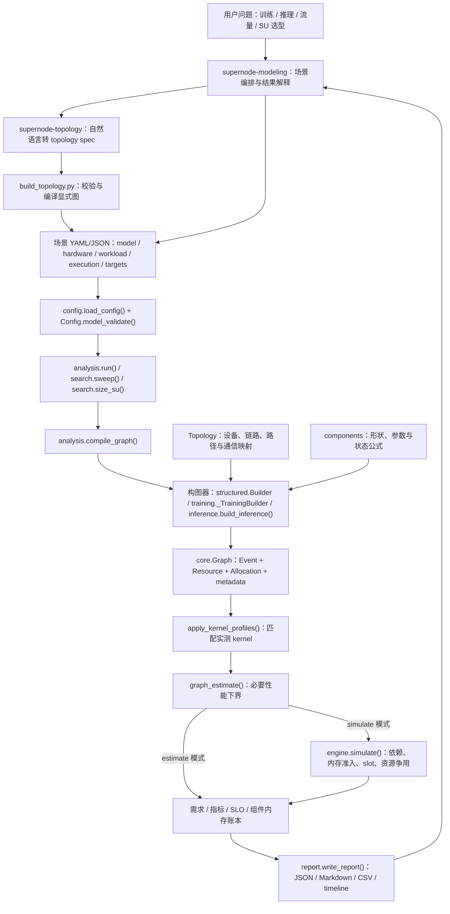

### G01 CLI 与单次运行

原文件 [diagrams/01-entry-and-run.mmd](diagrams/01-entry-and-run.mmd)。使用：主讲 08 与附录 A01。

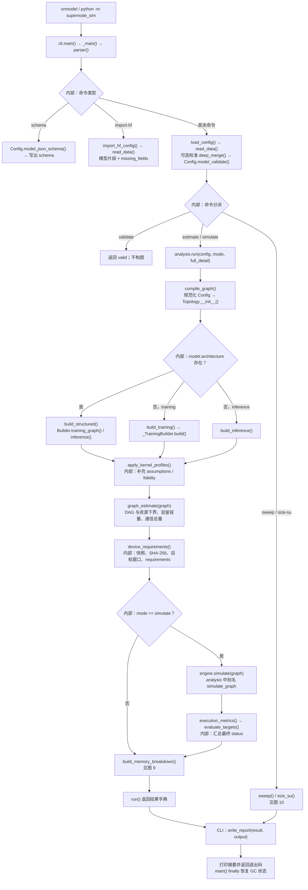

### G02 参数预算训练

原文件 [diagrams/02-training-budget.mmd](diagrams/02-training-budget.mmd)。使用：附录 A02。

```mermaid
flowchart TD
    ENTRY["training.build_training(config, topology)"] --> INIT["_TrainingBuilder.__init__()<br/>内部：rank / stage 映射与 dense / expert 参数预算"]
    INIT --> BUILD["build() → initial_state()<br/>驻留 weights / gradients / master / Adam / runtime"]
    BUILD --> STEP["内部：遍历 training step"]
    STEP --> STAGE["内部：遍历 PP stage<br/>pipeline_schedule(stage, stages, microbatches)"]
    STAGE --> PHASE["phase(step, stage, F或B, micro)<br/>phase_previous() 建立前驱"]
    PHASE --> LAYER["内部：按 F 正序 / B 逆序遍历层"]
    LAYER --> GATHER["按 FSDP / reshard 条件 add_gather()<br/>可选一层前瞻预取"]
    GATHER --> DISPATCH["可选 collective(EP dispatch)<br/>内部：权重精度转换、activation 生命周期"]
    DISPATCH --> CK{"内部：B 且 activation checkpointing？"}
    CK -->|是| RECOMP["kernel(forward=True)<br/>重放 TP / EP 通信"]
    CK -->|否| KERNEL["kernel(..., forward=F)<br/>创建计算与 HBM work 的 Event"]
    RECOMP --> KERNEL
    KERNEL --> COMM["collective(TP attention / MLP all_reduce)<br/>可选 EP combine"]
    COMM --> SYNC{"内部：B 到达梯度同步点？"}
    SYNC -->|是| GRAD["collective()<br/>dense EP AR → FSDP RS → replica DP AR"]
    SYNC -->|否| DONE["barrier(layer done)<br/>释放本层已消费临时分配"]
    GRAD --> DONE
    DONE --> MOREL{"内部：还有层？"}
    MOREL -->|是| LAYER
    MOREL -->|否| PDONE["barrier(phase done)"]
    PDONE --> SEND["有相邻 PP stage 时：<br/>内部可选 pack → Topology.transfer() → 可选 unpack<br/>send.done 供接收方依赖"]
    SEND --> MOREP{"内部：还有 phase / stage？"}
    MOREP -->|是| STAGE
    MOREP -->|否| OPT["optimizer(step)<br/>图 4：Adam 与可选 CPU offload"]
    OPT --> MORES{"内部：还有 step？"}
    MORES -->|是| STEP
    MORES -->|否| RETURN["内部：写 schedule / logical_memory / step_end_events<br/>返回 Graph"]
```

### G03 结构化训练

原文件 [diagrams/03-training-structured.mmd](diagrams/03-training-structured.mmd)。使用：主讲 10 与附录 A02。

```mermaid
flowchart TD
    ENTRY["build_structured() → Builder.__init__()<br/>Topology.populate() + parameter_inventory()"]
    ENTRY --> INIT["training_graph() → initial()<br/>states() / state_dtype() / local_elements()"]
    INIT --> STEP["内部：step → PP stage<br/>pipeline_schedule() → F或B / microbatch"]
    STEP --> LAYER["内部：按阶段方向遍历 stage layers"]
    LAYER --> GATHER["按 FSDP / reshard 条件 gather()<br/>collective(all_gather)"]
    GATHER --> ACT["activation_rows() → component_activations()<br/>内部：B 时建立或复用 gradient buffers"]
    ACT --> CK{"内部：B 且 checkpoint？"}
    CK -->|是| RECOMP["recompute_layer()<br/>kernel() + TP / EP + 临时状态"]
    CK -->|否| ORDER["component_order(layer)<br/>F 正序 / B 逆序遍历组件"]
    RECOMP --> ORDER
    ORDER --> DISPATCH["MoE 时 collective(EP dispatch)"]
    DISPATCH --> KERNEL["逐 rank kernel()<br/>权重转换、FLOPs/HBM、activation/state allocs/releases"]
    KERNEL --> COMM["MoE 时 collective(combine)<br/>attention / FFN 后 collective(TP all_reduce)"]
    COMM --> MOREC{"内部：还有组件？"}
    MOREC -->|是| ORDER
    MOREC -->|否| SYNC{"内部：B 到达梯度同步点？"}
    SYNC -->|是| GRAD["collective()<br/>FSDP RS → replica AR → dense EP AR"]
    SYNC -->|否| DONE["barrier(layer.done)<br/>释放 gather / gradient / recompute 临时项"]
    GRAD --> DONE
    DONE --> MOREL{"内部：还有层？"}
    MOREL -->|是| LAYER
    MOREL -->|否| PHASE["barrier(phase 完成)<br/>释放消费完的 PP receive 等状态"]
    PHASE --> SEND["有下游时 pipeline_transfer()<br/>可选 pack → Topology.transfer() → 可选 unpack<br/>内部：stage_previous 指向发送完成"]
    SEND --> MOREP{"内部：还有 phase / stage？"}
    MOREP -->|是| STEP
    MOREP -->|否| OPT["optimizer(step, stage tails)<br/>见图 4"]
    OPT --> MORES{"内部：还有 step？"}
    MORES -->|是| STEP
    MORES -->|否| ANNOTATE["annotate_collective_allocations()<br/>返回 Graph"]
```

### G04 优化器与 offload

原文件 [diagrams/04-optimizer-offload.mmd](diagrams/04-optimizer-offload.mmd)。使用：主讲 11 与附录 A05。

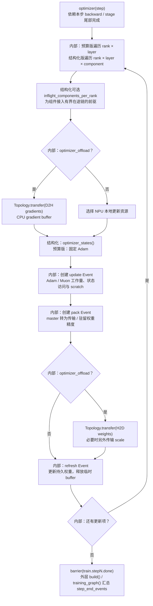

### G05 结构化推理

原文件 [diagrams/05-inference-structured.mmd](diagrams/05-inference-structured.mmd)。使用：主讲 12 与附录 A03。

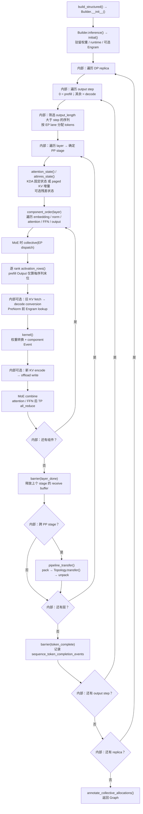

### G06 参数预算推理

原文件 [diagrams/06-inference-budget.mmd](diagrams/06-inference-budget.mmd)。使用：附录 A03。

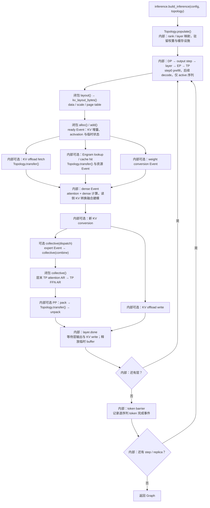

### G07 通信与拓扑展开

原文件 [diagrams/07-collective-topology.mmd](diagrams/07-collective-topology.mmd)。使用：主讲 15 与附录 A06。

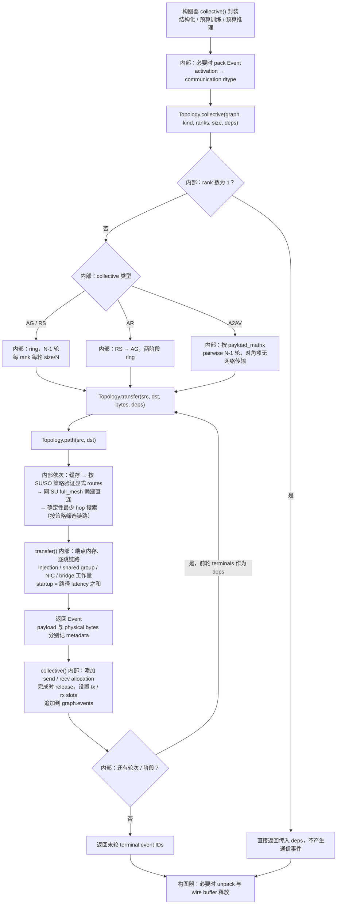

### G08 事件执行器

原文件 [diagrams/08-event-engine.mmd](diagrams/08-event-engine.mmd)。使用：主讲 16。

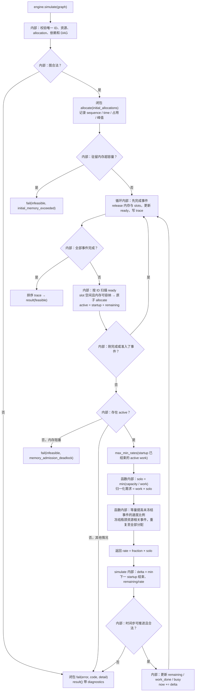

### G09 内存归因与报告

原文件 [diagrams/09-memory-and-report.mmd](diagrams/09-memory-and-report.mmd)。使用：主讲 17 和 22。

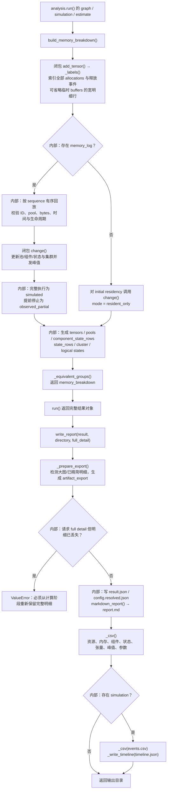

### G10 扫描与 SU 搜索

原文件 [diagrams/10-sweep-and-su-search.mmd](diagrams/10-sweep-and-su-search.mmd)。使用：主讲 21。

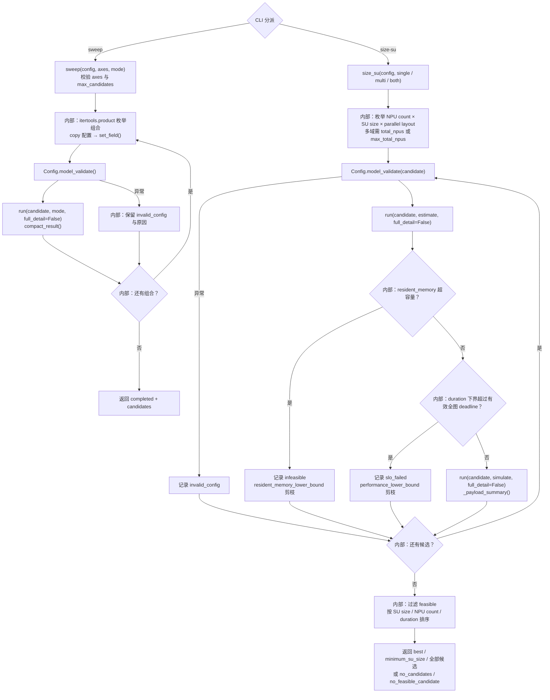

### G11 检查点与恢复

原文件 [diagrams/11-reference-checkpoint.mmd](diagrams/11-reference-checkpoint.mmd)。使用：附录 A07。

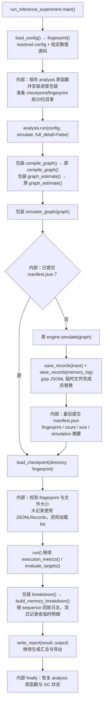

