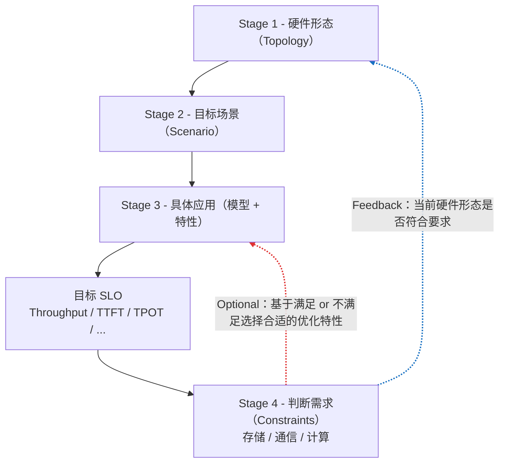

# 超节点网络需求建模 skill — 分析思维链条

> 文档状态：草稿。

## 整体流程

## Stage 1 - 硬件形态（Topology）

### 拓扑形态

FatTree / Clos / Mesh

### 组件？？？

| 组件或配置项 | 图中内容 |
| --- | --- |
| NPU / HBM | NPU 数，HBM 大小 |
| CPU | CPU ? |
| 互连方式？ | UB / URMA |
| 存储 | SSD / DDR |

## Stage 2 - 目标场景（Scenario）

| 目标场景 | 分支 |
| --- | --- |
| 训练 | 预训练、后训练 |
| 推理 | Prefill、Decode |
| Agentic Serving ？？？ | 原图未展开 |

## Stage 3 - 具体应用（模型 + 特性）

**具体应用 = 主流开源模型 + 优化 Feature。**

### 主流开源模型

DSK / GLM / Qwen / ...

### 优化 Feature

| 编号 | 优化特性 |
| --- | --- |
| 0 | 无额外特性（baseline） |
| 1 | KV Offload |
| 2 | 外置 Engram 池 |
| 3 | PD 分离 |
| 4 | 投机推理 |
| 5 | Expert 参数卸载 |
| ... | ... |

**考虑单个特性与多个特性叠加。**

## 目标 SLO

Throughput / TTFT / TPOT / ...

## Stage 4 - 判断需求（Constraints）

> 确定具体场景、目标后，分析存储、计算、通信需求。

### 存储

#### HBM 需求分析

原图中的 HBM 占用组成，按从左到右的顺序：

| 顺序 | 组成部分 | 图中英文或补充标注 |
| --- | --- | --- |
| 1 | 权重 | Weight |
| 2 | 激活 | Activation |
| 3 | **KVCache / Page Table** | 原图圈出强调 |
| 4 | 通信的 buffer | HCCL / DeepEP |
| 5 | 底噪 | — |

#### DRAM 需求分析

原图未展开。

#### DDR 需求分析

原图未展开。

> 原图分别列出了 DRAM 与 DDR，此处保留为两个条目。

### 通信

| 通信方向 | 图中关联需求 |
| --- | --- |
| D2D | 集合通信 / 并行需求 |
| H2D | 原图未展开 |
| D2RH | 原图未展开 |
| RH2D | 原图未展开 |
| ... | ... |

### 计算

？？？

## 反馈关系

### Feedback：当前硬件形态是否符合要求

从 **Stage 4 - 判断需求（Constraints）** 返回 **Stage 1 - 硬件形态（Topology）**。

### Optional：基于满足 or 不满足选择合适的优化特性

从 **Stage 4 - 判断需求（Constraints）** 返回 **Stage 3 - 具体应用（模型 + 特性）**。
